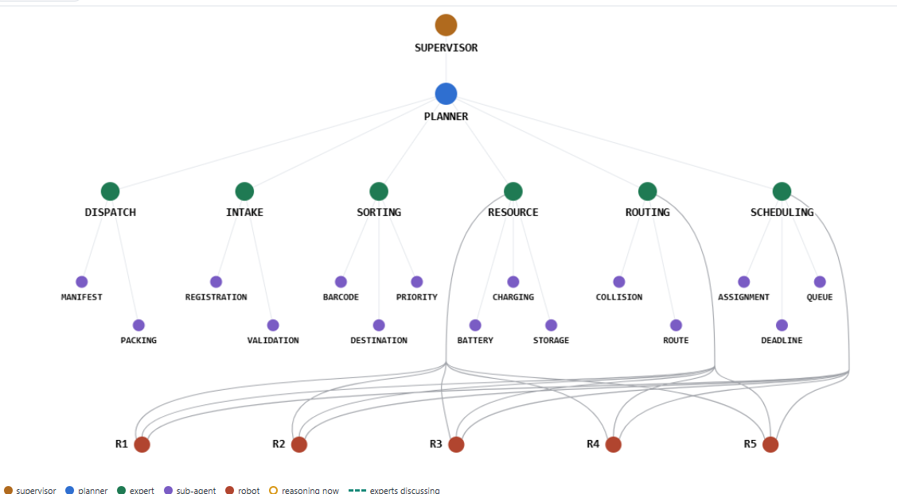
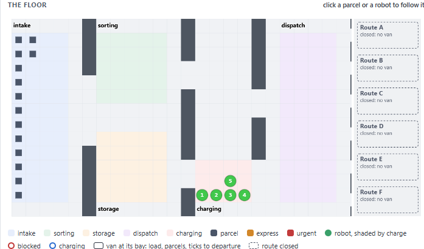

This repository contains the companion materials for the paper: **A Dragon-King-Based Runtime Monitoring Model for Resilient LLM-based Multi-Agent Ecosystems**

# Post Office Ecosystem: a multi-agent testbed for DK-RMM

The post-office ecosystem serves as a testbed for evaluating runtime monitoring in a multi-agent environment. It comprises five operational zones—intake, sorting, storage, charging, and dispatch—and five robots. Its operations are coordinated by a supervisor, seven expert agents (one planner and six specialists), and fifteen sub-agents. Each expert first attempts to make decisions using predefined rules. When these rules are insufficient, its CrewAI agent consults a local Ollama model (Qwen3:8B by default) and, where permitted by the peer map, consults one peer before deciding. The simulator retains execution control, requiring every decision to pass through a policy gate before execution.

All runtime activity is recorded in a unified event log. The Dragon-King Runtime Monitoring Model (DK-RMM) processes this log and evaluates twenty behavioral and operational indicators against their respective baselines. It classifies the ecosystem as STABLE, DEVIATING, UNSTABLE, or undergoing a Runtime Critical Transition (RCT), while using critical slowing down (CSD) and Dragon-King tests to identify potential warning signals. DK-RMM is observational; its findings are subject to human validation rather than automatically triggering interventions.

<p align="center">
  
  <br><em>The agents: supervisor, planner, the six experts with their sub-agents, and the robots each expert can task.</em>
</p>

<p align="center">
  
  <br><em>The floor, live: zones, parcels, robots shaded by charge, and the van bays.</em>
</p>

## Scenarios

The live page offers five scenarios. All run on the same facility.

| Scenario | What happens |
|---|---|
| **Normal** | Ordinary operation with its own variability; experts on rules first, the model when a rule is insufficient. |
| **M-S-DROP** | From tick 400, every message on the bus is dropped at delivery. |
| **M-S-DELAY** | From tick 400, routing messages are delayed by 10 ticks. |
| **ON-OFF, rules only** | ROUTING and SCHEDULING alternate between their rules (OFF) and deliberate violations (ON) in four phases from tick 1200 to 3800, while a consignment of 20 urgent hospital parcels arrives. Every expert on its rules. |
| **ON-OFF, model** | The same, with the experts on rules first and the model when a rule is insufficient. Needs Ollama. |

## The live page

`python main.py --api` serves it at `http://127.0.0.1:8000/`:

- **Robots & agents**: the floor and the interaction graph, following the run tick by tick.
- **Consultations**: each model consultation, the question and the peer's answer, the decision, latency and tokens.
- **DK-RMM**: the state, the indicators with their z-scores, CSD and the dragon-king test, the RCT explainer and the human gate (validate, activate, dismiss).
- **Runtime communication**: every message and event, classified by channel and interaction type.
- **Consultation trajectory** and **Event trajectory**: the run so far, as consultations on a clock and as events in order.
- **RCT log**: every RCT DK-RMM detected, with what drove it, saved under `results/live/` (`--no-record` to save nothing).
- **ON–OFF** (on the two ON-OFF scenarios): the phases, the robots' blockages, the hospital consignment and the run's summary.

## Quick start

Python 3.10 to 3.13 (3.12 recommended) and, for the model-backed experts,
[Ollama](https://ollama.com).

```bash
python -m venv .venv
source .venv/bin/activate            # Windows: .venv\Scripts\activate
pip install -e ".[dev]"
cp .env.example .env                 # Windows: copy .env.example .env
ollama pull qwen3:8b
python tools/verify_ollama.py        # one row per expert, with the model Ollama served
python tools/run_normal.py --ticks 300 --seed 1   # evidence in results/normal/s1/
python main.py --api                 # the live page
```

Without Ollama, `python main.py --api --rules` and `python tools/run_normal.py --rules`
run every expert on its rules.

## Switching the model

The model is configuration only: set `OLLAMA_MODEL` in `.env`, for example
`OLLAMA_MODEL=gemma4:26b` after `ollama pull gemma4:26b`, and run
`tools/verify_ollama.py` to confirm that all seven rows show the new served
model. All seven experts share one LLM, so they move together. The provider is
always Ollama.

## Tests

```bash
PYTHONHASHSEED=0 python -m pytest -q
```

The suite needs no Ollama: it starts a fake OpenAI-compatible server in the test
process and drives the real CrewAI integration through it. The browser tests of
the live page need the `ui-test` extra (`pip install -e ".[ui-test]"`, then
`python -m playwright install chromium`) and are skipped without it.

## Repository layout

```
post_office/          the simulation
  simulation/ core/ state/ environment/ robots/ tasks/   the facility and its clock
  agents/ crew/ discussion/ policy/ communication/       experts, CrewAI and Ollama, peer consultation, the gate
  dkrmm/              the runtime monitor (indicators, signals, states)
  observability/      event log, run records, RCT recorder, decision traces
  stress/             the scenarios (collapse, ON-OFF, C2-NEAR)
  api/ ui/            FastAPI server and the live page
tools/                batch drivers, analyses, figures, Ollama check
tests/                pytest suite (fake Ollama, Playwright for the page)
docs/                 DK-RMM indicators and evidence kinds
  packages/           one page per package
main.py               command line: run, or serve the live page
```

## Documentation

- [docs/dkrmm-indicators.md](docs/dkrmm-indicators.md): the nineteen DK-RMM indicators that feed an evidence kind, what each measures, and the kind it feeds.
- [docs/dkrmm-evidence-kinds.md](docs/dkrmm-evidence-kinds.md): the twelve evidence kinds and how they decide the state.
- [docs/packages/README.md](docs/packages/README.md): one page per package.
