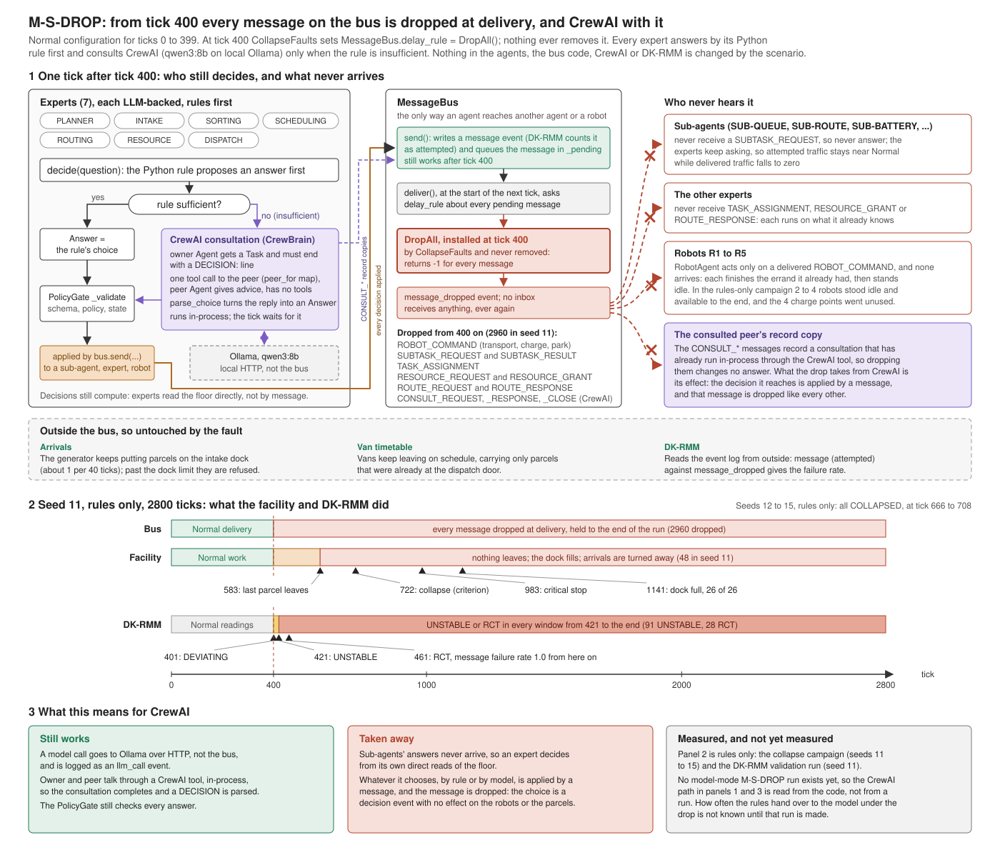
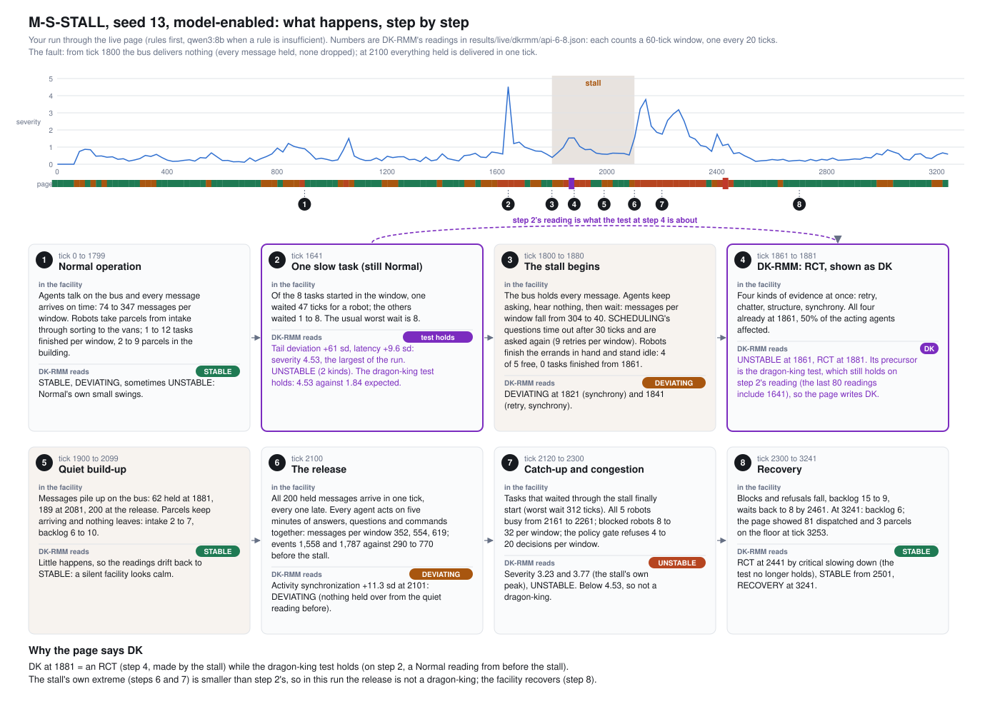
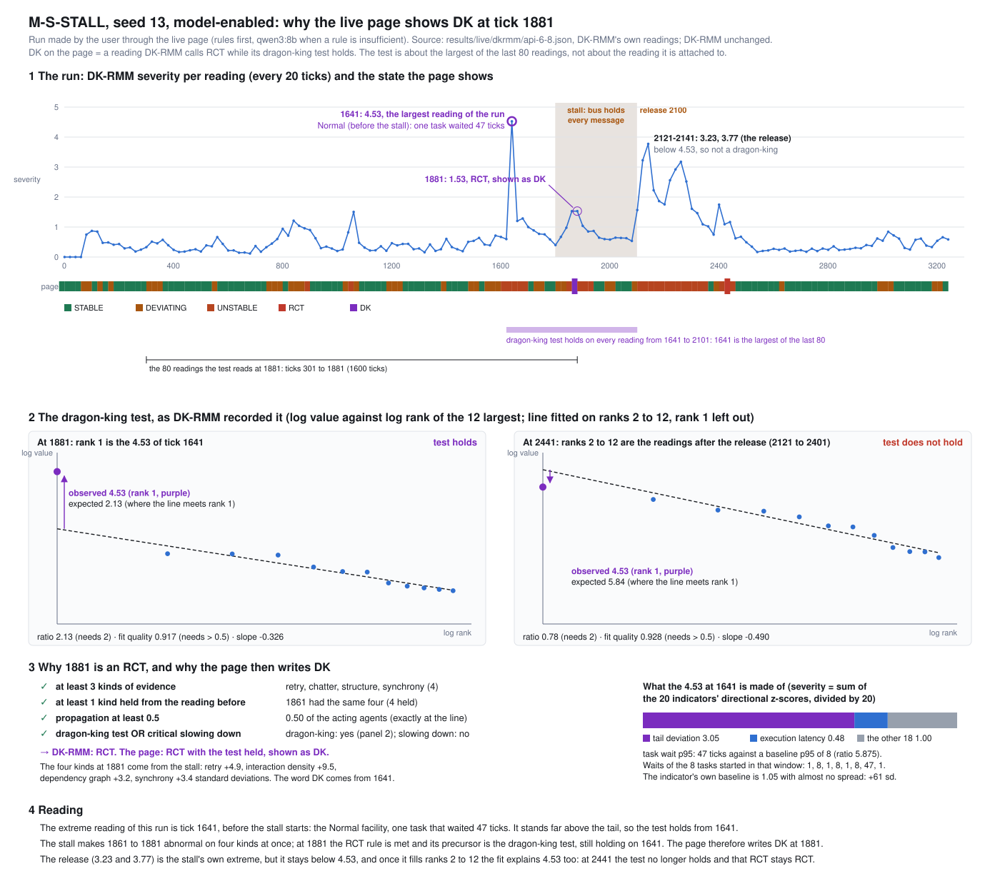

# Collapse scenarios

Study id `COLLAPSE-SCENARIOS`, label `Collapse scenarios`. Four one-mechanism
collapse scenarios on the Normal facility, each applied from outside at tick
400 and held to the end of the run, sharing the C2-NEAR study's control
(`N`, the Normal facility on seeds 11 to 15), its measurement
(`stress/measure.py::Collector`) and its criterion
(`stress/collapse.py::classify`). Results live under
`results/collapse_scenarios/`; nothing under `results/normal/` is read or
written.

Code: `post_office/stress/collapse_scenarios.py`, driver
`tools/run_collapse_scenarios.py`, tests `tests/test_collapse_scenarios.py`
and `tests/test_live_collapse_ui.py`. The C2-NEAR study, whose structure
this document mirrors, is in `docs/c2-near-system-override.md`.

This document records the four scenarios and how each is implemented, what
was and was not changed, how to run them, the collapse criterion, the tests,
the results of the rules-only runs made here, and a table for the model-mode
runs to be made on the user's machine.

A fifth scenario, M-S-STALL, was added on 2026-10-13 for DK-RMM's
dragon-king test: a build-up and one release rather than a fault held to the
end. Section 8 records it; sections 1 to 7 are about the four and are as
they were.

Every figure in section 6 is **rules-only** (every expert on its
deterministic rules, no model asked). Section 7 is for the model-mode
results and is empty until those runs are made.

## 1. The four scenarios

Exact Normal for the first 400 ticks, then one thing goes wrong and stays
wrong. Every scenario is built from `normal_config()` with no key added
(`collapse_scenarios.config(scenario)` returns `normal_config()` for all
four, `interceptors=[]` as it is). The disruption is applied by
`CollapseFaults.before_tick(400)` from outside the ecosystem, through seams
that already exist; no run can take it off.

| Id | Preset | Mechanism | Start | Holds until | Expected impact | How it is implemented |
|---|---|---|---|---|---|---|
| `MS-DROP` | `ms-drop` | Every message on the bus is dropped at delivery, so no agent hears another again and each one runs on what it already knows. | tick 400 | end of run | Dispatch stops once the errands already in hand are finished; the backlog grows to the dock limit and arrivals are refused. | `bus.delay_rule = DropAll()`: the rule returns `-1` for every message and counts it (`dropped`). |
| `MS-DELAY` | `ms-delay` | Every routing-related message arrives 10 ticks late; nothing is dropped. | tick 400 | end of run | Robots wait longer for routes and for blocks to be resolved, errands stretch, throughput falls and the backlog climbs; whether that is a collapse or a slower steady state is what the run shows. | `bus.delay_rule = DelayRouting(10)`: `10` for a routing-related message (counted as `delayed`), `None` for the rest (counted as `passed`). |
| `CS-STARVE` | `cs-starve` | The facility has no charge point and no rescue crew: every station is removed and a robot that runs flat stays where it stopped. | tick 400 | end of run | The fleet drains one robot at a time; each flat robot blocks the corridor it stopped in, and dispatch stops when the last robot with charge is gone. | Every key of `env.stations` is popped (CS-1 to CS-4, with each one's occupant recorded) and `eco.recovery` is replaced by `NoRescue(world)`. |
| `CS-PARTITION` | `cs-partition` | SCHEDULING (with SUB-QUEUE, SUB-DEADLINE and SUB-ASSIGNMENT) and RESOURCE (with SUB-BATTERY, SUB-CHARGING and SUB-STORAGE) cannot message each other in either direction; every other message is delivered. | tick 400 | end of run | Battery checks and storage claims never get an answer, so the assignments that need RESOURCE's grant stall; the parcels that can go straight to the door may still move. | `bus.delay_rule = Partition()`: `-1` for a message that crosses the partition, counted per direction; `None` for every other message (counted as `passed`). |



The schema above was drawn before the model-enabled runs were analysed, and two of its statements
are wrong: model-enabled M-S-DROP runs do exist (seeds 11 to 15, made on 2026-10-12, rows of
section 7), and after tick 400 the experts almost stop deciding (0 to 6 decisions per run, all by
rule, no model call). The measured version is
[`docs/img/ms-drop-crewai-v2.svg`](img/ms-drop-crewai-v2.svg), and the analysis is
[`docs/ms-drop-model-enabled-v1.md`](ms-drop-model-enabled-v1.md). The first schema is kept as it was
drawn. M-S-DROP run through the live page, with the backlog by zone, the decision traces and the
current DK-RMM readings, is [`docs/ms-drop-model-enabled.md`](ms-drop-model-enabled.md) (version 2)
with [`docs/img/ms-drop-crewai-v3.svg`](img/ms-drop-crewai-v3.svg).

Plus `N`, the control: the Normal facility on the same seeds, which is the
same N as the C2-NEAR study (`definition.json` of both names
`normal_config()` and no schedule), so its runs can serve here.

**The bus seam (DROP, DELAY, PARTITION).** `communication/bus.py::MessageBus`
has had a `delay_rule` attribute (`Optional[Callable[[Message],
Optional[int]]]`, `None` by default) consulted in `deliver()`, the one place
delivery is decided, once per tick before any agent acts. For each pending
message `hold = rule(message)`: `None` delivers it to the receiver's inbox; a
negative hold drops it, with a `message_dropped` event (category
communication, actor the sender, target the receiver, the message id); a
positive hold appends it to `bus._held` with `release_at = tick + hold`, and
`deliver()` releases it on that tick with an `agent_message_received` event
carrying `late_by`. The three rules are plain callables installed on that
attribute at tick 400; `bus.release_held()` exists on the bus and is never
called from the scenario module.

The exact predicate of M-S-DELAY, `is_routing_related(message)`: true when
`message.sender in ROUTING_GROUP or message.receiver in ROUTING_GROUP` with
`ROUTING_GROUP = ("ROUTING", "SUB-ROUTE", "SUB-COLLISION")`; or when
`message.message_type in (MessageType.ROUTE_REQUEST,
MessageType.ROUTE_RESPONSE)`; or when `message.message_type is
MessageType.ROBOT_COMMAND` and `message.content["operation"]` is one of
`set_route`, `yield`, `step_aside` (the three commands `routing_agent.py`
sends to a robot; nobody else sends those). Every other message is delivered
on time.

The exact predicate of C-S-PARTITION, `partition_direction(message)`: with
`SCHEDULING_GROUP = ("SCHEDULING", "SUB-QUEUE", "SUB-DEADLINE",
"SUB-ASSIGNMENT")` and `RESOURCE_GROUP = ("RESOURCE", "SUB-BATTERY",
"SUB-CHARGING", "SUB-STORAGE")` (the ids `ecosystem._populate` registers),
a message with `sender in SCHEDULING_GROUP and receiver in RESOURCE_GROUP`
is dropped and counted under `SCHEDULING->RESOURCE`; one with `sender in
RESOURCE_GROUP and receiver in SCHEDULING_GROUP` is dropped and counted
under `RESOURCE->SCHEDULING`; anything else (a message inside either group,
or to or from any other agent) is `None` and delivered.

**The stations dictionary and the rescue (STARVE).** `env.stations` is the
dictionary every reader uses (RESOURCE and its charging sub-agent,
`env.free_stations()`, the state views, the measurement's `stations`
column). At tick 400 `_charge_starvation()` pops
every key, recording `stations_before`, `stations_after` (empty),
`removed` and `occupied_at_removal` in the activation event; nothing is put
back. The ecosystem's `recovery` attribute, which `step()` calls once a
tick as `recovery.step(tick)`, is replaced by `NoRescue(world)`: it has the
`RecoveryService` interface (`step`, `stats`, `as_dict`), reads
`env.recovery_requests` exactly as the service does and honours nothing;
each request is written down once as `recovery_refused` (category
simulation, actor SIMULATION, reason `no rescue crew in this scenario`, the
robot's battery) and left in the queue. The class has no method that moves
a robot, claims a station or changes a battery
(`test_cs_starve_the_crew_has_no_method_that_restores`).

**No removal path.** `CollapseFaults` has exactly three public methods
(`before_tick`, `faults_applied`, `status`); no `remove`, `restore`,
`revert`, `release`, `reinstate` or `clear` is in any method name, the
module's source never calls `release_held(` and never sets `delay_rule =
None`, and the tests check the rule is still installed at tick 700 and the
stations still gone and the crew still refusing at the end of their runs.
The activation is in the event log as `stress_fault_activated` (study
`COLLAPSE-SCENARIOS`, scenario, mechanism, the detail above), and the
scenario's definition and its fingerprint in a `collapse_scenario` event at
tick 0.

## 2. What was not changed, and the shared edits

**Not changed.** Nothing in `post_office/communication/` (the bus and its
`delay_rule` seam were already there), `post_office/simulation/`,
`post_office/agents/`, the policy gate (`post_office/policy/`) or DK-RMM
(`post_office/dkrmm/`). The Normal scenario: `DEFAULT_CONFIG`, `PRESETS`
(`{"default": DEFAULT_CONFIG}`) and `normal_config()` are what they were,
the Normal entry of `SCENARIO_META` and the scenario selector's first label
are unchanged, and the 300-tick Normal event stream is byte for byte what
it was (section 5). The C2-NEAR study: `stress/c2near_system_override.py`,
its driver, `c2near_status()` and the `c2near` key of `/summary` are
unchanged, and its strip renders exactly as before (section 5, the C2-NEAR
screenshot).

**The shared edits of commit `53409eb`** (`git show --stat 53409eb`), the
commit that added the scenarios:

| File | Edit |
|---|---|
| `post_office/config/settings.py` (+81 -11) | `COLLAPSE_PRESETS` (preset -> scenario id), `COLLAPSE_LABELS`, the four `SCENARIO_META` entries (`purpose` is the mechanism, `about` what is expected; the scenario module reads these so there is one wording), `known_presets()` and `scenarios()` listing them after the C2-NEAR entries, `_SCENARIO_OF`, `config()` resolving a collapse preset through the scenario module, the two "unknown preset" messages naming them. |
| `post_office/api/runner.py` (+113 -29) | `_is_collapse`, `_is_study`; `_attach_faults` builds `CollapseFaults` for a collapse preset on any runner (rules-only included: no mechanism needs the model); `_dkrmm_block()` shared by both studies; `study_status()` (`family: "c2near"` or `"collapse"`); `reset()` treating a collapse preset as a study preset (seed 11 when entered from Normal, `normal_config()` restored on the way back). `c2near_status()` is unchanged. |
| `post_office/api/server.py` (+7 -2) | `/summary` carries `study` (`runner.study_status()`, null on Normal) beside the unchanged `c2near`; the reset endpoint's docstring names the new presets. |
| `tests/test_api_rcts.py`, `tests/test_api_trimmed.py`, `tests/test_live_c2near.py`, `tests/test_live_ui.py` | Pinned scenario counts updated from 4 to 8 (the selector's options, the RCT log's scenario rows, `known_presets()`), nothing else. |
| `docs/provenance*.{json,md}` | The new files registered as `new`. |
| New | `post_office/stress/collapse_scenarios.py`, `tools/run_collapse_scenarios.py`, `tests/test_collapse_scenarios.py`. |

**This commit** (`feat: collapse scenarios in the live UI strip, report and
README`):

| File | Edit |
|---|---|
| `post_office/ui/live.html` | The study strip paints from `/summary`'s `study` for both families (`paintStudy`): the C2-NEAR branch is the previous code, split into shared helpers (seed picker, clock, facts, DK-RMM) with the same output; the collapse branch adds the label, the mechanism and expected rows, the one fault's band to the end, and the counters per scenario. Hidden when `study` is null. No new words from the forbidden list; the page's source is checked by a test. |
| `tests/test_live_collapse_ui.py` | New: `/summary.study` on the four presets and on Normal (section 5). |
| `docs/collapse-scenarios.md` | This document. |
| `README.md` | One sentence linking this document after the C2-NEAR sentence. |
| `docs/provenance_classification.json`, `docs/provenance.json`, `docs/provenance.md` | The two new files registered as `new`; the record regenerated. |

No Python under `post_office/` changes in this commit: `runner.study_status()`
already carried every field the strip needs.

**The four-state view** (`feat: four-state DK-RMM view for the study
scenarios`): DK-RMM's five states are the Normal scenario's; the study
scenarios, this study and C2-NEAR alike, show four, with the monitor's
RECOVERY shown as STABLE (section 6 states the convention). The mapping is
`post_office/stress/states.py` (`four_state`, `four_state_counts`), used by
the runner's `_dkrmm_block` (`view: "four"`, `raw_state` kept), the live
page's strip, badge and DK-RMM tab under a study preset, `measure.py`
(`state_four`, `counts_four`, the `dkrmm_state_four` column beside the raw
`dkrmm_state`), `report.py` and `c2near_report.html`, and both drivers'
printed `dkrmm` column. Nothing under `post_office/dkrmm/` changes; the
Normal page shows the five states as before.

**DK on the live page** (2026-10-13): the live page splits RCT by its
precursor. An RCT reading whose dragon-king test held (the reading's
`dragon.is_dragon`, which the monitor records and its RCT rule reads) is
shown as **DK**; an RCT reached by critical slowing down alone stays RCT. A
study run on the page therefore reads STABLE, DEVIATING, UNSTABLE, RCT or DK
(`stress/states.py`: `STUDY_STATES`, `dk_state`, `study_state`), and Normal
its five monitor states with RCT split the same way. Where it shows: the
study strip's sequence, badge, legend and RCT line (`dk_ticks` beside
`rct_ticks` in the runner's `_dkrmm_block`), the verdict badge
(`monitor_digest` gains `dragon`, `previous_dragon`, `dk_readings`), the
DK-RMM tab's badge, history strip and RCT table (`/dkrmm/series` gains
`dragon`, `/dkrmm/rcts` a `dragon` per row). It is a view: the monitor still
says RCT, nothing under `post_office/dkrmm/` changes, and the measurement,
the results page and the drivers' tables keep the four states. On the ten
model-enabled M-S-DROP live runs the dragon-king test held in none of the
1,400 readings, so DK appears there nowhere.

## 3. How to run

**Live UI.** `python main.py --api`, then the scenario selector in the
control bar: after the Normal entry and the three C2-NEAR conditions come
`M-S-DROP · all messages dropped from 400`, `M-S-DELAY · routing messages
delayed 10 ticks from 400`, `C-S-STARVE · no charge point and no rescue crew
from 400` and `C-S-PARTITION · SCHEDULING and RESOURCE cannot message each
other from 400`. Choosing one rebuilds the run on `normal_config()` with the
scenario's one fault applied beside the run exactly as the driver applies it
(`CollapseFaults.before_tick` inside the runner's lock, before each
`eco.step()`), on seed 11 unless a seed is given. The seed picker in the
strip (11 to 15) rebuilds the same scenario on another seed, and `POST
/simulation/reset?preset=ms-drop&seed=12` does the same over the API. The
four scenarios run on rules or on the model alike (`--rules` is allowed).

Under the scenario strip the study strip appears (hidden on Normal), headed
COLLAPSE: the scenario's label and the seed picker; the facts of the
facility now (routes open, charge points left, the arrival interval); the
mechanism and what is expected, in the words of `SCENARIO_META`, with "The
fault holds to the end of the run; nothing is put back."; the one fault as a
chip, grey while pending and coloured with "at tick 400" once fired; the
schedule as one clock from tick 0 to 2800 with the fault marked, a band
from the tick it fired to the end and a needle at the current tick; the
counters the mechanism keeps (M-S-DROP: messages dropped; M-S-DELAY:
routing messages delayed, held on the bus now, other messages on time;
C-S-STARVE: charge points, rescue requests refused, the rescue crew;
C-S-PARTITION: dropped SCHEDULING to RESOURCE and RESOURCE to SCHEDULING,
other messages delivered); and DK-RMM on the same clock, one coloured segment
per assessment, the current state and the ticks at which an assessment was
RCT. The same figures are in `GET /summary` under `study` (`family:
"collapse"`; null on Normal; the C2-NEAR block under `family: "c2near"`
for those presets). The agents, sub-agents and robots are watched in the
existing graph, floor and panes while the fault acts. The live run records
DK-RMM's record under `results/live/` like every served run, never under
`results/normal/` and never under `results/collapse_scenarios/`.

**Headless, model mode**, on the user's machine, with Ollama serving the
configured model (the driver verifies the model's identity first and records
in each run's `verify.json` which model served every call, as the C2-NEAR
driver does). From the project root, one command per line (PowerShell, no
`&&`). `--control-from results/c2_near_system_override` reuses the C2-NEAR
study's N runs as the control when they exist there, are done and were made
in model mode with the same `--ticks`; with it, `all` skips the N runs it
finds there and runs only the four scenarios:

```
$env:PYTHONHASHSEED = "0"
python tools/run_collapse_scenarios.py --scenario all --seeds 11 12 13 14 15 --ticks 2800 --control-from results/c2_near_system_override
python tools/run_collapse_scenarios.py --analyze --control-from results/c2_near_system_override
```

Without `--control-from`, `all` runs N as well under `--out` and the
analysis pairs each scenario with that N. The scenarios can also be named
one at a time (`--scenario ms-drop --scenario cs-starve`). The seeds and the
tick count above are the defaults, so they can be left out.

**Headless, rules-only** (no model; every expert on its rules):

```
$env:PYTHONHASHSEED = "0"
python tools/run_collapse_scenarios.py --scenario all --seeds 11 12 13 14 15 --ticks 2800 --rules --out results/collapse_plumbing_rules --control-from results/c2_near_plumbing_rules
python tools/run_collapse_scenarios.py --analyze --out results/collapse_plumbing_rules --control-from results/c2_near_plumbing_rules
```

(`results/c2_near_plumbing_rules` is where the C2-NEAR document's rules-only
block puts its N runs; without it, drop `--control-from` and the N runs are
made under `--out`.)

**Where results land.** `--out` defaults to `results/collapse_scenarios`;
each run is written to `<out>/<scenario id>/s<seed>/` (`N`, `MS-DROP`,
`MS-DELAY`, `CS-STARVE`, `CS-PARTITION`) with `definition.json`,
`events.jsonl`, `series.csv`, `measurement.json` (the fault applied and the
scenario's counters beside the totals), `dkrmm.json`, `summary.json`,
`verify.json` and `done.json` (written last). `--analyze` writes
`<out>/summary.json` and prints the classification table. An existing run
directory is never overwritten: a directory with `done.json` is skipped,
one with `events.jsonl` and no `done.json` is reported as incomplete and
skipped; Ctrl-C writes the current run's files with `"interrupted": true`,
no `done.json`, and exits 130.

`results/normal/` is never touched: `--out` is refused when it resolves to
or inside `results/normal` (exit 2), nothing under it is read, and the
default output directory is elsewhere.

## 4. Collapse criterion

The criterion is the C2-NEAR study's, unchanged: `stress/collapse.py::
classify(run_rows, control_rows, params)` with the parameters `COLLAPSE`
(`evaluated_from` 400, `window` 250, `throughput_fraction` 0.5,
`throughput_evaluable_min` 2, `backlog_margin` 5, `slope_window` 200,
`refused_window` 200, `persist_ticks` 300, `critical_stop_window` 400), the
two collapse paths `sustained_degradation` and `critical_stop`, the
outcomes `COLLAPSED`, `DEGRADED` and `STABLE`, and the comparability rule
(same seed, same mode, same `--ticks`). Section 6 of
`docs/c2-near-system-override.md` defines every term and the series columns;
`measure.Collector` writes the same `series.csv` here, and
`ScenarioCollector.measurement()` adds the scenario and its counters to
`measurement.json`. DK-RMM's record sits beside the verdict and plays no part
in it.

## 5. Tests performed

**`tests/test_collapse_scenarios.py`, 22 tests** (about 7 s, rules-only
runs of 700 ticks shared through module fixtures):

- Isolation from Normal (2): no scenario fault fires before 400 and the
  events and series rows of every scenario are identical to the control's
  through tick 399 on seed 11; every scenario's `config()` is
  `normal_config()` and `DEFAULT_CONFIG` is untouched.
- M-S-DROP (2): from 400 every message is dropped and nothing reaches an
  inbox (`message_dropped` per pending message, inboxes empty); the counter
  grows and the rule is still installed at 700.
- M-S-DELAY (3): a routing message sent at t arrives at t + 11 and a plain
  one at t + 1, in a two-agent probe; in the run every `late_by` is exactly
  10 and nothing is dropped; the classification of a message (group, type,
  the three ROBOT_COMMAND operations, and the negatives).
- C-S-STARVE (3): no charge point from 400 and a rescue request is refused
  with the reason; a flat robot is refused once and never recovered
  (stranded to the end, battery unchanged); the crew class has no method that
  restores.
- C-S-PARTITION (2): SCHEDULING and RESOURCE cannot message each other in
  either direction while SCHEDULING to ROUTING, RESOURCE to its sub-agents
  and everything else is delivered; in the run only the cross-group traffic
  is dropped, counted per direction.
- The faults object and the definition (2): `CollapseFaults` has exactly
  three public methods and no removal path; the definitions and fingerprints
  of the five scenarios differ from one another and from the C2-NEAR
  conditions.
- The registry and the runner (5): the four presets follow the C2-NEAR ones
  with Normal first and unchanged; a rules-only runner carries `ms-drop`,
  fires it at 400 and reports it in `study_status()`; `/summary` carries
  `study` and a switch back to `default` rebuilds without the rule;
  `c2near_status()` and `study_status()` agree on a C2-NEAR preset; the RCT
  log tags the new presets with their labels.
- The driver (3): refuses `results/normal` and defaults elsewhere;
  `--analyze` uses a comparable control from `--control-from` and refuses a
  pair whose mode or ticks differ; a short run writes every file and never
  overwrites a done or incomplete directory.

**`tests/test_live_collapse_ui.py`, 5 tests** (API level, rules-only
runner, about 5 s): Normal has a null `study` and no schedule; `ms-drop`
after 410 ticks reports `family == "collapse"`, the fault applied at 400,
`dropped > 0` equal to the `message_dropped` events, the facility untouched
(six routes, four charge points, interval 40) and DK-RMM's sequence; the
other three scenarios report their own counters (delayed and held, no
charge point and no rescue crew, dropped per direction) and a switch back to
Normal leaves `study` null, `normal_config()` and `bus.delay_rule is None`;
a C2-NEAR preset reports `{"family": "c2near", **c2near}`; every word the
strip can show (labels, schedule labels, mechanism and expected sentences,
the selector's options) and the page's source itself are free of the
FORBIDDEN words and of em-dashes.

**`tests/test_live_ui.py`, 29 tests** (headless Chromium over a model-mode
fake-Ollama runner): all pass, among them the Normal page's text and the raw
sources of `/`, `/ui/rcts` and `/ui/trajectory` free of the FORBIDDEN words,
the strip hidden on Normal (`#c2near`), and the selector's eight options.
**`tests/test_live_c2near.py`, 10 tests**: pass unchanged.

**Screenshots** (rules-only server, seed 11, 1500 x 950, in the session's
scratch directory): the strip on `ms-delay` at tick 900 (band from 400,
"routing messages delayed 1,166 (10 ticks each) · held on the bus now 13 ·
other messages on time 984", DK-RMM UNSTABLE, no RCT), on `cs-starve` at
tick 1300 ("charge points 0 · rescue requests refused 0 · rescue crew none",
DK-RMM STABLE, "RCT reached at tick 941") and on `c2near-c0` at tick 850
(the four C2-NEAR chips, "no campaign", as before this change).

**Suite totals.** `PYTHONHASHSEED=0 .venv/bin/python -m pytest -q` with
Playwright Chromium available, on this commit: 1003 passed, 5 skipped, 0
failed (8 min 17 s). The subset `tests/test_live_c2near.py
tests/test_collapse_scenarios.py tests/test_api*.py` is 164 passed, 1
skipped; `tests/test_live_ui.py` 29 passed; `tests/test_docs_present.py` 18
passed after the provenance record was regenerated.

**The Normal invariance hash check.** `tools/run_normal.py --rules --ticks
300 --seed 1` (`PYTHONHASHSEED=0`) on this commit: 4816 events; with
`wall_clock` and `run_id` removed from every event and the events
re-serialised with `json.dumps(event, sort_keys=True)` and joined by
newlines, the md5 is `3140ebe3dbbf2dc3b37cfa37d898748a`; with `wall_clock`
alone removed, `0f26648a55502bcccf89b6d5bee65fb7`. Both equal the values
recorded for `main` before the C2-NEAR work in
`docs/c2-near-system-override.md`, section 10: the Normal event stream is
unchanged.

## 6. Observed results, rules-only

**DK-RMM states in this study: four, not five.** DK-RMM's five states
(STABLE, DEVIATING, UNSTABLE, RCT, RECOVERY) are the Normal scenario's. The
study scenarios present four: STABLE, DEVIATING, UNSTABLE and RCT. RECOVERY,
the monitor's name for a window back at baseline right after an escalated
window, is shown as STABLE in every study view: the live strip and the
`study` block of `/summary`, the `state_four` and `counts_four` of each
run's `measurement.json` and its `dkrmm_state_four` series column, the
drivers' printed `dkrmm` column, and the table and reading below
(`post_office/stress/states.py`). This is a view and nothing more: the
monitor under `post_office/dkrmm/` is unchanged, its record (`dkrmm.json`,
`monitor.history`, the raw `dkrmm` block and `dkrmm_state` column) keeps
the five states, and the Normal page is as it was. A "DK-RMM final" of
STABLE below therefore covers a run whose monitor's own last word was
RECOVERY (M-S-DROP s11 and M-S-DELAY s15), and the STABLE count folds the
RECOVERY count in.

**Rules-only.** Made here on 2026-10-11 with the driver (`--scenario all
--rules --control-from <the C2-NEAR rules-only N runs>`, `--out` a scratch
directory, `PYTHONHASHSEED=0`), every expert on its rules, no model. These
runs show that the mechanisms fire, hold and are measured, and what the
facility does under each on its rules; they say nothing about the model.
Values are from `<out>/summary.json` (the classification, written by
`--analyze`), each run's `measurement.json` (`totals`, `counters`) and
`dkrmm.json` (`current.state` in the four-state view, `counts.RCT`). The
control of every seed is
the C2-NEAR rules-only N run of that seed (`N/s<seed>`, 2800 ticks,
`done.json`), which dispatched 83, 76, 73, 79, 64 parcels for seeds 11 to
15 with an end backlog of 4, 7, 4, 6, 6 and no arrival refused.

| Scenario | Seed | outcome | collapse_tick | criterion | held_to_end | first_degraded | critical_stop | dispatched | backlog_end | arrival_refused | counters | stations_end | robots_flat_end | DK-RMM final (four states) | RCTs |
|---|---|---|---|---|---|---|---|---|---|---|---|---|---|---|---|
| MS-DROP | 11 | COLLAPSED | 722 | sustained_degradation+critical_stop | True | 722 | 983 | 13 | 31 | 48 | dropped 2960 | 4 | 0 | STABLE | 0 |
| MS-DROP | 12 | COLLAPSED | 708 | sustained_degradation+critical_stop | False | 708 | 941 | 14 | 32 | 41 | dropped 2974 | 4 | 0 | DEVIATING | 1 |
| MS-DROP | 13 | COLLAPSED | 666 | sustained_degradation+critical_stop | False | 666 | 941 | 13 | 32 | 35 | dropped 2242 | 4 | 0 | STABLE | 0 |
| MS-DROP | 14 | COLLAPSED | 666 | sustained_degradation+critical_stop | True | 666 | 983 | 15 | 32 | 43 | dropped 1523 | 4 | 0 | STABLE | 0 |
| MS-DROP | 15 | COLLAPSED | 698 | sustained_degradation+critical_stop | False | 666 | 983 | 14 | 33 | 31 | dropped 1531 | 4 | 0 | STABLE | 0 |
| MS-DELAY | 11 | COLLAPSED | 791 | sustained_degradation+critical_stop | True | 791 | 1066 | 17 | 31 | 40 | delayed 2389, on time 2764, held at end 0 | 4 | 0 | DEVIATING | 0 |
| MS-DELAY | 12 | COLLAPSED | 875 | sustained_degradation+critical_stop | False | 708 | 1816 | 20 | 32 | 31 | delayed 2096, on time 2742, held at end 0 | 4 | 0 | UNSTABLE | 0 |
| MS-DELAY | 13 | COLLAPSED | 750 | sustained_degradation | False | 750 | 1233 | 19 | 30 | 27 | delayed 1952, on time 3300, held at end 3 | 4 | 0 | STABLE | 0 |
| MS-DELAY | 14 | COLLAPSED | 754 | sustained_degradation+critical_stop | True | 754 | 1441 | 21 | 32 | 35 | delayed 632, on time 1736, held at end 0 | 4 | 0 | STABLE | 0 |
| MS-DELAY | 15 | COLLAPSED | 875 | sustained_degradation | False | 875 | 1191 | 22 | 29 | 24 | delayed 1873, on time 2799, held at end 2 | 4 | 0 | STABLE | 0 |
| CS-STARVE | 11 | COLLAPSED | 1291 | sustained_degradation+critical_stop | True | 1291 | 1400 | 32 | 29 | 26 | charge points 0, rescue refused 0 | 0 | 0 | DEVIATING | 1 |
| CS-STARVE | 12 | COLLAPSED | 1291 | sustained_degradation+critical_stop | False | 1291 | 1608 | 31 | 29 | 24 | charge points 0, rescue refused 0 | 0 | 0 | DEVIATING | 2 |
| CS-STARVE | 13 | COLLAPSED | 1291 | sustained_degradation+critical_stop | False | 1291 | 1525 | 33 | 30 | 17 | charge points 0, rescue refused 0 | 0 | 0 | DEVIATING | 0 |
| CS-STARVE | 14 | COLLAPSED | 1291 | sustained_degradation+critical_stop | True | 1291 | 1441 | 37 | 27 | 25 | charge points 0, rescue refused 0 | 0 | 0 | DEVIATING | 0 |
| CS-STARVE | 15 | COLLAPSED | 1458 | sustained_degradation+critical_stop | False | 1458 | 1566 | 32 | 27 | 10 | charge points 0, rescue refused 0 | 0 | 0 | STABLE | 2 |
| CS-PARTITION | 11 | COLLAPSED | 791 | sustained_degradation+critical_stop | True | 791 | 1025 | 16 | 29 | 43 | dropped S->R 351, R->S 0, other delivered 4787 | 4 | 0 | STABLE | 0 |
| CS-PARTITION | 12 | COLLAPSED | 750 | sustained_degradation+critical_stop | False | 750 | 983 | 16 | 30 | 37 | dropped S->R 329, R->S 1, other delivered 5015 | 4 | 0 | DEVIATING | 0 |
| CS-PARTITION | 13 | COLLAPSED | 750 | sustained_degradation+critical_stop | False | 750 | 1025 | 17 | 29 | 30 | dropped S->R 339, R->S 0, other delivered 4783 | 4 | 0 | STABLE | 0 |
| CS-PARTITION | 14 | COLLAPSED | 754 | sustained_degradation+critical_stop | True | 754 | 1066 | 18 | 29 | 42 | dropped S->R 307, R->S 1, other delivered 4743 | 4 | 0 | STABLE | 0 |
| CS-PARTITION | 15 | COLLAPSED | 708 | sustained_degradation+critical_stop | False | 708 | 983 | 17 | 30 | 29 | dropped S->R 357, R->S 1, other delivered 4853 | 4 | 0 | STABLE | 0 |

Notes on the table. `held_to_end` is `degradation_held_to_end`: whether the
sustained-degradation run that fired at `collapse_tick` held on every tick
to 2800 (a `False` means the degraded flag lapsed on some later tick, which
happens when the control's own throughput window dips so that the run is no
longer below half of it; the collapse stands once fired). `critical_stop`
is `critical_stop_tick`, the first tick of a 400-tick window in which the
run dispatched nothing while the control dispatched something; it held to
the end in every run but MS-DELAY s13 and s15, where it lapsed and the
criterion is `sustained_degradation` alone. `evaluated_ticks` is 2401 for
every run (ticks 400 to 2800) and `not_evaluable_ticks` is 0 everywhere but
`through_degraded` on seeds 12, 13 and 15 (83, 42, 84 ticks on which the
control dispatched fewer than two in its window, as in the C2-NEAR plumbing
runs). The counters are the final `CollapseFaults.status()`: `dropped`,
`delayed`, `passed` (on time or delivered), `held_now` (held at the end),
`recovery_refused`. Every run fired exactly its one fault at tick 400.
`S->R` is `SCHEDULING->RESOURCE`, `R->S` is `RESOURCE->SCHEDULING`.

DK-RMM's assessments by state in these runs (140 per run, `counts` of each
run's `dkrmm.json` with RECOVERY folded into STABLE; the monitor's own last
word is given where it was RECOVERY):

| Scenario | Seed | STABLE | DEVIATING | UNSTABLE | RCT | monitor's own final word |
|---|---|---|---|---|---|---|
| MS-DROP | 11 | 98 | 32 | 10 | 0 | RECOVERY |
| MS-DROP | 12 | 100 | 22 | 17 | 1 | |
| MS-DROP | 13 | 100 | 26 | 14 | 0 | |
| MS-DROP | 14 | 97 | 25 | 18 | 0 | |
| MS-DROP | 15 | 102 | 28 | 10 | 0 | |
| MS-DELAY | 11 | 90 | 36 | 14 | 0 | |
| MS-DELAY | 12 | 92 | 33 | 15 | 0 | |
| MS-DELAY | 13 | 94 | 39 | 7 | 0 | |
| MS-DELAY | 14 | 101 | 29 | 10 | 0 | |
| MS-DELAY | 15 | 90 | 39 | 11 | 0 | RECOVERY |
| CS-STARVE | 11 | 95 | 35 | 9 | 1 | |
| CS-STARVE | 12 | 96 | 29 | 13 | 2 | |
| CS-STARVE | 13 | 91 | 29 | 20 | 0 | |
| CS-STARVE | 14 | 87 | 36 | 17 | 0 | |
| CS-STARVE | 15 | 93 | 29 | 16 | 2 | |
| CS-PARTITION | 11 | 106 | 26 | 8 | 0 | |
| CS-PARTITION | 12 | 89 | 39 | 12 | 0 | |
| CS-PARTITION | 13 | 99 | 35 | 6 | 0 | |
| CS-PARTITION | 14 | 99 | 28 | 13 | 0 | |
| CS-PARTITION | 15 | 98 | 39 | 3 | 0 | |

### Reading, rules-only

1. **Every run of every scenario collapsed under the criterion, in every
   seed, by both paths in 18 of 20 runs.** The collapse ticks are 666 to
   875 for the three message scenarios and 1291 to 1458 for the charge
   starvation; the facility dispatched 13 to 22 parcels in M-S-DROP,
   M-S-DELAY and C-S-PARTITION and 31 to 37 in C-S-STARVE, against 64 to 83
   for the control, with the building at 27 to 33 parcels at the end (the
   dock limit) and 10 to 48 arrivals turned away. The control of the same
   seed refused none.

2. **M-S-DROP.** Every message after tick 400 is dropped (1523 to 2974 per
   run; the count varies with the seed, and a facility that hears nothing
   soon has little to say). The last parcel left on a van at tick 541 to
   583, within 200 ticks of the fault, once the errands already in hand were
   finished; the degraded flag rose at 666 to 722 and the critical stop at
   941 to 983 (400 ticks of nothing dispatched while the control dispatched).
   Two to four robots stood idle and available to the end: there was no
   message to assign them anything. The four charge points stayed; nobody
   was told to use them.

3. **M-S-DELAY.** 632 to 2389 routing-related messages per run arrived
   exactly 10 ticks late and 1736 to 3300 others on time, nothing dropped,
   with 0 to 3 held on the bus at the end (13 at tick 900 of s11 in the live
   run of section 5). This was the slowest of the four to collapse and the only
   one where the critical stop did not hold in every seed (s13, s15): parcels
   kept leaving in ones and twos until tick 666 (s11) to 1416, so the collapse
   came through sustained degradation at 750 to 875 (first degraded tick 708
   on s12). The expected sentence left open whether this would be a
   collapse or a slower steady state; on rules it is a collapse by the
   criterion, 17 to 22 parcels dispatched against 64 to 83.

4. **C-S-STARVE: the honest note.** No robot went flat in any run
   (`robots_flat_end` 0), no rescue was requested and so none was refused
   (`recovery_refused` 0), and the expected sentence ("the fleet drains one
   robot at a time; each flat robot blocks the corridor") did not come
   about. What happened instead: with every charge point gone, each robot
   worked until it passed the 25% commit line (`COMMIT_BELOW` in
   `robots/robot.py`, `reserve_battery` in the Normal policy), below which
   a robot stops taking work and asks for a charge; RESOURCE answered
   `charge_unavailable` (reason "every charge point is occupied", its
   wording for no free station: 4728 such events in s11) and the robot sat
   where it was, idle and in nobody's way. The last parcel left at tick
   1000 to 1208 and the fleet was wholly idle from tick 1718 to 2263; the
   collapse was declared at 1291 to 1458 by sustained degradation and the
   critical stop from 1400 to 1608. An idle robot drains 0.01% a tick
   (`IDLE_COST`), so one that stopped at 25% is at about 10% by tick 2800
   (every robot's last `battery_band` event is the 10% band) and would run
   flat only after about 2500 further ticks. The collapse is therefore the
   reserve policy's, not a stranded fleet's; the `NoRescue` crew was
   installed, is in every `measurement.json` (`rescue_crew: "none"`) and
   was never called on. A run long enough, or a fleet that worked below the
   commit line, would be needed to see the flat-robot mechanism; this study
   does not change the policy to force it.

5. **C-S-PARTITION.** 307 to 357 messages from SCHEDULING's group to
   RESOURCE's were dropped per run and 0 or 1 the other way (RESOURCE
   answers what it is asked; with the questions gone there is almost
   nothing to drop in return), while 4743 to 5015 other messages were
   delivered. The effect on rules was the same as dropping everything: the
   battery checks and storage claims SCHEDULING needs before an assignment
   never came back, the last parcel left at tick 583 to 666, and the
   collapse ticks (708 to 791) and critical stops (983 to 1066) match
   M-S-DROP's within a van interval. The "parcels that can go straight to
   the door may still move" of the expected sentence did not amount to
   more than M-S-DROP's 13 to 15: 16 to 18 dispatched.

6. **DK-RMM (observe only), in the four-state view.** It raised few or no
   RCTs on these collapses: none in any M-S-DELAY or C-S-PARTITION run, one
   in M-S-DROP s12, and one, two and two in C-S-STARVE s11, s12 and s15 (on
   s11 at tick 941, as the live strip shows on the same seed). Its final
   state at tick 2800 was STABLE in 12 of the 20 collapsed runs (two of
   them, M-S-DROP s11 and M-S-DELAY s15, windows the monitor itself called
   RECOVERY), DEVIATING in 7 and UNSTABLE in 1, and across the 140
   assessments of a run it spent 87 to 106 in STABLE (the control N runs of
   the same seeds, rules-only: 92 to 97). A facility that has gone quiet, with few messages, few
   decisions and robots standing still, does not look to the monitor like a
   runaway: its indicators are built for a system that is doing too much
   wrong, not one that has stopped doing anything. None of this entered the
   classification, and it is recorded here as what the monitor did, not
   as a verdict on it.

## 7. Model-mode results

The M-S-DROP rows are filled from the user's `results/collapse_scenarios/summary.json` (the runs
made on 2026-10-12, 05:42 to 06:47 UTC, with the model-mode commands of section 3 below). Their
DK-RMM column comes from the monitor as it was before the 2026-10-12 extension. The decision
pathway of these runs, with the rules-only comparison, is analysed in
[`docs/ms-drop-model-enabled-v1.md`](ms-drop-model-enabled-v1.md). The other scenarios' model-mode runs
are on the user's machine and not analysed here. The commands:

```
$env:PYTHONHASHSEED = "0"
python tools/run_collapse_scenarios.py --scenario all --seeds 11 12 13 14 15 --ticks 2800 --control-from results/c2_near_system_override
python tools/run_collapse_scenarios.py --analyze --control-from results/c2_near_system_override
```

Every row below is **model mode** (`mode` `model` in `done.json`), classified
against the C2-NEAR study's model-mode N run of the same seed. The rules-only
figures of section 6 are not to be copied here.

| Scenario | Seed | mode | ticks | outcome | collapse_tick | criterion | held_to_end | first_degraded | critical_stop | dispatched | backlog_end | arrival_refused | counters | robots_flat_end | DK-RMM final (four states) | RCTs | done |
|---|---|---|---|---|---|---|---|---|---|---|---|---|---|---|---|---|---|
| MS-DROP | 11 | model | 2800 | COLLAPSED | 722 | sustained_degradation+critical_stop | True | 722 | 983 | 15 | 36 | 41 | dropped 803 | 0 | STABLE | 0 | True |
| MS-DROP | 12 | model | 2800 | COLLAPSED | 791 | sustained_degradation+critical_stop | True | 791 | 983 | 14 | 32 | 41 | dropped 2251 | 0 | DEVIATING | 0 | True |
| MS-DROP | 13 | model | 2800 | COLLAPSED | 666 | sustained_degradation+critical_stop | True | 666 | 1025 | 15 | 32 | 33 | dropped 2245 | 0 | DEVIATING | 0 | True |
| MS-DROP | 14 | model | 2800 | COLLAPSED | 708 | sustained_degradation+critical_stop | True | 708 | 1025 | 18 | 34 | 38 | dropped 2244 | 0 | STABLE | 0 | True |
| MS-DROP | 15 | model | 2800 | COLLAPSED | 750 | sustained_degradation+critical_stop | True | 750 | 983 | 17 | 30 | 31 | dropped 2251 | 0 | STABLE | 0 | True |
| MS-DELAY | 11 | model | 2800 | | | | | | | | | | | | | | |
| MS-DELAY | 12 | model | 2800 | | | | | | | | | | | | | | |
| MS-DELAY | 13 | model | 2800 | | | | | | | | | | | | | | |
| MS-DELAY | 14 | model | 2800 | | | | | | | | | | | | | | |
| MS-DELAY | 15 | model | 2800 | | | | | | | | | | | | | | |
| CS-STARVE | 11 | model | 2800 | | | | | | | | | | | | | | |
| CS-STARVE | 12 | model | 2800 | | | | | | | | | | | | | | |
| CS-STARVE | 13 | model | 2800 | | | | | | | | | | | | | | |
| CS-STARVE | 14 | model | 2800 | | | | | | | | | | | | | | |
| CS-STARVE | 15 | model | 2800 | | | | | | | | | | | | | | |
| CS-PARTITION | 11 | model | 2800 | | | | | | | | | | | | | | |
| CS-PARTITION | 12 | model | 2800 | | | | | | | | | | | | | | |
| CS-PARTITION | 13 | model | 2800 | | | | | | | | | | | | | | |
| CS-PARTITION | 14 | model | 2800 | | | | | | | | | | | | | | |
| CS-PARTITION | 15 | model | 2800 | | | | | | | | | | | | | | |

The columns are the `--analyze` table's (`outcome`, `collapse_tick`,
`criterion`, `held_to_end`, `first_degraded_tick`, `critical_stop_tick`,
`dispatched`, `backlog_end`, `arrival_refused`, `dropped`, `delayed`,
`refused`, `robots_flat_end`, `dkrmm` (the four-state view, section 6),
`rcts`, `done`); `counters` folds
`dropped`, `delayed`, `refused` and, for C-S-PARTITION, `dropped_by_direction`
from the run's `measurement.json`. A reading in the manner of section 6
belongs under this table once the runs exist, with the model-mode N figures
of `docs/c2-near-system-override.md`, section 9, as the control.

## 8. M-S-STALL: a build-up and one release, for the dragon-king test

Added 2026-10-13. DK-RMM, the four scenarios above, the control and Normal are
unchanged (section 8.3 says how that was checked).

### 8.1 Why a fifth scenario

DK-RMM's dragon-king test (`dkrmm/signals.py::dragon_king`, unchanged) reads
the last 80 severity readings, fits log(value) against log(rank) on ranks 2 to
12 and holds when the largest reading is at least twice what that fit
predicts for rank 1 (with fit quality above 0.5). It needs **one reading far
above the others**. A fault that steps the facility onto a plateau (M-S-DROP)
gives many similar high readings: the fit then explains the largest one, and
no M-S-DROP run reached the factor of 2 (largest ratio 1.39, model-enabled
seed 13). The fifth scenario is the other shape: pressure builds while
nothing is heard, then everything happens in one tick.

### 8.2 The scenario

| Id | Preset | Mechanism | Start | Holds until | Expected impact | How it is implemented |
|---|---|---|---|---|---|---|
| `MS-STALL` | `ms-stall` | From tick 1800 the bus delivers nothing: every message is held, none is dropped, and at tick 2100 everything held is delivered in that one tick; from then on messages are delivered as usual. | tick 1800 | tick 2100, when everything held is delivered | For five minutes the agents wait on answers, give up on them and ask again while parcels keep arriving; at 2100 every agent receives five minutes of messages at once and acts on them together. Whether that release is a dragon-king for DK-RMM, and whether the facility returns to its Normal after it, is what the run shows. | `bus.delay_rule = HoldUntil(bus, 2100)`: for a message that reaches delivery at tick t < 2100 the hold is `2100 - t`, so the bus's own release of held messages delivers all of them at 2100 (counted as `held`); from 2100, `None` for every message (counted as `passed`). Never -1. |

Label on the page: `M-S-STALL · every message held from 1800 and all
delivered at 2100`.

**Start at 1800, not 400.** The dragon-king test reads the last 80 readings
(1600 ticks). Until tick 1701 those include the monitor's first 100 ticks,
read while its baselines were still forming (seed 11: 1.17 at tick 81, 1.23
at tick 101), and a stall started at 400 is judged against them and against
indicator baselines that are still noisy. With the same hold started at 400
the largest ratio over 65 rules-only probe runs (seeds 11 to 15, stalls of
260 to 320 ticks; in memory, the hold installed directly on the bus, so
without the `stress_fault_activated` event `CollapseFaults` logs) was 1.78,
and the test never held. From 1800 the series and the
24-window baselines hold Normal readings only. A tick is one second
(`config/settings.py`), so the stall is five minutes, from minute 30 to
minute 35.

**Nothing is put back.** The rule is installed once and never taken off; the
hold ends by the rule's own definition. `CollapseFaults` gains
`_message_stall` and no other method, the module never calls
`bus.release_held` and never sets `delay_rule = None` (asserted, as for the
four).

**Files.**

| File | Change |
|---|---|
| `post_office/config/settings.py` | `ms-stall` in `COLLAPSE_PRESETS`, `COLLAPSE_LABELS` and `SCENARIO_META`; docstrings say five. |
| `post_office/stress/collapse_scenarios.py` | `STALL_START` 1800, `STALL_TICKS` 300, `RELEASE` 2100, `START_OF`, `HOLDS_UNTIL`, `MESSAGE_STALL`, `HoldUntil`, `CollapseFaults._message_stall`, `status()` gains `held` and `release_at`; `NAMES` gains `ms-stall`; `definition()["start"]` is the scenario's own start (400 for the four and N, as before). |
| `post_office/api/runner.py`, `post_office/observability/experiment.py` | The study strip's `pressure_from`, the decision traces' split and the recorder's fault tick read the scenario's own start instead of the constant 400 (the same value for the four). |
| `post_office/ui/live.html` | `paintCollapse` gains an M-S-STALL branch: the band runs from the start to the release, the counters are messages held, held on the bus now, the release tick and messages delivered after it, and the sentence under the expectation says the hold ends at its release. No new element. |
| `tools/run_collapse_scenarios.py` | `ms-stall` is a `--scenario` choice (`all` is six); `dkrmm.json` gains `dk` (`dk_of`: the ticks at which the dragon-king test held, the RCT readings among them, the first of each, the largest ratio); the tables gain `held`, `first_dk_tick`, `dk_readings`, `max_ratio`. |
| `tests/test_ms_stall.py` (new, 7 tests) | Registry and scenario; `HoldUntil` alone; the four scenarios' fingerprints and start; a rules-only run on seed 13 to tick 2160 (exact Normal before 1800, nothing received from 1801 to 2099, every held message delivered at 2100 and none dropped, the rule still installed); what DK-RMM read on it; the live runner and page. |
| `tests/test_collapse_scenarios.py`, `test_api_trimmed.py`, `test_api_rcts.py`, `test_live_c2near.py`, `test_live_ui.py` | The lists and counts of scenarios gain `ms-stall` (eight options to nine). |

### 8.3 What was checked unchanged

- `post_office/dkrmm/`: no diff; `DKRMM_TREE_SHA` pin (`tests/test_api_rcts.py`) passes.
- Normal: the event stream of a 2800-tick rules-only Normal run is byte-identical before and after (seed 1: 29,579 events, sha256 `5e07efbe...8d260`; seed 11: 35,634 events, `d8821...a259`).
- The four and N: `fingerprint()` unchanged for all five (asserted in `tests/test_ms_stall.py`); M-S-DROP and C-S-STARVE seed 11, 900 ticks, through the driver before and after: `series.csv` identical, `dkrmm.json` state and record identical, `measurement.json` differs only by the two new counter keys (`held: 0`, `release_at: null`).
- Full suite: 1092 passed, 7 skipped (`.venv/bin/python -m pytest -q`), 2026-10-13.

### 8.4 Results, rules-only (seeds 11 to 15, 2800 ticks)

`python tools/run_collapse_scenarios.py --scenario N --scenario ms-stall --rules --analyze`,
written to `results/collapse_scenarios/` (N and MS-STALL). The release is
tick 2100; the readings around it are DK-RMM's own, as recorded.

| Seed | Held | 2101 (severity, state, ratio) | 2121 | 2141 | Dragon-king test held from | DK on the page (RCT with the test held) | Collapse outcome |
|---|---|---|---|---|---|---|---|
| 11 | 295 | 1.63 DEVIATING 0.92 | 2.68 RCT 1.38 | 2.91 RCT 0.99 | never | none | DEGRADED (first 2041) |
| 12 | 310 | 1.71 DEVIATING 0.89 | 4.46 UNSTABLE 1.75 | 4.54 RCT 0.93 | never | none | STABLE |
| 13 | 110 | **7.61** DEVIATING **3.20** | 0.97 RCT 3.20 | 1.27 RCT 3.26 | **2101** | **2121, 2141** | DEGRADED (first 1958) |
| 14 | 569 | 4.23 DEVIATING 1.97 | 4.11 RCT 1.04 | 4.24 RCT 0.67 | never | none | DEGRADED (first 2166) |
| 15 | 294 | 1.52 DEVIATING 1.18 | 6.61 RCT 0.68 | 6.32 RCT 0.42 | never after 1800 | 1481 only, before the stall (Normal's own) | STABLE |

None of the ten runs collapsed. The N control on the same seeds, for
comparison: the test held on N seed 15 at 1481 (an RCT, ratio 3.75, severity
5.87: Normal's own extreme, which M-S-STALL seed 15 shares since it is exact
Normal before 1800) and on N seed 13 at 2521 (DEVIATING, ratio 2.16), and on
no other N reading.

**Reading.** On seed 13 the release is a dragon-king: at 2101 the severity is
7.61 against 2.37 expected from the tail (fit quality 0.91), carried by the
tasks that waited through the stall (tail deviation +76.9 and execution
latency +62.7 standard deviations, communication failure rate +3.0, activity
synchronization +4.5). That reading is DEVIATING, because the facility was
quiet in the reading before and no kind of evidence was held over; at 2121
the RCT rule is met (three kinds, one held over, 57% of the acting agents
affected) with the dragon-king test as its precursor, so the page shows DK at
2121 and 2141. On the other seeds the release does not stand alone: either
it is split across two readings (the agents' synchronised burst in the
reading just after the release, the long waits in the next), or the reading
that carries it is UNSTABLE or RCT, in which case the monitor's baselines do
not learn from it and the next reading is as high. Either way rank 2 is as
high as rank 1 and the fit explains it. On seed 15 Normal's own extreme at
1481 is still among the last 80 readings at 2100 and the fit is steep.

### 8.5 How sensitive this is to when the release lands

DK-RMM reads every 20 ticks (at ticks 1, 21, 41, ...), over 60-tick windows.
The release tick decides which readings see the burst and the long waits.
Rules-only, in memory, through `CollapseFaults` and DK-RMM exactly as the
driver runs them, with only `RELEASE` changed (stall from 1800 to the
release), to tick 2320; each cell is the largest ratio from 1800 and, when
the test held, the first RCT reading with it (DK) or the first reading at
which it held without an RCT by 2320 (dragon). The 2100 row is the scenario
as defined and matches the driver runs above.

| Release tick | Ticks before the next reading | s11 | s12 | s13 | s14 | s15 |
|---|---|---|---|---|---|---|
| 2100 | 1 | 1.38 | 1.75 | 3.39 DK (RCT 2121) | 1.97 | 1.28 |
| 2101 | 0 | 1.47 | 1.89 | 3.37 dragon 2101 | 1.86 | 1.28 |
| 2102 | 19 | 1.68 | 1.95 | 2.25 DK (RCT 2161) | 3.05 DK (RCT 2141) | 1.28 |
| 2103 | 18 | 1.69 | 1.96 | 2.32 DK (RCT 2161) | 3.03 DK (RCT 2141) | 1.28 |
| 2104 | 17 | 1.68 | 1.96 | 2.46 dragon 2121 | 3.06 DK (RCT 2141) | 1.28 |
| 2105 | 16 | 1.68 | 1.97 | 2.45 dragon 2121 | 3.03 DK (RCT 2141) | 1.28 |
| 2106 | 15 | 1.69 | 1.99 | 2.44 dragon 2121 | 3.03 DK (RCT 2141) | 1.28 |
| 2107 | 14 | 1.69 | 1.95 | 2.44 dragon 2121 | 3.03 DK (RCT 2141) | 1.28 |
| 2108 | 13 | 1.70 | 1.95 | 2.30 DK (RCT 2141) | 3.04 DK (RCT 2141) | 1.28 |
| 2109 | 12 | 1.72 | 1.98 | 2.32 DK (RCT 2141) | 3.04 DK (RCT 2141) | 1.28 |
| 2110 | 11 | 1.72 | 1.96 | 2.31 DK (RCT 2141) | 3.04 DK (RCT 2141) | 1.28 |
| 2111 | 10 | 1.73 | 1.95 | 2.40 dragon 2121 | 3.03 DK (RCT 2141) | 1.28 |
| 2112 | 9 | 1.69 | 1.95 | 2.42 DK (RCT 2161) | 3.01 DK (RCT 2141) | 1.28 |
| 2113 | 8 | 1.61 | 1.95 | 2.36 DK (RCT 2161) | 1.88 | 1.28 |
| 2114 | 7 | 1.55 | 1.90 | 2.45 dragon 2121 | 1.76 | 1.28 |
| 2115 | 6 | 1.26 | 1.75 | 2.54 dragon 2121 | 1.74 | 1.28 |
| 2116 | 5 | 2.89 DK (RCT 2141) | 1.81 | 3.84 dragon 2121 | 1.83 | 1.28 |
| 2117 | 4 | 2.93 DK (RCT 2141) | 1.77 | 3.86 DK (RCT 2161) | 1.85 | 1.28 |
| 2118 | 3 | 1.62 | 1.77 | 3.79 DK (RCT 2141) | 1.86 | 1.28 |
| 2119 | 2 | 1.63 | 1.80 | 3.88 DK (RCT 2141) | 1.89 | 1.28 |

Over the 20 release ticks the test holds on seed 13 every time, on seed 14
for releases 2102 to 2112, on seed 11 for 2116 and 2117, and never on seeds
12 (largest 1.99) and 15. The scenario keeps the round figures (start at
minute 30, five minutes); the table is here so that the choice is visible and
so that whether DK-RMM sees a dragon-king is seen to depend, on most seeds,
on where the release falls against its 20-tick readings. That dependence is
a property of the monitor's overlapping windows and of its baseline rule,
not of the facility.

### 8.6 Not done here

- **Model-enabled runs** of M-S-STALL have not been made. They are for the
  user's machine: `python tools/run_collapse_scenarios.py --scenario ms-stall --analyze`
  (with the model-mode N already under `--out`, or `--control-from` naming
  it), or the live page (scenario `M-S-STALL`, run past tick 2160). Nothing
  above says what the model-enabled facility does.
- The live page was not driven through a full M-S-STALL run here; the
  runner, the strip's data and the page's code path are covered by
  `tests/test_ms_stall.py`.

### 8.7 The model-enabled live run on seed 13 (made by the user)



The run step by step (`tools/ms_stall_steps_figure.py`): Normal; the slow task
at 1641; the stall from 1800; the RCT shown as DK at 1881; the quiet build-up;
the release at 2100; the catch-up and congestion; the recovery. The figure
below it shows the dragon-king test itself.



Record `results/live/dkrmm/api-6-8.json` (the user's run through the live
page, rules first and qwen3:8b when a rule is insufficient, to tick 3241);
figure drawn by `tools/ms_stall_dk_figure.py` from that record. The page shows
DK at 1881, but the extreme reading is tick 1641, before the stall: severity
4.53 (tail deviation +61.0 and execution latency +9.6 standard deviations;
one task waited 47 ticks against a baseline p95 of 8). The test holds on every
reading from 1641 to 2101 because 1641 stays the largest of the last 80
readings. At 1881 the RCT rule is met by the stall's own evidence (retry,
chatter, structure, synchrony, all four held from 1861; propagation 0.50;
critical slowing down not met), with the dragon-king test as its precursor,
so the page writes DK. The release (2121: 3.23, 2141: 3.77) stays below 4.53
and is not a dragon-king in this run; once the readings after it fill ranks 2
to 12 the fit explains 4.53 as well (2441: expected 5.84, ratio 0.78), and the
RCT at 2441 stays RCT. On rules, seed 13's release was the dragon-king
(section 8.4); on the model it is not.
