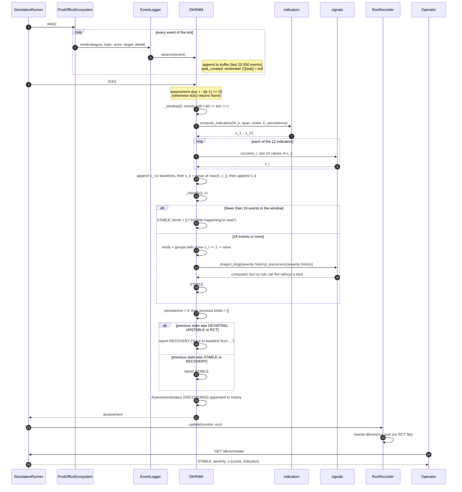
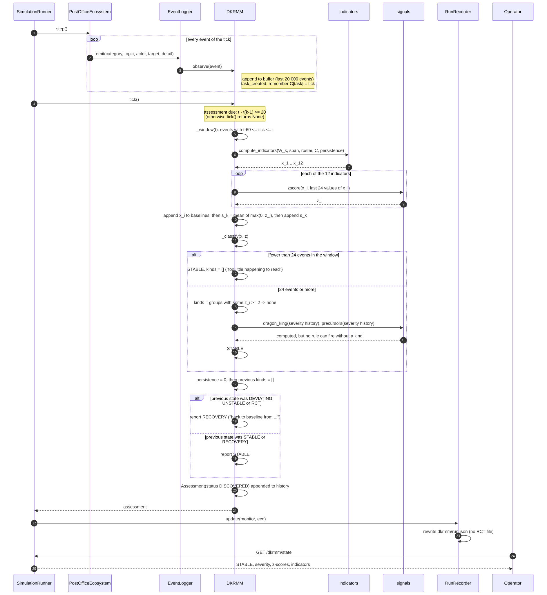
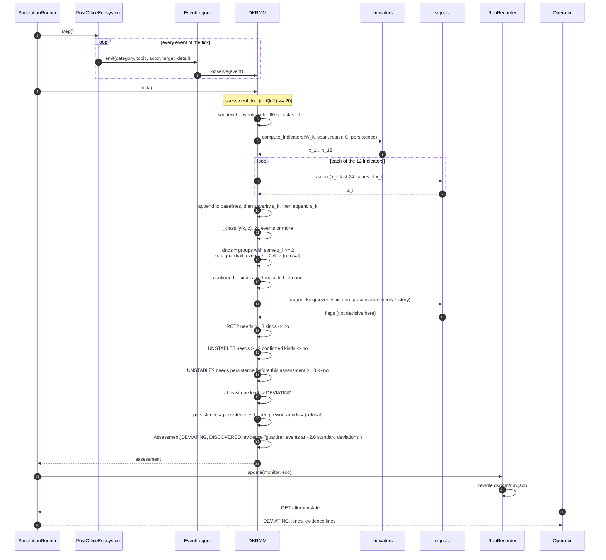
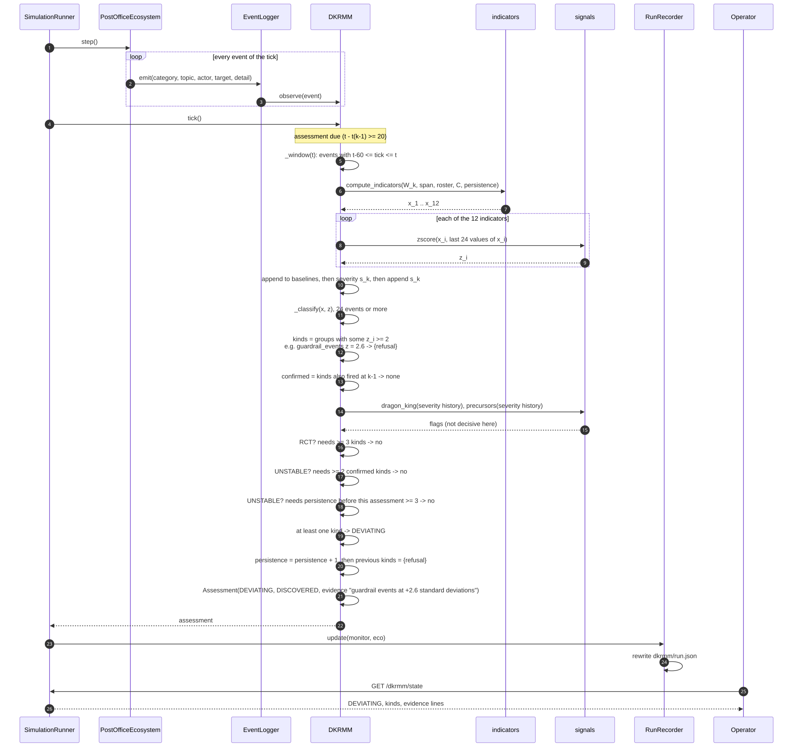
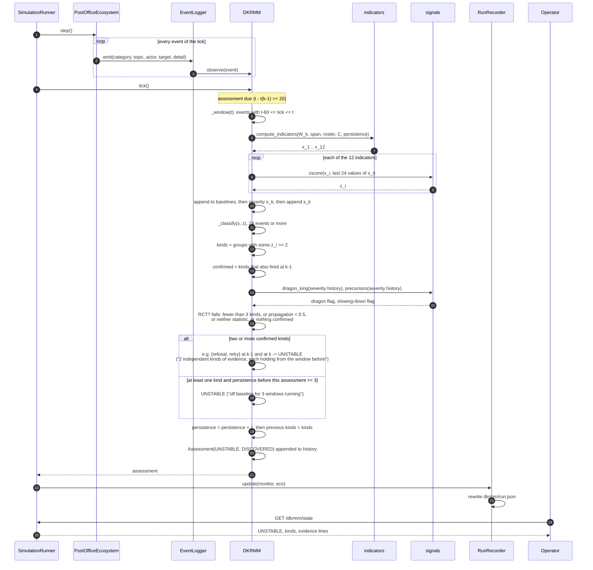
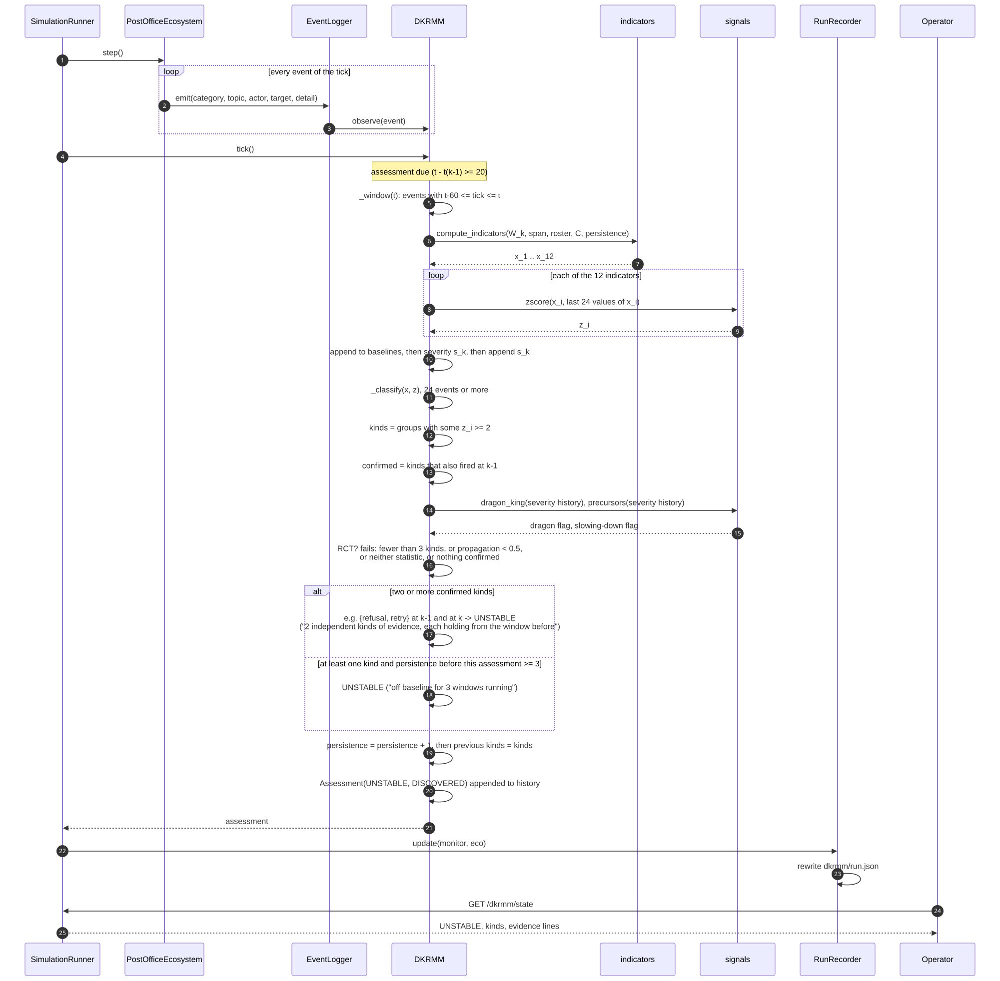
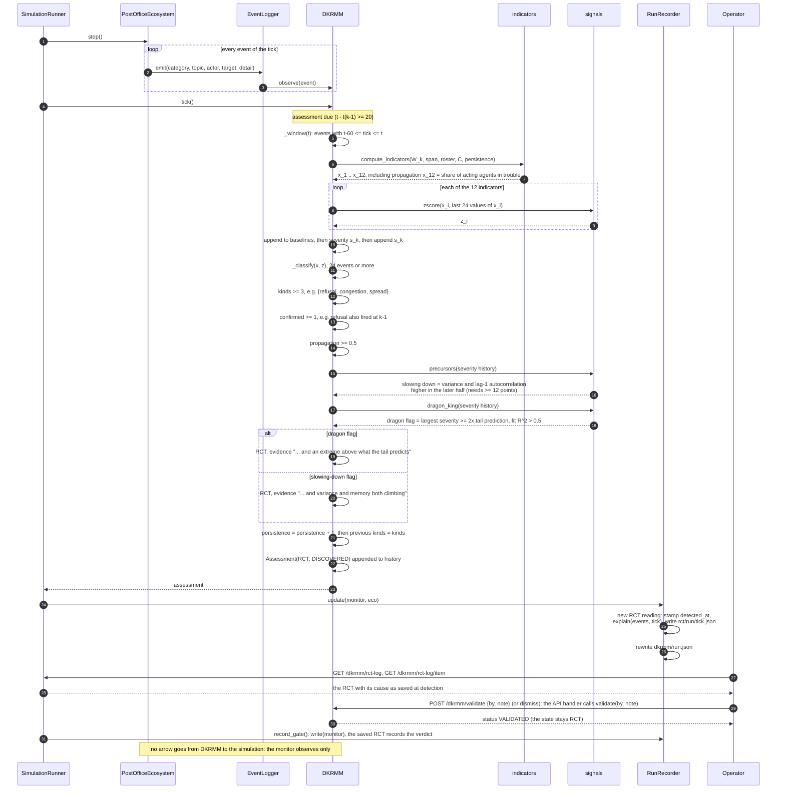
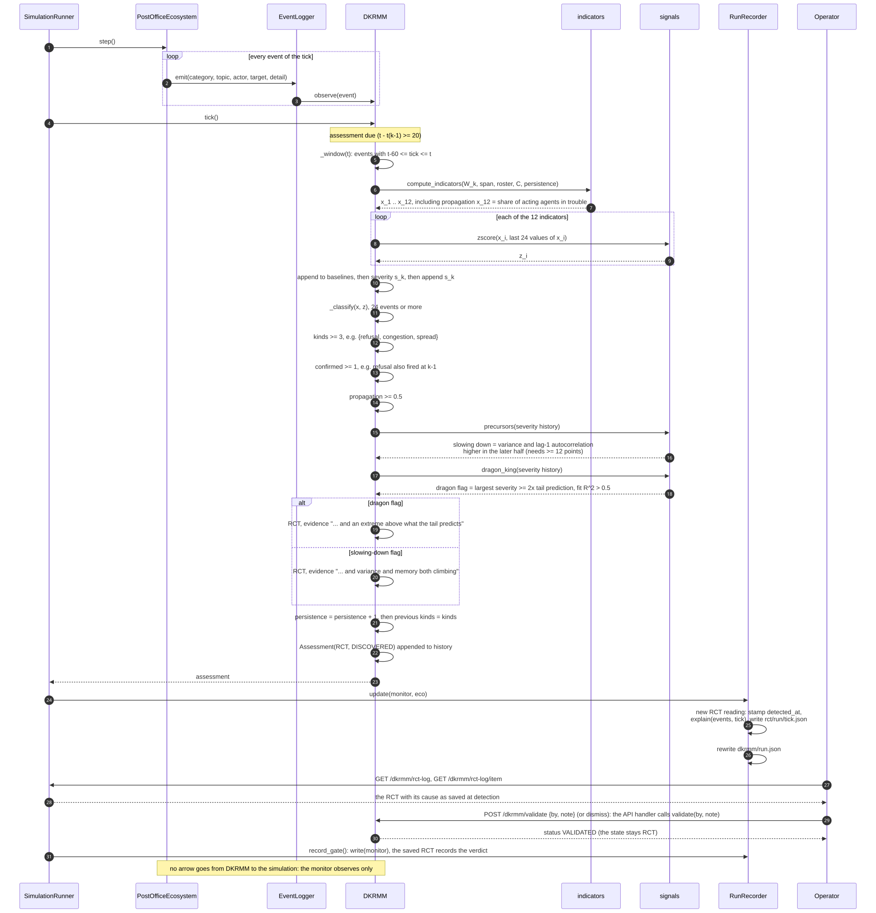
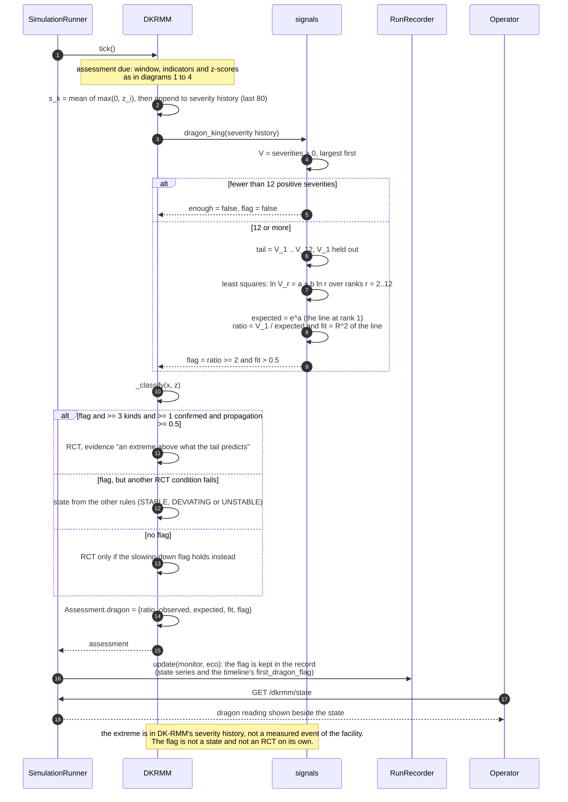
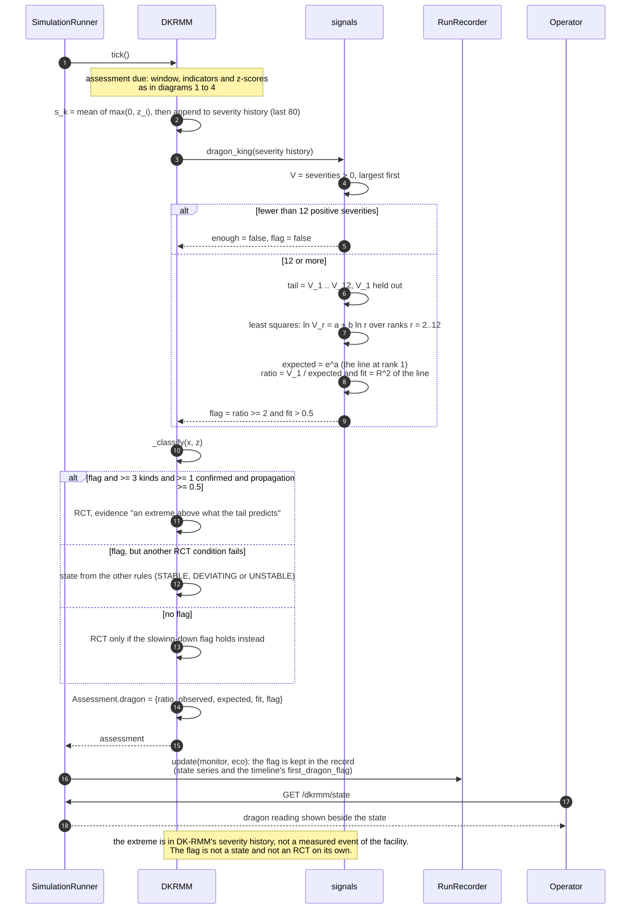

# DK-RMM sequence diagrams

Five sequence diagrams of one DK-RMM assessment, one per outcome: STABLE, DEVIATING, UNSTABLE, RCT,
and the dragon-king flag on the severity series (an extreme value of DK-RMM's own severity score).
Every message in the diagrams is a call or a data flow that exists in the code; the conditions are
the rules of `DKRMM._classify` (`post_office/dkrmm/monitor.py`) and the symbols are those of
[dkrmm-mathematics.md](dkrmm-mathematics.md), where each formula is derived and referenced.

The participants are the same in every diagram:

| Participant | Code | Role |
|---|---|---|
| SimulationRunner | `api/runner.py` | steps the run once per tick and then asks the monitor for an assessment |
| PostOfficeEcosystem | `simulation/ecosystem.py` | the simulation; emits every event through the logger |
| EventLogger | `communication/events.py` | records each event and calls its subscribers |
| DKRMM | `dkrmm/monitor.py` | the monitor: buffers events, assesses every 20 ticks |
| indicators | `dkrmm/indicators.py` | `compute_indicators`: the twelve indicators of one window |
| signals | `dkrmm/signals.py` | `zscore`, `precursors` (critical slowing down), `dragon_king` |
| RunRecorder | `observability/run_record.py` | writes the run's DK-RMM record and one file per RCT (when recording is on) |
| Operator | the live page and the API | reads the assessment; validates or dismisses it |

Every assessment starts the same way (steps 1 to 11 of each diagram): the run steps, every event
reaches the monitor through the logger, and when 20 ticks have passed since the last assessment the
monitor reads the window $W_k$ of the last 60 ticks, computes the twelve indicators, scores each
against its own last 24 values ($z_{i,k}$), and forms the severity $s_k$ (mean of the positive scores).
The diagrams differ in what `_classify` finds. DK-RMM never sends anything back to the simulation:
all its arrows point away from it, towards the recorder and the operator.

## 1. STABLE

STABLE is the outcome when the window holds fewer than 24 events (nothing is read) or when no
indicator stands two baseline standard deviations above its mean, so no evidence kind fires. The
persistence counter returns to 0. If the previous assessment was DEVIATING, UNSTABLE or RCT, the
same computed STABLE is reported as RECOVERY.

## 2. DEVIATING

DEVIATING is one or more evidence kinds firing in a window with enough activity, with none of the
stronger rules satisfied: not three kinds with confirmation, spread and a statistic (RCT); not two
kinds that also fired in the previous assessment; and not a deviation that has already lasted three
assessments. The persistence counter increases by one, and the kinds are remembered so the next
assessment can confirm them.

## 3. UNSTABLE

UNSTABLE has two routes. Either at least two kinds of evidence fire in this window and also fired in
the previous one, or at least one kind fires after three or more consecutive assessments that were
not STABLE. The RCT rule is checked first, so UNSTABLE means the RCT conditions were not all met.

## 4. RCT (Runtime Critical Transition)

An RCT requires all four conditions in one assessment with enough activity:
- at least three evidence kinds fire;
- at least one of them also fired in the previous assessment;
- at least half of the acting agents had a trouble event;
- the severity history shows either critical slowing down or a dragon-king outlier.

When recording is on, the recorder saves the RCT with its explanation at the moment it is first seen. A person then validates or dismisses it; the verdict changes the discovery status, not the state.

## 5. Dragon-king flag (extreme severity)

The dragon-king test asks whether the largest severity in the monitor's history (last 80 assessments) sits
at least twice above what a straight line through the next eleven largest severities, on log rank against
log value, predicts for rank 1, and whether that line fits well. It needs at least 12 positive severities,
so it cannot fire before the 16th assessment. The flag is reported with every assessment. On its own it
is not a state: it contributes to an RCT only together with three evidence kinds, a confirmed kind and
spread across at least half of the acting agents, and it is one of two alternatives (the other is
critical slowing down). In the terms of dragon-king theory, the flag marks an extreme value that the
ordinary tail of the severity distribution does not explain; the code does not test whether such an
extreme corresponds to an extreme event of the facility itself.
