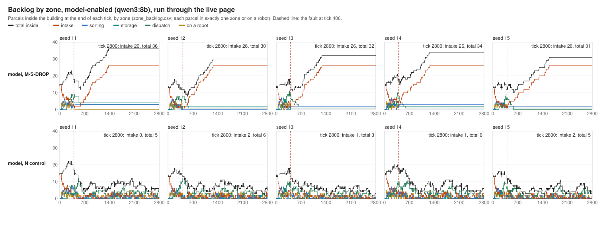
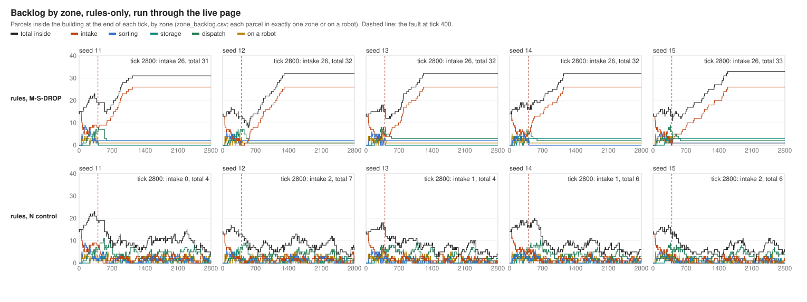

# M-S-DROP with the model enabled, run through the live page

Version 2 (2026-10-12). Version 1 of this report, which analysed the five model-enabled runs made
earlier by `tools/run_collapse_scenarios.py`, is kept unchanged as
[`ms-drop-model-enabled-v1.md`](ms-drop-model-enabled-v1.md). Nothing in it is withdrawn. This version
adds the live-page experiment and the four measurements version 1 could not make:

- the decision-to-action pathway, linked by identifiers;
- the backlog per zone, per tick;
- every DK-RMM reading of the current monitor, as it was made;
- a run that stops by itself at tick 2800 and is kept on disk.

**Status: complete.** All twenty live runs are measured: model-enabled M-S-DROP and its no-drop
control (seeds 11 to 15), made on your machine through the page with Ollama serving qwen3:8b,
and the same ten rules-only, made here through the same page. Section 4 has the model-enabled
runs, section 5 the rules-only runs, and section 9 what remains open.

## 1. What the existing page and backend already did, and what they lacked

Inspected before any change (`post_office/api/runner.py`, `api/server.py`, `ui/live.html`,
`ui/live.py`, `communication/bus.py`, `communication/events.py`, `observability/run_record.py`,
`stress/collapse_scenarios.py`, `stress/measure.py`, `main.py`):

| Question | Finding |
|---|---|
| How a run is started and watched | `python main.py --api` serves the page. The page's **scenario** selector, the study strip's **seed** selector (11 to 15) and **Start**, **Reset** and **speed** drive `POST /simulation/reset` and `/simulation/start`. The page polls `/summary`, `/frame`, `/consultations`, `/llm/calls` and `/dkrmm/*`, and takes every event from `WS /ws`. |
| Seed, model and M-S-DROP | The `ms-drop` preset exists. Choosing it rebuilds the run on seed 11, and any seed can be picked on the strip. Mode is fixed at server start: model by default, `--rules` for rules-only. In model mode `require_model` checks the model first, and again at every reset. |
| Live or precomputed | Live. Every figure comes from the runner's published frame after each tick. Nothing is precomputed. |
| Fault at 400 | `CollapseFaults.before_tick(world.tick + 1)` runs inside the step lock, just before `eco.step()`, exactly as in the driver. At tick 400 it installs `DropAll` as the bus's `delay_rule` and logs `stress_fault_activated`. Nothing removes the rule. |
| Why no consultation after 400 | Every decision the model can answer is taken in a message handler (`_sub_result` of SCHEDULING, ROUTING and INTAKE). It runs only when a sub-agent's reply is delivered. From tick 400 no message is delivered, so no such decision is reached. Measured again below: 0 eligible decisions after the fault in every M-S-DROP run. |
| What was missing | A run did not stop at 2800 (it ticked until paused). Nothing kept the run's events, series, per-zone backlog or DK-RMM readings per run: `RunRecorder` wrote only DK-RMM's record and the RCTs, to `results/live`. The page could not link a decision to the messages, deliveries and robot commands that followed it. On-time delivery logs no event at all: the bus logs a send, a drop and a late delivery, never an on-time arrival. |

## 2. What was added (opt-in; Normal unchanged)

| File | What it adds |
|---|---|
| `main.py` | `--experiment-dir PATH` and `--stop-at N` (with `--api`). `--experiment-dir` needs `--stop-at` and is refused under `results/normal`. Without them nothing changes. |
| `post_office/api/runner.py` | `stop_at`: the run stops itself at that tick, under the step lock, and a Start after that does not tick. `experiment_dir`: at a run's first Start (tick 0) on a collapse preset or its N control (`c2near-n`, `default`), an `ExperimentRecorder` keeps the run. A pause keeps it `incomplete`, a reset or server stop closes it `incomplete`, a crash closes it `failed`, and the stop tick closes it `complete`. A zone series and a decision tracer are kept beside every run, for the page. |
| `post_office/observability/experiment.py` | The run directory `<root>/<scenario>/s<seed>/`, in the driver's layout (`definition.json`, `events.jsonl`, `series.csv`, `measurement.json`, `dkrmm.json`, `summary.json`, `verify.json` with the served-model check, `done.json` only when complete). Added beside them: `zone_backlog.csv`, `dkrmm_assessments.jsonl`, `decision_traces.jsonl`, `message_traces.jsonl`, `trace_summary.json` and `status.json`. An existing directory is never written into; a repeated run goes to `s<seed>-2`. |
| `post_office/observability/zone_backlog.py` | One row per tick: intake, sorting, storage, dispatch, carried (on a robot), other, total. Each parcel is counted once, by `current_zone`, and the six columns sum to `len(env.parcels)`. Also `loaded_on_van` (part of dispatch, not added to the sum) and the tick's arrivals, dock refusals, departures on a van, returns and refusals after arrival, read from the counters `generator.created`, `generator.refused`, `env.dispatched_count`, `env.returned_count` and `env.refused_count`. Each row is checked against the previous total plus arrivals minus the three ways out (`reconciled`). |
| `post_office/observability/decision_trace.py` | Decision and message traces, linked only by identifiers the run wrote (the module docstring lists each link and its basis): decision to consultation (`decision_id` = `call_id`), to the reply it answered (`content.operation`, subject, `in_reply_to`), to the messages and registry events it emitted (same agent, same tick, carrying its subject), to later robot commands on the same task id. Message to drop (`message_dropped.message_id`), to on-time receipt (the receiver taking it from its inbox), to late receipt (`agent_message_received`) and to replies (`in_reply_to`). ROBOT_COMMAND to the robot's `command_<operation>` (sender, robot, correlation id, the tick it was taken). Transport to the parcel's lift and drop (parcel id and robot id). |
| `post_office/communication/bus.py` | `watch_inbox`: read-only observers of `inbox()`. It is the only evidence of on-time delivery, since that logs no event. An empty list costs one `if`. |
| `post_office/api/server.py` | `GET /zones`, `GET /decision-traces`, and `/summary`'s `kept` (where the run is kept, its status and stop tick). |
| `post_office/ui/live.html`, `ui/live.py` | In the existing panes: the **Backlog by zone** chart in the DK-RMM pane (every tick, a dashed line at the fault), a **Decision → action** table under the consultations (eligibility, the model's consultation and calls, the gate, each message's delivery and the robot command applied), a **RUN KEPT** line on the study strip, and "kept" on the run line. No new page, pane or control. |
| `tools/analyze_live_ms_drop.py` | Reads kept run directories into `analysis.json` and `analysis.md`. It never overwrites. |
| `tools/zone_backlog_figure.py` | The per-seed zone figure (standard library only). |

Nothing emits an event. A run's event stream is the same with or without the new observers
(section 7).

## 3. Commands

On your machine, model-enabled (Ollama serving qwen3:8b):

```
python main.py --api --experiment-dir results/m_s_drop_crewai/live --stop-at 2800
```

In the page, for each condition and seed:

1. Choose the scenario: *M-S-DROP · all messages dropped from 400*, or *C2-NEAR · N control* for the no-drop control.
2. Choose the seed on the strip and set the speed to 512×.
3. Press **Start**.

The RUN KEPT line names the folder and shows `complete` at tick 2800.

Rules-only, the same way, with `--rules` and another root. This is how section 5 was produced, in
a headless Chromium driving the same page:

```
python main.py --api --rules --experiment-dir results/m_s_drop_crewai/live_rules --stop-at 2800
```

Analysis, figure and collapse classification:

```
python tools/analyze_live_ms_drop.py --condition rules=results/m_s_drop_crewai/live_rules --condition model=results/m_s_drop_crewai/live --out results/m_s_drop_crewai/live_analysis_v2
python tools/zone_backlog_figure.py --run "model, M-S-DROP=results/m_s_drop_crewai/live/MS-DROP" --run "model, N control=results/m_s_drop_crewai/live/N" --title "Backlog by zone, model-enabled, run through the live page" --out docs/img/ms-drop-zone-backlog-model.svg
python tools/run_collapse_scenarios.py --analyze --out results/m_s_drop_crewai/live
```

## 4. The model-enabled live runs

Made on your machine with
`python main.py --api --experiment-dir results/m_s_drop_crewai/live --stop-at 2800`, from the page:
M-S-DROP and the no-drop control (`c2near-n`, kept as `N`), seeds 11 to 15. Read from
`results/m_s_drop_crewai/live/` by `tools/analyze_live_ms_drop.py` into `live_analysis_v2/`. Your
earlier output, `live_analysis_full/`, agrees with it row for row except one column, "subject
messages received": the tool then counted only the four pathway kinds and now counts every message
a decision sent that carries its subject, of any kind, which is how section 6 counts them.

- **Run status.** All ten are `complete` at tick 2800, `mode: model`, with all seven experts on the
  model. A further `MS-DROP/s11-2` exists: it was reset at tick 338, is kept as `incomplete`, and is
  not used (the analysis reads `s<seed>` only).
- **Model identity.** `require_model` passed for every run: qwen3:8b, digest `500a1f06…`, Q4_K_M.
  Every model call was served by qwen3:8b and none failed at the HTTP level: M-S-DROP 149, 156, 153,
  161 and 156 calls; control 506, 489, 480, 479 and 423.
- **Trace correction.** M-S-DROP seeds 11, 14 and 15 were recorded before the trace correction
  (section 5), and the analysis re-derives their later-command links: 52, 56 and 49 changed. The
  other seven runs were recorded with the corrected tracer, and 0 changed.

### 4.1 Decision stages

"Subject messages" are all the messages a decision sent that carry its subject, of any kind.
"Later commands" are robot commands sent in later ticks on the same task.

| Run | seed | phase | decisions | answer a reply | eligible | consulted | model calls (failed) | model answer accepted / rejected / no usable answer | gate refused | subject messages received | robot commands applied | later commands applied |
|---|---|---|---|---|---|---|---|---|---|---|---|---|
| M-S-DROP | 11 | before 400 | 923 | 351 | 141 | 141 | 149 (0) | 132 / 9 / 0 | 105 | 384 of 384 | 81 of 81 | 81 of 81 |
| M-S-DROP | 12 | before 400 | 796 | 346 | 140 | 140 | 156 (0) | 125 / 15 / 0 | 80 | 351 of 351 | 79 of 79 | 84 of 86 |
| M-S-DROP | 13 | before 400 | 837 | 367 | 143 | 143 | 153 (0) | 123 / 20 / 0 | 87 | 371 of 371 | 86 of 86 | 75 of 77 |
| M-S-DROP | 14 | before 400 | 888 | 338 | 149 | 149 | 161 (0) | 139 / 9 / 1 | 106 | 372 of 372 | 71 of 71 | 86 of 90 |
| M-S-DROP | 15 | before 400 | 800 | 357 | 148 | 148 | 156 (0) | 141 / 6 / 1 | 79 | 363 of 364 | 91 of 91 | 81 of 84 |
| M-S-DROP | 11 to 15 | from 400 | 1 / 0 / 2 / 1 / 0 | 0 | 0 | 0 | 0 | 0 | 0 | 0 | 0 | 0 |
| N control | 11 | from 400 | 2,027 | 1,216 | 307 | 307 | 353 (0) | 294 / 13 / 0 | 96 | 1,333 of 1,333 | 368 of 368 | 289 of 289 |
| N control | 12 | from 400 | 1,629 | 953 | 276 | 276 | 316 (0) | 273 / 3 / 0 | 43 | 1,114 of 1,116 | 250 of 251 | 240 of 240 |
| N control | 13 | from 400 | 1,499 | 908 | 284 | 284 | 318 (0) | 282 / 2 / 0 | 28 | 973 of 973 | 247 of 247 | 208 of 208 |
| N control | 14 | from 400 | 1,852 | 1,079 | 294 | 294 | 332 (0) | 283 / 11 / 0 | 82 | 1,178 of 1,180 | 305 of 307 | 254 of 254 |
| N control | 15 | from 400 | 1,342 | 809 | 234 | 234 | 294 (0) | 229 / 5 / 0 | 30 | 923 of 923 | 227 of 227 | 199 of 199 |

Summed over the five seeds:

| | M-S-DROP before 400 | M-S-DROP from 400 | N control before 400 | N control from 400 |
|---|---|---|---|---|
| decisions | 4,244 | 4 | 4,149 | 8,349 |
| eligible / consulted | 721 / 721 | 0 / 0 | 718 / 718 | 1,395 / 1,395 |
| model calls (failed) | 775 (0) | 0 | 764 (0) | 1,613 (0) |
| model answer accepted / rejected / no usable answer | 660 / 59 / 2 | 0 | 640 / 77 / 1 | 1,361 / 34 / 0 |
| subject messages received | 1,841 of 1,842 | 0 | 1,837 of 1,837 | 5,521 of 5,525 |
| robot commands applied | 408 of 408 | 0 | 372 of 372 | 1,397 of 1,400 |
| later commands applied | 407 of 418 | 0 | 406 of 406 | 1,190 of 1,190 |

**What the model-enabled runs show.**

- **Before the fault**, every eligible decision consulted the model, in both conditions. Every robot
  command a decision sent was applied.
- **From tick 400 under M-S-DROP**, no decision was eligible, none consulted, and no model call was
  made, in all five seeds. The 4 decisions are PLANNER's `release_work`.
- **The control, without the drop**, kept consulting: 1,395 consultations and 1,613 model calls
  after tick 400, and 1,397 robot commands from decisions applied.
- **Messages not received in the control** (4 of 5,525; also 3 robot commands not applied) were all
  sent at tick 2800 and still pending when the run stopped.
- **The later M-S-DROP commands not applied** (11 of 418) were all dropped. Seeds 12 and 13: two
  aborts each, sent at ticks 505 to 539. Seed 14: one transport sent at 399 and three aborts sent at
  ticks 500 to 535. Seed 15: three aborts sent at ticks 483 to 528. Each of the ten aborts was sent
  in the same tick as its task's `task_released`, whose reason reads "errand ran 141 ticks without
  ending".

Model-call latency (median / mean / max, ms):

| Run | seed 11 | seed 12 | seed 13 | seed 14 | seed 15 |
|---|---|---|---|---|---|
| M-S-DROP, before 400 | 305.6 / 476.2 / 8,861.5 | 302.0 / 495.5 / 2,835.4 | 305.8 / 449.1 / 3,982.9 | 305.1 / 487.9 / 7,443.0 | 294.9 / 411.4 / 2,970.9 |
| N control, from 400 | 282.7 / 543.1 / 4,023.6 | 289.6 / 547.4 / 3,027.0 | 302.4 / 512.3 / 3,324.4 | 314.5 / 556.8 / 3,312.1 | 347.0 / 797.3 / 7,763.9 |

### 4.2 Messages and backlog by zone



| Run | seed | messages sent / dropped / delivered from 400 (pending at end) | intake at 399, at 2800 | total at 2800 | intake reaches 26 | first dock refusal | arrivals / departures / dock refusals from 400 | last robot command applied | last van |
|---|---|---|---|---|---|---|---|---|---|
| M-S-DROP | 11 | 798 / 796 / 0 (2) | 2, 26 | 36 | 1372 | 1418 | 25 / 7 / 41 | 391 | 583 |
| M-S-DROP | 12 | 2,248 / 2,246 / 0 (2) | 1, 26 | 30 | 1270 | 1306 | 25 / 7 / 42 | 399 | 583 |
| M-S-DROP | 13 | 2,242 / 2,240 / 0 (2) | 2, 26 | 32 | 1284 | 1323 | 24 / 8 / 33 | 399 | 625 |
| M-S-DROP | 14 | 2,972 / 2,970 / 0 (2) | 4, 26 | 34 | 1275 | 1282 | 23 / 7 / 40 | 396 | 583 |
| M-S-DROP | 15 | 2,965 / 2,962 / 0 (3) | 1, 26 | 31 | 1587 | 1615 | 26 / 7 / 31 | 399 | 583 |
| N control | 11 | 11,372 / 0 / 11,367 (5) | 0, 0 | 5 | never | none | 65 / 73 / 0 | 2791 | 2791 |
| N control | 12 | 10,509 / 0 / 10,497 (12) | 1, 2 | 6 | never | none | 68 / 71 / 0 | 2799 | 2791 |
| N control | 13 | 9,486 / 0 / 9,481 (5) | 4, 1 | 3 | never | none | 57 / 67 / 0 | 2799 | 2666 |
| N control | 14 | 10,727 / 0 / 10,718 (9) | 4, 1 | 6 | never | none | 61 / 70 / 0 | 2799 | 2708 |
| N control | 15 | 9,310 / 0 / 9,307 (3) | 0, 2 | 5 | never | none | 56 / 55 / 0 | 2789 | 2750 |

The model-enabled M-S-DROP runs fill the same way as the rules-only ones (section 5.3). Only
intake grows after the fault. It reaches the dock cap of 26, then the dock refuses arrivals. The
other zones keep what the last delivered commands left. Every zone row of all ten runs reconciles.

### 4.3 DK-RMM (current monitor, every reading as made)

| Run | seed | from 400: STABLE / RECOVERY / DEVIATING / UNSTABLE / RCT | first DEVIATING / UNSTABLE / RCT from 400 | final | STABLE or RECOVERY with intake rising |
|---|---|---|---|---|---|
| M-S-DROP | 11 | 0 / 0 / 2 / 81 / 37 | 401 / 441 / 461 | UNSTABLE | 0 |
| M-S-DROP | 12 | 0 / 0 / 3 / 95 / 22 | 401 / 461 / 481 | RCT | 0 |
| M-S-DROP | 13 | 0 / 0 / 3 / 101 / 16 | 401 / 461 / 521 | RCT | 0 |
| M-S-DROP | 14 | 0 / 0 / 3 / 103 / 14 | 401 / 461 / 481 | UNSTABLE | 0 |
| M-S-DROP | 15 | 0 / 0 / 3 / 91 / 26 | 401 / 741 / 461 | UNSTABLE | 0 |
| N control | 11 | 37 / 18 / 37 / 27 / 1 | 401 / 921 / 1501 | STABLE | 14 |
| N control | 12 | 47 / 16 / 33 / 23 / 1 | 721 / 941 / 2781 | RCT | 17 |
| N control | 13 | 52 / 17 / 34 / 16 / 1 | 701 / 881 / 901 | DEVIATING | 19 |
| N control | 14 | 50 / 16 / 35 / 18 / 1 | 601 / 881 / 1801 | UNSTABLE | 22 |
| N control | 15 | 43 / 18 / 31 / 25 / 3 | 561 / 621 / 2481 | RECOVERY | 16 |

With the current monitor the model-enabled M-S-DROP runs read like the rules-only ones (section 7).
No reading after the fault is STABLE or RECOVERY, so version 1's readings of intake rising while
STABLE do not occur.

What drives the readings is the same as rules-only. In all 600 post-fault readings the evidence
includes the communication failure rate; `backlog_growth` is in evidence in 0, 3, 1, 0 and 0. Its
largest post-fault value is 0.10, 0.10, 0.15, 0.10 and 0.10 parcels a tick, its pre-fault values
range from -0.15 to +0.10, and its largest post-fault z is 1.61, 2.10, 2.60, 1.53 and 1.92. The last
reading (tick 2781) records INTAKE 26 in every seed's snapshot.

The control's STABLE or RECOVERY readings with intake rising are ordinary arrivals: intake there
never exceeds 4 parcels after tick 400. The control also has 1 to 3 RCT readings after tick 400, and
2 to 9 per seed if the rules-only control is counted too. Those are readings on a facility without a
fault.

### 4.4 Collapse (criterion unchanged, against the model-enabled N of the same seed)

| Seed | outcome | criterion | collapse tick | critical stop tick | held to end |
|---|---|---|---|---|---|
| 11 | COLLAPSED | sustained degradation + critical stop | 722 | 983 | yes |
| 12 | COLLAPSED | sustained degradation + critical stop | 708 | 983 | yes |
| 13 | COLLAPSED | sustained degradation + critical stop | 666 | 1025 | yes |
| 14 | COLLAPSED | sustained degradation + critical stop | 666 | 983 | yes |
| 15 | COLLAPSED | sustained degradation + critical stop | 750 | 983 | yes |

The driver's own classification (`tools/run_collapse_scenarios.py --analyze --out
results/m_s_drop_crewai/live`) gives the same five rows. Rules-only (section 5.4) and model-enabled
collapse in all ten runs, with collapse ticks 666 to 750. The model changes nothing after the fault,
because it is never asked.

## 5. Rules-only M-S-DROP and its control, run through the page

Ten runs, seeds 11 to 15, M-S-DROP and N (the `c2near-n` preset: the Normal configuration, no
fault), 2800 ticks, all `complete`. Kept in `results/m_s_drop_crewai/live_rules/`; the analysis is
`results/m_s_drop_crewai/live_rules_analysis/analysis.md`. The driver's own classification of these
directories (`tools/run_collapse_scenarios.py --analyze --out results/m_s_drop_crewai/live_rules`) is
`live_rules/summary.json` and agrees with section 5.4.

**Correction made during this work.** A first set of these ten runs could link a later robot
command to a decision through a parcel id. For example, seed 11's transport command for T-0115
was attached to SORTING's decision on its parcel. A later command now joins a decision only on a
task id: `content.task_id`, or a correlation id that the registry created as a task. A test checks
this. The ten runs were made again through the page with the corrected code. Their event streams
are identical to the first set's, and they replace it in `live_rules/`.

**The page runs the driver's experiment.** Each event stream equals the driver's run of the same
seed, excluding wall clock and run id (17,603 / 15,048 / 12,936 / 10,948 / 10,743 events for
M-S-DROP, 35,680 / 33,622 / 31,937 / 31,939 / 28,706 for N). Two lines differ: the stop reason, and
the driver's `collapse_scenario` marker at tick 0, which the page does not log. Every `series.csv`
column is equal except `events` in the tick-1 row, which counts that marker.

### 5.1 Decisions, and why the model would not be asked after the fault

| Seed | decisions before 400 | eligible before 400 | decisions from 400 | eligible from 400 |
|---|---|---|---|---|
| 11 | 930 | 146 | 2,401 (all PLANNER `release_work`) | 0 |
| 12 | 828 | 132 | 0 | 0 |
| 13 | 842 | 150 | 11 | 0 |
| 14 | 874 | 117 | 0 | 0 |
| 15 | 823 | 119 | 0 | 0 |

The no-drop control, from tick 400: 2,585 / 2,324 / 2,024 / 2,003 / 1,615 decisions, of which
401 / 360 / 385 / 333 / 278 are eligible. In model mode the eligible decisions are the ones that
consult (version 1: 697 of 697 before the fault).

### 5.2 The pathway messages, by delivery

Sent / received on time / dropped / pending at the end. Robot commands also show how many were
applied. Phases are split by the tick the message was sent. A message sent at tick 399 is
delivered or dropped at 400, so the "before" phase shows a few drops.

| Seed | phase | ROUTE_REQUEST | RESOURCE_REQUEST | TASK_ASSIGNMENT | ROBOT_COMMAND |
|---|---|---|---|---|---|
| 11 | before | 40 / 40 / 0 / 0 | 40 / 40 / 0 / 0 | 119 / 119 / 0 / 0 | 240 / 239 / 1 / 0, applied 239 |
| 11 | from 400 | 0 | 1 / 0 / 1 / 0 | 18 / 0 / 18 / 0 | 3 / 0 / 3 / 0, applied 0 |
| 12 | before | 50 / 50 / 0 / 0 | 50 / 50 / 0 / 0 | 124 / 124 / 0 / 0 | 198 / 198 / 0 / 0, applied 198 |
| 12 | from 400 | 0 | 2 / 0 / 2 / 0 | 26 / 0 / 26 / 0 | 3 / 0 / 3 / 0, applied 0 |
| 13 | before | 45 / 45 / 0 / 0 | 45 / 45 / 0 / 0 | 123 / 123 / 0 / 0 | 214 / 213 / 1 / 0, applied 213 |
| 13 | from 400 | 0 | 0 | 23 / 0 / 23 / 0 | 2 / 0 / 2 / 0, applied 0 |
| 14 | before | 51 / 51 / 0 / 0 | 51 / 51 / 0 / 0 | 141 / 140 / 1 / 0 | 191 / 191 / 0 / 0, applied 191 |
| 14 | from 400 | 0 | 2 / 0 / 2 / 0 | 20 / 0 / 20 / 0 | 2 / 0 / 2 / 0, applied 0 |
| 15 | before | 47 / 47 / 0 / 0 | 47 / 47 / 0 / 0 | 122 / 122 / 0 / 0 | 205 / 205 / 0 / 0, applied 205 |
| 15 | from 400 | 0 | 2 / 0 / 2 / 0 | 26 / 0 / 26 / 0 | 1 / 0 / 1 / 0, applied 0 |

In the control every robot command received was applied, with three exceptions: one each in N
seeds 11 and 14, and one sent on seed 15's last tick and still pending. Seeds 11 and 14 are
RESOURCE's `charge` commands that the robot declined in its report ("already on an errand"). The
trace records them as "taken, and no matching command event".

The last robot command applied was at tick 399, 389, 399, 399 and 397. The last van left at tick
583, 541, 541, 583 and 583, carrying parcels already loaded before the fault.

### 5.3 Backlog by zone



| Seed | tick | intake | sorting | storage | dispatch | on a robot | total |
|---|---|---|---|---|---|---|---|
| 11 | 399 | 8 | 2 | 1 | 6 | 2 | 19 |
| 11 | 2800 | 26 | 2 | 0 | 2 | 1 | 31 |
| 12 | 399 | 0 | 1 | 2 | 7 | 3 | 13 |
| 12 | 2800 | 26 | 2 | 2 | 1 | 1 | 32 |
| 13 | 399 | 5 | 2 | 1 | 6 | 2 | 16 |
| 13 | 2800 | 26 | 2 | 0 | 3 | 1 | 32 |
| 14 | 399 | 6 | 2 | 2 | 5 | 2 | 17 |
| 14 | 2800 | 26 | 0 | 3 | 2 | 1 | 32 |
| 15 | 399 | 0 | 2 | 3 | 6 | 2 | 13 |
| 15 | 2800 | 26 | 1 | 3 | 2 | 1 | 33 |

Only intake grows after the fault. The other zones freeze at what the last delivered commands
left. Intake reaches the dock's cap of 26 at tick 1132, 1306, 1215, 1149 and 1587. The first dock
refusal follows at tick 1195, 1318, 1248, 1196 and 1615, and refusals total 48, 41, 35, 43 and 31.
Arrivals from tick 400 are 18, 26, 22, 20 and 26. Departures on a van from tick 400 are 6, 7, 6,
5 and 6, all before tick 600.

The control at tick 2800 has 4, 7, 4, 6 and 6 parcels inside, never more than 2 at intake, and
no dock refusal. Every row of all ten runs reconciles.

### 5.4 Collapse (criterion unchanged, against N of the same seed)

| Seed | outcome | criterion | collapse tick | first degraded tick |
|---|---|---|---|---|
| 11 | COLLAPSED | sustained degradation + critical stop | 722 | 722 |
| 12 | COLLAPSED | sustained degradation + critical stop | 708 | 708 |
| 13 | COLLAPSED | sustained degradation + critical stop | 666 | 666 |
| 14 | COLLAPSED | sustained degradation + critical stop | 666 | 666 |
| 15 | COLLAPSED | sustained degradation + critical stop | 698 | 666 |

## 6. Decision to action: traces

Every decision of a kept run is one line of `decision_traces.jsonl`, and the same view is on the
page's Decision → action table. Each link names its basis (section 2). Summed over the five
rules-only seeds:

| Stage | M-S-DROP before 400 | M-S-DROP from 400 | N control before 400 | N control from 400 |
|---|---|---|---|---|
| decisions | 4,297 | 2,412 | 4,297 | 10,551 |
| answering a reply taken that tick (request identified) | 1,849 | 0 | 1,849 | 6,534 |
| eligible for the model (rule recorded a trigger) | 664 | 0 | 664 | 1,757 |
| consulted (rules-only: never) | 0 | 0 | 0 | 0 |
| refused by the gate (`policy` or `state`), rule used again | 430 | 0 | 430 | 443 |
| decisions that sent a message carrying their subject | 1,656 | 0 | 1,656 | 5,905 |
| those messages / received on time | 1,909 / 1,907 | 0 | 1,909 / 1,909 | 6,762 / 6,762 |
| robot commands among them / applied | 486 / 485 | 0 | 486 / 486 | 2,038 / 2,038 |
| later robot commands on the same task / applied | 572 / 560 | 0 | 569 / 569 | 1,873 / 1,873 |

Before 400 the two conditions are the same run, so their first columns agree except where a later
link crosses the fault. From 400 on, the M-S-DROP decisions are all PLANNER's `release_work`
(2,401 in seed 11 and 11 in seed 13, none in the other seeds). It needs no reply, is never
eligible, and sends nothing that carries its subject.

Three traces from seed 11, as the files record them:

1. **A decision whose effect reached a robot.** Tick 382, SCHEDULING `choose_robot` for T-0115:
   - It answers SUB-ASSIGNMENT's reply M-002736 (to request M-002724); T-0115 was assigned by
     M-002598.
   - The rule's first pick was refused by the gate (`state`: R3 was delivering), and the rule chose
     again, R3.
   - Registry: `task_assigned` R3. ROUTE_REQUEST M-002740 and RESOURCE_REQUEST M-002741 were both
     received at 383 and answered by ROUTE_RESPONSE M-002761 and RESOURCE_GRANT M-002764 at 385.
   - Then, on the same task id: `task_started` at 386, and transport command M-002769 sent at 386,
     received by R3 at 387 and applied (`command_transport`) at 387.
2. **A decision whose effect landed just before the fault.** Tick 398, ROUTING `resolve_block` for
   T-0115 (eligible: still blocked after 6 ticks; rule answer YIELD, gate ok). ROBOT_COMMAND
   M-002833 `yield` was received by R3 at 399 and applied (`command_yield`) at 399. The next
   command on T-0115, `set_route` M-002837 sent at 399, was dropped at 400. T-0115 was released at
   527, and the `abort` sent then (M-003006) was dropped at 528.
3. **A decision whose request never came back.** Tick 399, SCHEDULING `choose_next_task` chose
   T-0106 (eligible: conflict). Its SUBTASK_REQUEST M-002838 to SUB-ASSIGNMENT was dropped at 400,
   so the `choose_robot` that would answer it never happens.

The model-enabled traces carry, on each eligible decision, the consultation, its model calls and the
served model (section 4.1). The tests check the same fields on a fake-Ollama run.

## 7. DK-RMM

DK-RMM is the current monitor (operational indicators of 2026-10-12, `DKRMM_TREE_SHA` unchanged by
this work). Every reading is kept as it was made in `dkrmm_assessments.jsonl`: values, baselines,
z, evaluable, evidence and state. It observes only. Nothing in this work changes it.

| Seed | readings | from 400: STABLE / RECOVERY / DEVIATING / UNSTABLE / RCT | first DEVIATING / UNSTABLE / RCT from 400 | final |
|---|---|---|---|---|
| 11 | 140 | 0 / 0 / 1 / 91 / 28 | 401 / 421 / 461 | UNSTABLE |
| 12 | 140 | 0 / 0 / 3 / 97 / 20 | 401 / 601 / 461 | RCT |
| 13 | 140 | 0 / 0 / 3 / 114 / 3 | 401 / 461 / 2421 | UNSTABLE |
| 14 | 140 | 0 / 0 / 3 / 117 / 0 | 401 / 461 / none | UNSTABLE |
| 15 | 140 | 0 / 0 / 3 / 96 / 21 | 401 / 461 / 481 | RCT |

These are the same readings version 1 reported for the driver's rules-only runs, as expected from
identical event streams.

**Intake accumulating while DK-RMM reads STABLE.** Investigated against the readings themselves:

- **With the current monitor it does not happen under M-S-DROP.** From tick 400 no reading is
  STABLE or RECOVERY, in any seed (the study strip's four-state view paints RECOVERY green, so both
  were counted). The monitor reads DEVIATING from 401 and UNSTABLE or RCT after that.
- **It did happen in version 1's model-enabled runs.** Those were read by the monitor as it was
  before the operational indicators: STABLE in 92, 78, 65, 67 and 74 of 120 windows after the
  fault. That monitor had no communication failure rate, backlog or throughput indicator. Adding
  them was the fix, made earlier on 2026-10-12. The model-enabled live runs, read by the current
  monitor, have no STABLE or RECOVERY reading after the fault either (section 4.3).
- **What drives the current readings is not the backlog.** In every one of the 120 post-fault
  readings of each seed the evidence includes the communication failure rate. Agent coupling and
  interaction density follow. `backlog_growth` is in evidence in 0, 3, 1, 0 and 0 readings.
- **Why the backlog indicator stays quiet.** By its documented definition (indicator 14 of
  `docs/dkrmm-operational-indicators.md`), it is the change in parcels inside per tick since the
  last reading, compared with its baseline. Intake fills slowly. The largest post-fault value is
  0.10, 0.10, 0.15, 0.10 and 0.10 parcels a tick (at most 3 parcels in a 20-tick window). The
  pre-fault readings already range from -0.15 to +0.10. The largest z after the fault is 1.79,
  2.10, 2.68, 1.81 and 1.92. What grows is the level, over about 40 windows, and the level is not
  an indicator. Each reading's snapshot does record it: `by_zone` shows INTAKE 26 at tick 2781 in
  every seed.

**Verdict: not a defect by the documented criteria, so no change was made.** The indicator
computes what its definition says. Catching a slow rise in level would need a new indicator or a
new rule, that is, a new formula. That is your decision and is listed as an open question in
section 9.

## 8. Tests and checks

| Check | Result |
|---|---|
| `tests/test_live_experiment.py`, 14 tests. Observers change no event. An inbox watcher sees every take and alters none. A runner without the options never stops and writes nothing. The stop tick ends a run, and Start does not tick past it. Pause gives incomplete; reset gives a new `-2` directory, never an overwrite. Non-experiment presets are not kept. The CLI guards (stop tick needed, `results/normal` refused). Zone rows sum, reconcile and agree with `series.csv`. Under M-S-DROP the fault fires at 400 and holds: every message sent from 400 to 449 is dropped and no robot command is applied after 400. Every trace link is backed by its identifiers. The trace summary splits at 400 with 0 eligible decisions after it. A fake-Ollama model run records mode, identity and served models, and its consulted decisions carry their model calls. The API reads `/zones`, `/decision-traces` and `/summary.kept`, and the page carries the new elements. The analysis re-derives exactly the later-command links the corrected tracer records. | 14 passed |
| Whole suite, including the browser tests of the live page (run in the cloud workspace, headless Chromium) | 1080 passed, 7 skipped (each skip names an input this workspace lacks: no review package, no older commit to compare, no rules-only plumbing results, or no queue at the sampled tick) |
| Normal unchanged: the Normal run (seed 1, 2800 ticks, through the runner) at the previous commit `cd62474` and with this work | identical, 29,580 events, SHA-256 `5e07efbe…` |
| Live page against the driver: the ten rules-only runs | identical event streams (section 5) |
| Existing results untouched: nothing written outside `results/m_s_drop_crewai/live_rules/`, `live_rules_analysis/`, the results README, the new docs and the code (the model-enabled runs in `live/` and the analyses `live_analysis/` and `live_analysis_full/` are yours, read here unchanged; `live_analysis_v2/` is new); version 1 of the report and schemas v1 and v2 unchanged | checked |

## 9. Still open

- **The intake-level question for DK-RMM** (section 7). Whether a slow rise in level should count as
  evidence is a design decision. Today's monitor has no indicator for it. (2026-10-13: addressed
  by `backlog_level_deviation`, `docs/dkrmm-backlog-level-deviation.md`; every reading in this
  report was made before it was added.)
- **RCT readings in the no-drop control.** 1 to 3 per model-enabled control seed after tick 400
  (section 4.3). They are recorded as made. Whether they are acceptable false alarms is a question
  for the monitor's validation, not for this experiment.
- **Robot command declined.** A robot that declines a command (`charge_declined`) reports it in a
  ROBOT_REPORT that carries no `in_reply_to`. The trace marks the command as taken and not applied,
  but cannot link the refusal itself to the command.
- **On-time delivery has no event.** The trace takes it from the inbox observer, so it exists only in
  runs made with this code, not in older event logs.
- **No exact counterfactual for the model runs.** Model answers vary from run to run, so a
  model-enabled run and its control diverge before the fault (the decision counts before tick 400
  differ). The control shows what the facility does without the drop. It does not show what the same
  run would have done.
