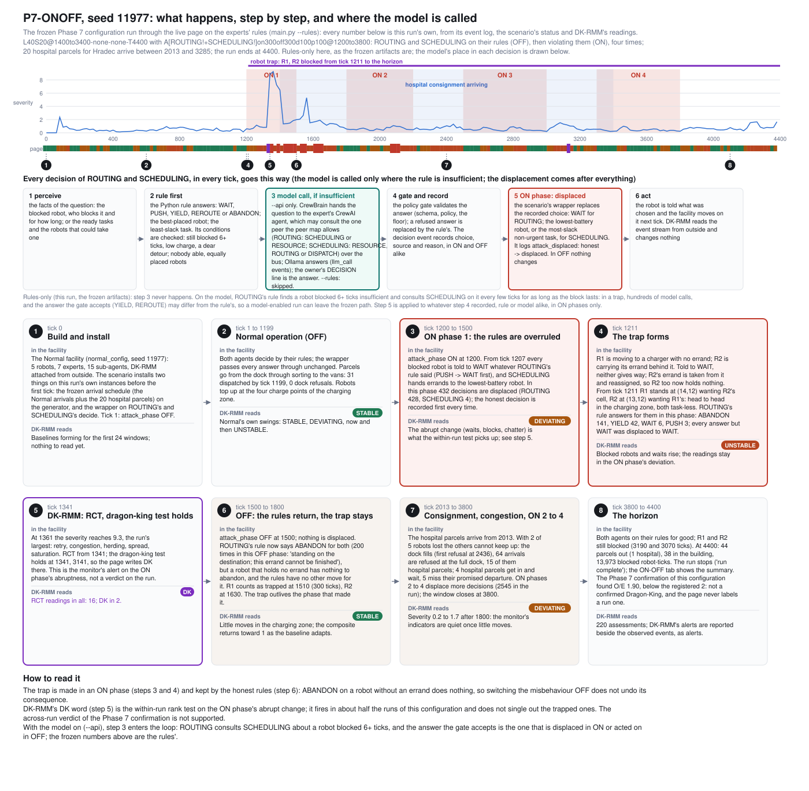

# P7-ONOFF: the Phase 7 ON-OFF agent misbehaviour in the live app

The sixth study scenario of the live page (`post_office/stress/onoff_attack.py`,
preset `p7-onoff`, label "ON-OFF, rules only" (since 2026-10-23;
before that "Phase 7 · ON–OFF Agent Misbehaviour--Only Rules", and until 2026-10-18
"... (Orphaned-Robot Deadlock)")) is the configuration the Phase
7 confirmation of the Dragon-King search froze on 2026-10-15 (exp_cascade, `PROTOCOL_P7_CONFIRM`; the report
`REPORT_PHASE6_7`). It is added as a scenario, like M-S-STALL before it; the
Normal scenario, the C2-NEAR conditions, the five collapse scenarios, DK-RMM
and everything under `results/` are what they were.

## 1. The scenario

Since 2026-10-18 the scenario runs every expert on its Python rules whatever
mode the app was served in (`RULES_ONLY_PRESETS` in `config/settings.py`): the
runner builds no model brains for it, the model badge says so, and a
model-mode app (`--api`) runs it exactly as a rules-only app does, so seed
11977 reproduces the frozen run in either. Before that date, on a model-mode
app, the preset ran with the model behind the rules and left the frozen path
at the first model answer. The same schedule on the rules-first,
model-when-insufficient experts is the seventh scenario, `p7-onoff-model`
(`docs/p7-onoff-model.md`).

Workload `L40S20@1400to3400-none-none-T4400`: the Normal facility
(`normal_config()`, byte for byte) whose arrivals follow the generator's own
schedule, drawn once per seed from its two streams, plus a hospital
consignment of 20 extra parcels whose arrival ticks are drawn once per seed
with a density rising from 1400 to 3400, each addressed to the hospital's town
(HRADEC) with the service word "urgent". Horizon 4400; the run stops there by
itself. No communication fault, no charge loss.

Misbehaviour `A[ROUTING!+SCHEDULING!]on300off300d100p100@1200to3800`: ROUTING
and SCHEDULING alternate between OFF, in which they decide exactly as the
unmodified code does, and ON, in which every one of their targeted decisions
is displaced after the honest rule, the triage and the validation gate have
run and been recorded: ROUTING answers WAIT to every blocked robot (instead of
PUSH, YIELD, REROUTE or ABANDON) and SCHEDULING gives every errand the
lowest-battery able robot and starts the non-urgent task with the most slack
first. Cycle k is ON for 300 + 100 k ticks and OFF for 300: ON 1200 to 1500,
1800 to 2200, 2500 to 3000, 3300 to 3800; OFF for good after 3800. Every phase
change is an `attack_phase` event and every displaced decision an
`attack_displaced` event carrying the honest and the displaced choice (the
event names are the frozen artifacts'; the page calls the mechanism
misbehaviour, because the Normal page's source names no removed family).

Both are installed from outside the ecosystem at construction, through seams
that already exist, as the Phase 7 harness installed them: the arrival
schedule replaces `eco.generator.step` on that one instance; the displacement
wraps the `decide` bound method of the two agent instances built for the run.
Nothing in `agents`, `simulation`, `communication`, `dkrmm` or `policy`
changes, no configuration key is added, nothing adaptive runs, and nothing
is replayed from a recording: every run shows its own outcome.

## 2. What the confirmation found, and what the page says about it

On 1,000 fresh seeds (11301 to 12300) the configuration produced seven runs in
which an ON phase left two or three robots that held no errand head to head in
the charging zone. In OFF the honest rules had no move for them: ROUTING's
answer for a robot standing on another robot's destination is ABANDON, which
gives back an errand the robot does not hold, so the trap held to the horizon,
through every OFF phase and past the end of the window. Seed 11977, the
largest, lost R1 and R2 from tick 1211 for 3,190 ticks: 26 of 33 urgent
parcels never dispatched, 64 dock refusals, 38 parcels left in the building.
Its urgent burden was 1.90 times the expected maximum of the untrapped tail,
below the registered factor 2: the registered verdict is **not supported**,
and the page never labels a run a confirmed Dragon-King. DK-RMM's own
readings (RCT, and the readings its dragon-king test held on) are shown
beside the observed events as the monitor's alerts, which is what they are.

The scenario starts on seed 11977 when chosen from Normal, as the
demonstration: the live run of that seed reproduces the frozen confirmation
run event for event (`tests/test_p7_onoff.py` checks the sha256 of the first
1,700 ticks' events against the archived stream; the full 4,400 ticks were
checked the same way when the scenario was added, 57,191 events identical).
The seed picker offers three more trapped seeds and two untrapped ones; any
seed can be set over the API, and a seed outside the frozen set shows
whatever happens on it.

## 3. The live page

The study strip shows the four ON phases as bands on the clock, the phase now
(ON or OFF, the ticks left in it, the targets) and the decisions displaced so
far; DK-RMM's sequence runs under it as for every study. The **ON–OFF** tab,
shown on this preset only, has the misbehaviour's state and schedule, the
system-wide impact (robots blocked and trapped, fleet available, blocked
robot-ticks, hospital parcels arrived, awaiting dispatch, past their promise,
dispatched; standard dispatches; the backlog and the dock refusals), the
trap read as a sequence of what happened (when and in which phase the robots
stopped, that they held no errand, how many of ROUTING's answers were
displaced to WAIT, how many times it has answered ABANDON since the phase
switched OFF, and that the blockage continues), the robots with their blocked
streaks and ROUTING's rule answers during each, the hospital consignment
parcel by parcel, and at the horizon the final run summary. A robot is
reported trapped once it has stood BLOCKED for 300 consecutive ticks (the
Phase 7 definition); two robots each blocked by the other are marked head to
head. On the floor a trapped robot wears a dashed ring with a tag (ticks
blocked, errand or none), a head-to-head pair is joined by a bar, and the
zone of a persistent trap is outlined. The Runtime communication pane shows
every displaced decision as a row reading `ON phase: resolve_block PUSH ->
WAIT (displaced)` and every phase change as `phase ON: ROUTING, SCHEDULING`.

When DK-RMM's dragon-king test holds on an RCT reading (the page's DK word,
on every study preset), the scenario strip shows a **DK alert**: the tick of
the newest such reading, a short name of the extreme event once the run has
one (on this preset, from the trap as observed: "orphaned-robot trap: R1, R2
blocked since tick 1211, no errand, charging zone", or "robot trap (R1, R2)
cleared at tick N" after one ends; on a collapse scenario the fault's own
label; nothing while no event has been observed, so a reading that arrives
before the trap is shown with its tick alone) and a *details* button that
opens the ON–OFF tab (the DK-RMM tab on the other presets). A reading that is new since the last heartbeat pulses
the chip and sounds two short tones (Web Audio, no file); the *sound* switch
beside the speed menu turns the beep off, and the choice is kept in that
browser. On the strip's DK-RMM row the same DK word, its tick and the event's
name appear under the RCT line, followed by the event's impact as the run
stands: on the hospital consignment (parcels waiting in the building, past
their promised departure, refused at the full dock, dispatched), once a
hospital parcel has arrived or been refused, and the robots lost, once one is
trapped; a part with nothing observed yet is left out rather than described
as absent. The chip carries the short form of the same figures. Browsers play sound only after a click on the page, so a DK that
arrives before any click is shown without the tone. The alert names what was
observed and says in its tooltip that it is the monitor's alert, not a
verdict.

## 4. Step by step, with the model's place



`tools/p7_onoff_steps_figure.py` draws the schema from a headless run of the
scenario on seed 11977 (the live page's configuration, rules-only): the
severity and page strip of DK-RMM on the clock with the four ON phases and the
trap, the six stations every ROUTING and SCHEDULING decision passes through
(perceive, rule first, the model call where a rule is insufficient, the gate
and the record, the ON-phase displacement, the act), and the eight steps of
the run with what DK-RMM read at each. With `--rules` the model station is
skipped and the numbers are the frozen run's; with `--api` ROUTING consults
SCHEDULING about a robot blocked six ticks or more, every few ticks for as
long as the block lasts, and the answer the gate accepts is what the ON phase
displaces or the OFF phase acts on, so a model-enabled run can leave the
frozen path.

## 5. Running it

```
.venv\Scripts\python main.py --api --rules      (or --api: the scenario runs on rules either way)
```

choose the scenario in the selector (seed 11977), press Start; the run ends
at tick 4400. Headless, the same run is `SimulationRunner(seed=11977,
preset="p7-onoff", rules_only=True)` stepped to 4400. The frozen artifacts are
rules-only and so is every run of this preset; the model path is
`p7-onoff-model`.

## 6. Checks made when the scenario was added

Normal and the existing scenarios: the event streams, floor frames and
summaries of `default` (seeds 1 and 11, 600 ticks), `c2near-n` and `c2near-c0`
(seed 11, 900), `ms-drop`, `ms-delay`, `cs-starve`, `cs-partition` (seed 11,
800) and `ms-stall` (seed 13, 2200) are identical before and after the change;
`tests/test_normal_alignment.py` holds the Normal baseline. The project's
tests pass with the new file (`tests/test_p7_onoff.py`, 8 tests) and the five
files that count the scenario options updated for the tenth.
