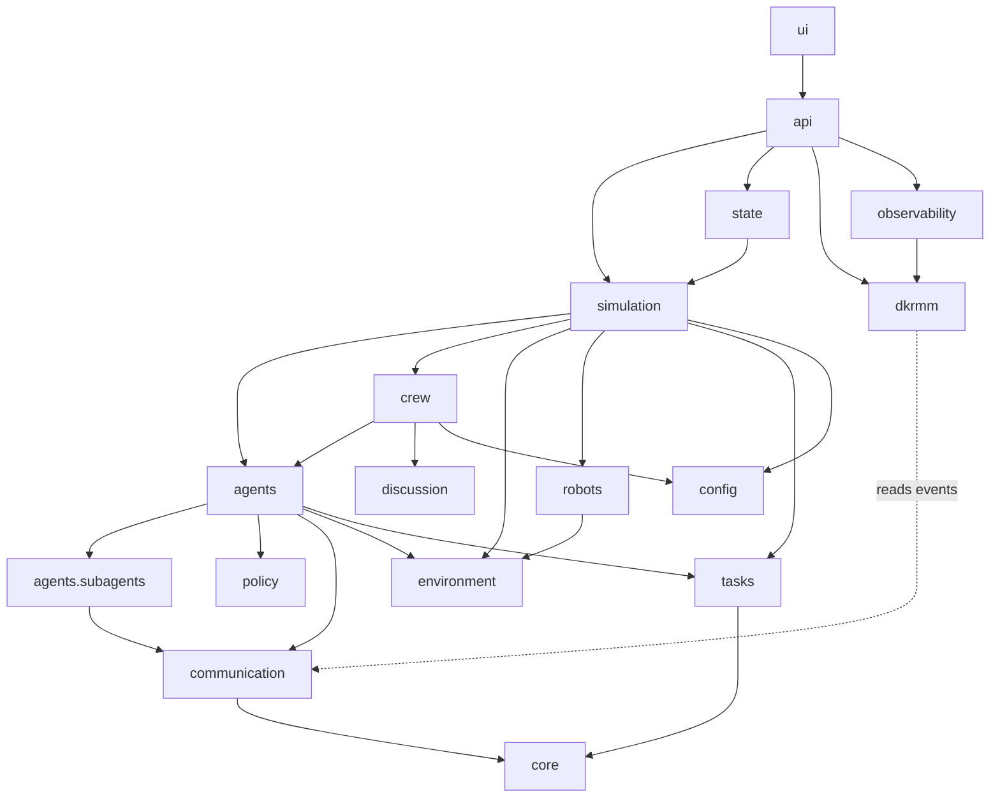

# Packages of `post_office`

One page per package of the `post_office` code, each with a short description, a class diagram
(Mermaid source, rendered in VS Code and on GitHub, and the same diagram as an SVG under `img/`
for papers and slides) and a table of its classes. Every class defined in the code is drawn; the
pages were checked against the code with a script that lists each package's classes, bases and
public members with Python's `ast`. Module-level functions that matter are drawn as boxes marked
`<<module>>`, and classes from other packages as boxes marked `<<external>>`.

| Package | Page | What it is |
|---|---|---|
| `simulation` | [simulation.md](simulation.md) | The assembled ecosystem and the clock that drives it: builds everything in a fixed order and steps it tick by tick. |
| `agents` | [agents.md](agents.md) | The agent hierarchy: supervisor, planner, six operational experts and one agent per robot, with the rules-first decision pipeline. |
| `agents.subagents` | [agents-subagents.md](agents-subagents.md) | The fifteen deterministic clerks below the experts, each owned by exactly one expert. |
| `crew` | [crew.md](crew.md) | The CrewAI side: the seven experts as CrewAI agents on one Ollama-backed LLM and the synchronous owner, peer, owner consultation. |
| `discussion` | [discussion.md](discussion.md) | Who an expert may consult (the peer map), what a peer is briefed with, and how a decision line is read. |
| `config` | [config.md](config.md) | Every dial of a run and the Ollama settings that put a model behind an expert. |
| `communication` | [communication.md](communication.md) | The message bus between agents, the event log of everything that happens, and the interaction taxonomy stamped on each event. |
| `dkrmm` | [dkrmm.md](dkrmm.md) | DK-RMM, the runtime monitor: reads the event stream, computes the twelve indicators and names the collective state; observe only. |
| `observability` | [observability.md](observability.md) | Decision scope tracing, and the record of DK-RMM's readings and RCTs with their explanation, kept beside the run. |
| `policy` | [policy.md](policy.md) | The gate between what an agent decided and what the facility does. |
| `environment` | [environment.md](environment.md) | The physical facility: floor plan, zones, parcels, charge points, shelves, vans, bag room, recovery requests. |
| `robots` | [robots.md](robots.md) | The robots as bodies with position, load, charge and errand, stepping themselves each tick. |
| `tasks` | [tasks.md](tasks.md) | Work as data: tasks with type, owner, status and history, and the registry that records their transitions. |
| `core` | [core.md](core.md) | Reproducible randomness, readable identifiers, standing orders and the shared handles agents are attached with. |
| `state` | [state.md](state.md) | One JSON-serialisable view of the whole ecosystem for the API and the UI. |
| `api` | [api.md](api.md) | The HTTP and WebSocket server over one running simulation, and the runner that owns it. |
| `ui` | [ui.md](ui.md) | The browser front end: the live page, the floor, the Trajectory and the RCT log pages. |

## How the packages depend on each other

The picture shows the main dependencies only, layer by layer; the table under it lists every
package another package imports from (read from the code with `ast`, including imports made inside
functions), so nothing is left out. `simulation` assembles the run, `agents` and `crew` decide,
`communication` carries messages and events, `environment`, `robots`, `tasks`, `core` and `config` are
the world and its settings, `dkrmm` and `observability` watch from outside, and `api` and `ui` serve it.

| Package | Imports from |
|---|---|
| `agents` | `agents.subagents`, `communication`, `core`, `environment`, `observability` (only `context`), `policy`, `robots`, `tasks` |
| `agents.subagents` | `agents`, `communication`, `core`, `environment`, `robots`, `tasks` |
| `api` | `communication`, `config`, `crew`, `dkrmm`, `observability`, `simulation`, `state`, `ui` |
| `communication` | `core` |
| `config` | `agents`, `crew`, `environment`, `robots` |
| `core` | `communication`, `environment`, `robots`, `tasks` |
| `crew` | `agents`, `communication`, `config`, `core`, `discussion` |
| `discussion` | `core` |
| `dkrmm` | `communication` |
| `environment` | `agents.subagents` |
| `observability` | `communication`, `config`, `dkrmm` |
| `policy` | `environment` |
| `robots` | `environment` |
| `simulation` | `agents`, `agents.subagents`, `communication`, `config`, `core`, `crew`, `discussion`, `environment`, `policy`, `robots`, `tasks` |
| `state` | `environment`, `simulation` |
| `tasks` | `core`, `environment` |
| `ui` | `api`, `communication`, `config`, `dkrmm` |

Two facts the table shows and the package pages explain: no module of `agents`, `crew`,
`environment`, `robots`, `tasks` or `simulation` imports `dkrmm`, so the monitor can be removed
without changing a run; and `agents` reaches `observability` only for the decision scope in
`observability.context` (one import in `agents/base.py`), not for the RCT recorder.
