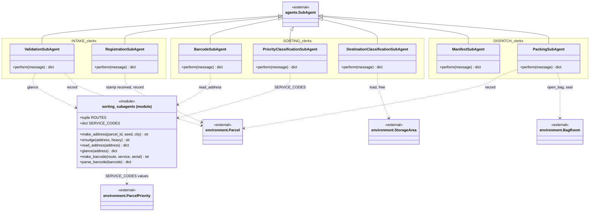
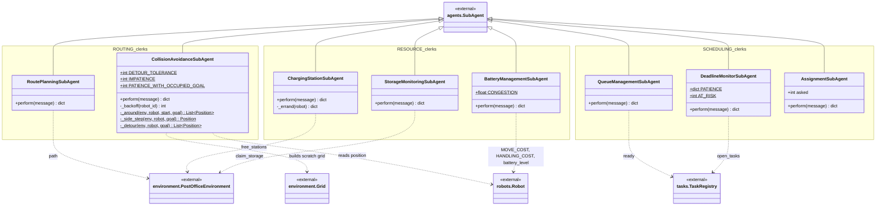

# post_office.agents.subagents

The fifteen clerks below the experts, each a `SubAgent` owned by exactly one expert whose id is its `parent_id` (the namespace boxes group them by owner: INTAKE, SORTING, DISPATCH in the first diagram, ROUTING, SCHEDULING, RESOURCE in the second). Each clerk is request and response: its expert sends a `SUBTASK_REQUEST`, the inherited `SubAgent.handle()` calls `perform()`, and the returned dict (keyed by `operation`) goes back to the parent as a `SUBTASK_RESULT`. The clerks measure and report, and the experts decide: validation and the barcode scan read the address through `glance()` and `read_address()` in the `sorting_subagents` module, the classification clerks report the claimed service and the shelf load, the floor clerks plan paths, cost detours and errands, order the queue, flag deadlines and list free charge points. A few write bookkeeping that is theirs to write: registration stamps `received` on the parcel, packing puts the parcel into a bag in the `environment.BagRoom`, and the storage clerk claims and releases shelves. `simulation.PostOfficeEcosystem` constructs all fifteen with their parent ids, `simulation.generator` uses `make_address()` and `smudge()`, and `SortingAgent` uses `make_barcode()`; the package depends on `agents.base`, `environment`, `robots` and `tasks`. The rule to know: a sub-agent may address only its parent, which the bus directory enforces and logs, so no other expert can reach past the owner to its clerks.

## Class diagram

### Front door, sorting and back door

### Floor clerks

## Classes

| Class | Module | Role |
|---|---|---|
| `ValidationSubAgent` | `gate_subagents.py` | SUB-VALIDATION (INTAKE): glances at an unaccepted parcel's address and reports legibility, declared route and service, network membership and size. |
| `RegistrationSubAgent` | `gate_subagents.py` | SUB-REGISTRATION (INTAKE): books an accepted parcel in by stamping `received`. |
| `ManifestSubAgent` | `gate_subagents.py` | SUB-MANIFEST (DISPATCH): books a parcel out, reporting its route, priority, size and ticks waited at the door. |
| `PackingSubAgent` | `gate_subagents.py` | SUB-PACKING (DISPATCH): puts a released parcel into the open bag for its route and mail class, sealing a full bag and opening the next. |
| `BarcodeSubAgent` | `sorting_subagents.py` | SUB-BARCODE (SORTING): machine-reads the address with `read_address()` into a route and service, or reports why it will not scan. |
| `PriorityClassificationSubAgent` | `sorting_subagents.py` | SUB-PRIORITY (SORTING): reports the claimed service as a `ParcelPriority`, the size, ticks waited and parcels on the dock. |
| `DestinationClassificationSubAgent` | `sorting_subagents.py` | SUB-DESTINATION (SORTING): settles the one-answer legs (intake to sorting, storage to dispatch, urgent via sorting) and otherwise reports shelf load, free shelves and storage policy. |
| `sorting_subagents (module)` | `sorting_subagents.py` | Address and barcode helpers: `ROUTES`, `SERVICE_CODES`, `make_address()`, `smudge()`, `read_address()` (scanner read), `glance()` (clerk read), `make_barcode()`, `parse_barcode()`. |
| `RoutePlanningSubAgent` | `routing_subagents.py` | SUB-ROUTE (ROUTING): turns start, pickup, optional via and dropoff into cell lists with `env.path()`; no judgement. |
| `CollisionAvoidanceSubAgent` | `routing_subagents.py` | SUB-COLLISION (ROUTING): for a blocked robot, measures detour, side step, push and occupied-goal cases and returns the feasible options (WAIT, REROUTE, YIELD, PUSH, ABANDON) with their geometry. |
| `QueueManagementSubAgent` | `scheduling_subagents.py` | SUB-QUEUE (SCHEDULING): orders ready tasks earliest deadline first with promoted tasks ahead, and returns a shortlist of eight with slack. |
| `DeadlineMonitorSubAgent` | `scheduling_subagents.py` | SUB-DEADLINE (SCHEDULING): reports unstarted tasks at risk of missing their promise (`AT_RISK`) or waiting past `PATIENCE`. |
| `AssignmentSubAgent` | `assignment_subagent.py` | SUB-ASSIGNMENT (SCHEDULING): costs each free robot for the errand (module constants `COST_PER_CELL`, `MARGIN`) and lists the ones able to finish it. |
| `BatteryManagementSubAgent` | `resource_subagents.py` | SUB-BATTERY (RESOURCE): estimates an errand's charge cost from route length, `MOVE_COST`, `HANDLING_COST` and the `CONGESTION` factor. |
| `ChargingStationSubAgent` | `resource_subagents.py` | SUB-CHARGING (RESOURCE): lists free reachable charge points with walking distance, plus rival robots needing charge and their errands. |
| `StorageMonitoringSubAgent` | `resource_subagents.py` | SUB-STORAGE (RESOURCE): reports shelf load, claims and releases a shelf for a parcel, and reports the facts for `accept_into_storage`. |
