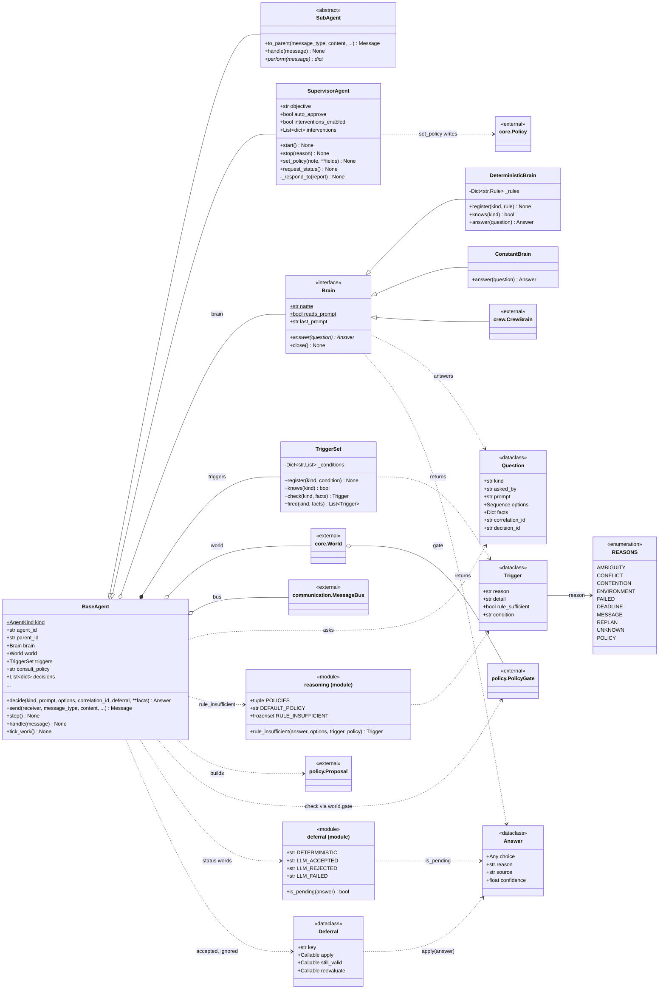
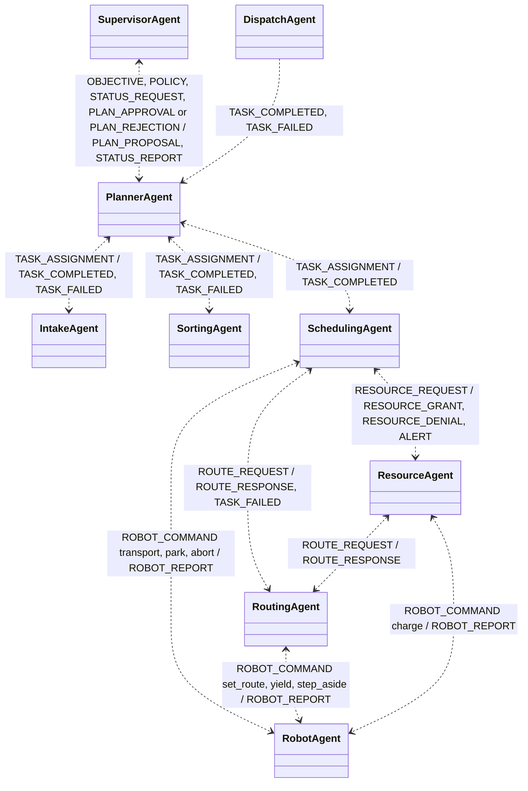

# post_office.agents

The agent hierarchy that runs the simulated facility: a plain-Python `SupervisorAgent`, the `PlannerAgent`, six experts (`IntakeAgent`, `SortingAgent`, `SchedulingAgent`, `RoutingAgent`, `ResourceAgent`, `DispatchAgent`) and one `RobotAgent` per robot, all subclasses of `BaseAgent`, which `simulation.PostOfficeEcosystem` builds, attaches to the `communication.MessageBus` and the shared `core.World`, and steps once per tick (read the inbox, then `tick_work()`). Every judgement goes through `BaseAgent.decide()`: the agent's `TriggerSet` names a `Trigger` if the case is not routine, the rule registered on a `DeterministicBrain` answers first, `reasoning.rule_insufficient()` decides whether the agent's `Brain` (for example the external `crew.CrewBrain`) is consulted instead, and the answer becomes a `policy.Proposal` checked by the `PolicyGate` on `world.gate`, with the rule answering again on a refusal. `Deferral` records are still built by the experts but are accepted and ignored, since every decision is answered synchronously inside `decide()`, and `SchedulingAgent` keeps an `AssignmentLog` of per-errand `ErrandRecord` timings. Agents hold no references to each other: every arrow in the message-flow diagram is a bus message addressed by agent id, and a label `X / Y` on a two-way arrow means X travels from the first-named agent to the second and Y comes back. The fifteen clerks each expert talks to through `SUBTASK_REQUEST` and `SUBTASK_RESULT` are documented separately in `agents.subagents`; the package also depends on `environment`, `robots` and `tasks`, and is read by `state.SystemState` and used by `crew`. The rule to know: an agent acts only through its own messages and its own `decide()` answers, and `RobotAgent` is meant to be the only caller of a robot's methods, with one exception visible in the code: `ResourceAgent` calls `Robot.abort()` on a stranded robot and starts and ends opportunistic top-ups directly.

## Class diagram

### Decision pipeline

### The experts

```mermaid
classDiagram
  direction TB
  class BaseAgent["BaseAgent"]
  class PlannerAgent {
    +str objective
    +bool approved
    +int tasks_created
    -Set _classifying
    -Set _transporting
    +handle(message) None
    +tick_work() None
    -_propose_plan() None
    -_issue_transports() None
    -_report_status(to) None
  }
  class IntakeAgent {
    +int accepted
    +int refused
    -Dict _jobs
    -Dict _waiting
    +handle(message) None
    +refuse(parcel_id, reason) bool
    -_sub_result(message) None
    -_accept_or_refuse(parcel_id, content, answer) None
    -_accept(parcel_id, reason, town, service) None
  }
  class SortingAgent {
    +int classified
    -Dict _jobs
    -Dict _waiting
    +handle(message) None
    +reprice(parcel, service, tick) bool
    -_sub_result(message) None
    -_classified(parcel_id, message, content, source) None
    -_return_to_sender(parcel_id, reason) None
  }
  class SchedulingAgent {
    +AssignmentLog assignments
    -Dict _dispatch
    -Set _reserved
    -Dict _queued
    -Dict _asking
    +handle(message) None
    +tick_work() None
    +handover_ready(task_id) bool
    -_robot_chosen(task_id, robot_id) None
    -_command(task_id) None
    -_abandon(task_id, reason, cause) None
    ...
  }
  class RoutingAgent {
    +int PUSH_COOLDOWN$
    +int routes_planned
    +int blocks_resolved
    -Dict _waiting
    +handle(message) None
    -_plan(message) None
    -_ask_collision(robot_id, blocked_by, ...) None
    -_replan(message) None
    -_carry_out_block(robot_id, ..., answer) None
  }
  class ResourceAgent {
    +int RECOVERY_AFTER$
    +int granted
    +int denied
    -Dict _clearances
    -Dict _charging
    +handle(message) None
    +tick_work() None
    -_maybe_answer(key) None
    -_arrange_charge(robot_id, correlation_id) None
    -_recover_stranded() None
    ...
  }
  class DispatchAgent {
    +int released
    +int held
    +int handed_over
    +List~dict~ manifest
    +handle(message) None
    +tick_work() None
    -_release_or_hold(parcel_id, route, waiting, van, answer) None
    -_hand_over_ready(route) None
    -_hand_over(bag, van) None
  }
  class RobotAgent {
    +Robot robot
    +int commands
    +int reports
    +handle(message) None
    +tick_work() None
    -_narrate(report)$ str
  }
  class AssignmentLog {
    +Dict~str,ErrandRecord~ records
    +List~ErrandRecord~ history
    +asked(message_id, tick) None
    +selected(message_id, task_id, tick) None
    +assigned(task_id, robot_id, tick, queued) None
    +promoted(task_id, tick) None
    +commanded(task_id, robot_id, tick) None
    +completed(task_id, robot_id, tick) None
    +retired(task_id, tick) None
    +report() dict
    ...
  }
  class ErrandRecord {
    <<dataclass>>
    +str task_id
    +str robot_id
    +int next_assignment_requested_tick
    +int queued_tick
    +int promoted_tick
    +int command_tick
    +int errand_completed_tick
    +int robot_idle_ticks_between_errands
    +bool prepared_in_advance
    ...
  }
  class Robot["robots.Robot"]
  <<external>> Robot
  class RecoveryRequest["environment.RecoveryRequest"]
  <<external>> RecoveryRequest
  class DepartureBoard["environment.DepartureBoard"]
  <<external>> DepartureBoard
  class BagRoom["environment.BagRoom"]
  <<external>> BagRoom
  class TaskRegistry["tasks.TaskRegistry"]
  <<external>> TaskRegistry
  class sorting_subagents["agents.subagents.sorting_subagents"]
  <<external>> sorting_subagents

  BaseAgent <|-- PlannerAgent
  BaseAgent <|-- IntakeAgent
  BaseAgent <|-- SortingAgent
  BaseAgent <|-- SchedulingAgent
  BaseAgent <|-- RoutingAgent
  BaseAgent <|-- ResourceAgent
  BaseAgent <|-- DispatchAgent
  BaseAgent <|-- RobotAgent
  SchedulingAgent *-- AssignmentLog : assignments
  AssignmentLog "1" *-- "*" ErrandRecord : records, history
  RobotAgent o-- Robot : robot
  ResourceAgent ..> Robot : abort, begin_top_up, end_top_up
  ResourceAgent ..> RecoveryRequest : creates
  PlannerAgent ..> TaskRegistry : create CLASSIFY, TRANSPORT
  ResourceAgent ..> TaskRegistry : create CHARGE
  IntakeAgent ..> DepartureBoard : promise_for
  SortingAgent ..> DepartureBoard : promise_for
  DispatchAgent ..> DepartureBoard : at_bay
  DispatchAgent ..> BagRoom : seal, open_bags, waiting
  IntakeAgent ..> sorting_subagents : ROUTES
  SortingAgent ..> sorting_subagents : make_barcode
```

### Message flow between agents

## Classes

| Class | Module | Role |
|---|---|---|
| `BaseAgent` | `base.py` | Common agent: identity, parent, brain, triggers, bus and world handles; `decide()` runs triage, rule, brain, gate and record; `send()`/`reply()` go through the bus; `step()` = inbox then `tick_work()`. |
| `SubAgent` | `base.py` | Base for clerks owned by exactly one expert: `handle()` answers `SUBTASK_REQUEST` with `perform()` (abstract) and sends the result `to_parent()`. |
| `SupervisorAgent` | `supervisor.py` | Plain-Python human seat: states objective and policy, approves the plan, reads status reports, adjusts one `Policy` field per report, and is the on/off switch (`start()`, `stop()`). |
| `Brain` | `brain.py` | The judgement interface: `answer(question) -> Answer`; `reads_prompt` and `last_prompt` let experiments tell an unread prompt from an unsent one. |
| `DeterministicBrain` | `brain.py` | Brain made of Python rules registered per decision kind; the default brain and the fallback under a model brain. |
| `ConstantBrain` | `brain.py` | Brain that always gives the same choice (first option if off-list); for tests. |
| `Question` | `brain.py` | Frozen dataclass: one judgement call with kind, asker, prompt, admissible options, facts, correlation id and decision id. |
| `Answer` | `brain.py` | Frozen dataclass: the choice, reason, source (`deterministic`, model, `fallback`, ...) and confidence. |
| `TriggerSet` | `reasoning.py` | Per-agent registry of conditions by decision kind; `check()` returns the first fired `Trigger`, `fired()` returns all. |
| `Trigger` | `reasoning.py` | Frozen dataclass: one named cause to reason (`reason` from `REASONS`), its detail, an optional `rule_sufficient` override and the condition name. |
| `REASONS` | `reasoning.py` | Plain class of string constants (not an `Enum`) used as the fixed vocabulary of reasons; `all()` lists them. |
| `reasoning (module)` | `reasoning.py` | Consult policies (`insufficient`, `any_trigger`, `always`), `RULE_INSUFFICIENT` reasons and `rule_insufficient()`, which decides whether the rule's answer stands. |
| `Deferral` | `deferral.py` | Dataclass of callbacks (`apply`, `still_valid`, `reevaluate`) for finishing a decision later; built by experts, ignored on the synchronous path. |
| `deferral (module)` | `deferral.py` | Telemetry words for how a decision ended (`deterministic`, `llm_accepted`, `llm_rejected`, `llm_failed`, ...) and `is_pending()`. |
| `PlannerAgent` | `planner_agent.py` | Turns the objective into tasks: proposes the plan, issues receive and classify tasks to INTAKE and SORTING, decides `release_work` (how many transports to release) and reports status to the supervisor. |
| `IntakeAgent` | `intake_agent.py` | Front door: asks SUB-VALIDATION, decides `accept_parcel`, then has SUB-REGISTRATION book the parcel in and sets its promise from the `DepartureBoard`; `refuse()` turns a parcel away. |
| `SortingAgent` | `sorting_agent.py` | Asks SUB-BARCODE, SUB-PRIORITY and SUB-DESTINATION, decides `classify_destination` (shelf or door), applies the barcode, and `reprice()`s the promise on the scanned service. |
| `SchedulingAgent` | `scheduling_agent.py` | Matches ready tasks to robots via SUB-QUEUE and SUB-ASSIGNMENT (`choose_next_task`, `choose_robot`), gets a route from ROUTING and clearance from RESOURCE, commands the robot, prepares the next errand ahead, and abandons stale dispatches. |
| `RoutingAgent` | `routing_agent.py` | Forwards route requests to SUB-ROUTE, and on a blocked robot asks SUB-COLLISION and decides `resolve_block` (WAIT, REROUTE, YIELD, PUSH, ABANDON), sending the resulting robot command. |
| `ResourceAgent` | `resource_agent.py` | Only expert that may say no: grants or denies clearances (`battery_sufficient`, shelf claim), allocates charge points (`allocate_charge_point`), judges `accept_into_storage`, arranges charging and top-ups, and requests recovery of stranded robots. |
| `DispatchAgent` | `dispatch_agent.py` | Back door: watches parcels awaiting dispatch, asks SUB-MANIFEST, decides `release_parcel` (RELEASE or HOLD, bounded by `MAX_HOLD_TICKS`), has SUB-PACKING bag it, and hands sealed bags to the van at the bay. |
| `RobotAgent` | `robot_agent.py` | One robot's participant: applies `ROBOT_COMMAND`s to its `robots.Robot`, steps the body each tick, and routes reports to SCHEDULING, ROUTING or RESOURCE by `REPORT_ROUTING`. |
| `AssignmentLog` | `assignment_metrics.py` | The scheduler's stopwatch: stamps each stage of an errand and `report()`s idle ticks between errands and the share prepared in advance. |
| `ErrandRecord` | `assignment_metrics.py` | Dataclass of one errand attempt's stage ticks (requested, selected, queued, promoted, commanded, completed) and the robot's idle gap. |
