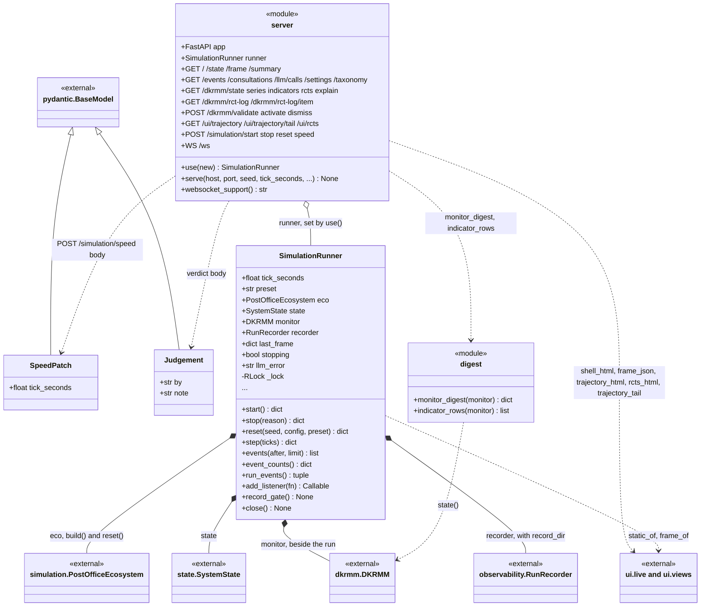

# post_office.api

This package serves one running simulation over HTTP and a WebSocket. `SimulationRunner` owns the `PostOfficeEcosystem` (built by `simulation.build` and rebuilt by `reset`), a `SystemState` view of it, the `DKRMM` monitor attached beside the run and, with a `record_dir`, an observability `RunRecorder`; it ticks the ecosystem on a background thread under one coarse lock and after every tick publishes `last_frame`, a plain dictionary the reads are answered from. The `server` module is the FastAPI app: its routes read `last_frame` or the runner's lock-free accessors, send the controls (start, stop, reset, speed) through the runner, pass a person's DK-RMM verdict (a `Judgement` body) to the monitor, serve the ui pages and relay the event stream on `/ws`. `digest` condenses the monitor's state into the one-line strip at the top of the page and the twelve indicator rows. The package depends on simulation, state, config, crew, dkrmm, observability, `communication.taxonomy` and ui, and is started by `main.py --api`, which calls `serve`. The rule to know: request handlers never take the step lock, so a reader may see the run one tick behind but never a tick half done, and a tick that is inside a model consultation never freezes the page.

## Class diagram

## Classes

| Class | Module | Role |
|---|---|---|
| `SimulationRunner` | `runner.py` | Owns the ecosystem, the tick thread and the lock; starts, stops, resets and steps the run, attaches DK-RMM and the run recorder, publishes `last_frame` and relays events to WebSocket listeners. |
| `server` | `server.py` | `<<module>>`: the FastAPI `app`, the served `runner` (`use`), `serve` and `websocket_support`, and the 27 routes, one handler function each (`get_root`, `get_state`, ..., `set_speed`, `stream`). |
| `SpeedPatch` | `server.py` | Pydantic body of `POST /simulation/speed`: `tick_seconds`, bounded between the 512x floor and 10 s. |
| `Judgement` | `server.py` | Pydantic body of `POST /dkrmm/validate`, `/activate` and `/dismiss`: who answers and why. |
| `digest` | `digest.py` | `<<module>>`: `monitor_digest`, the current assessment in a few fields (with `attached: false` when there is no monitor), and `indicator_rows`, the twelve indicators with their descriptions, values and z-scores. |
