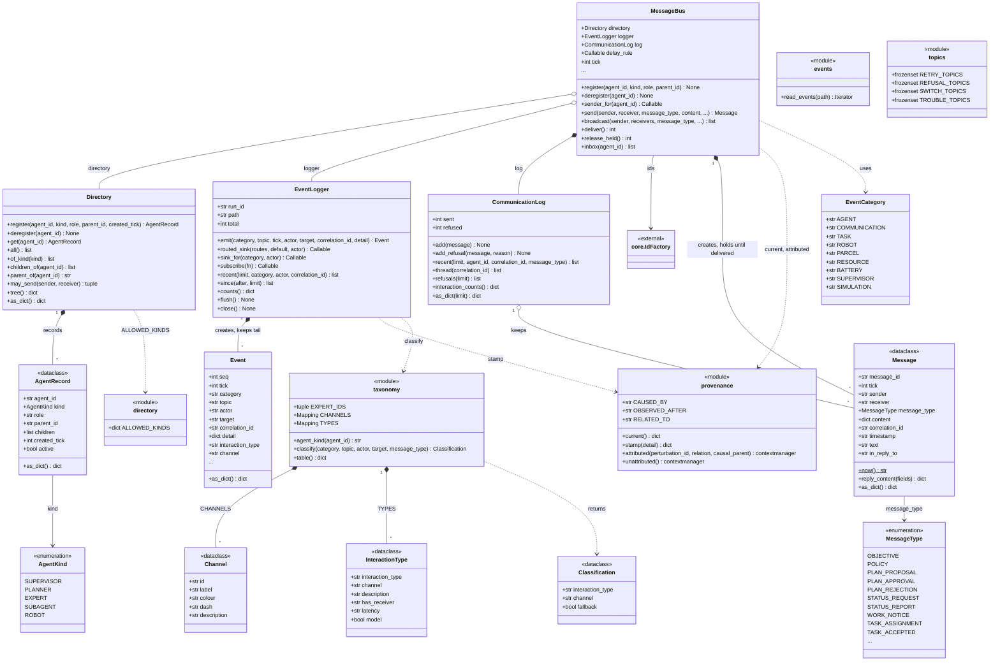

# post_office.communication

This package is the only channel between agents and the record of everything that happens in a run. `MessageBus` routes `Message` envelopes between registered agents: each send is checked against the `Directory` and its `may_send` rules (the `AgentKind` hierarchy in `ALLOWED_KINDS` plus the rule that a sub-agent may only address its parent), recorded in the bus's `CommunicationLog`, and delivered into inboxes at the start of the next tick, or held when a perturbation has set a `delay_rule`. `EventLogger` writes every event as one JSON line, keeps the newest `Event` objects in memory for the API and calls its subscribers; on each `emit` it adds the `provenance` stamp in force and the interaction type and channel that `taxonomy.classify` assigns. `topics` holds the topic groupings (retry, refusal, switch, trouble) shared by DK-RMM and the perturbation tracer, and `provenance` the context-variable attribution that perturbation injectors open. Agents, the simulation ecosystem, crew, observability, dkrmm, api and ui all import it, while it depends only on `core.ids.IdFactory`. The rule to know: no agent imports the bus (each is handed a `send` callable that closes over its own id), and every message, delivered or refused, is written to the log, so there is no private channel.

## Class diagram

## Classes

| Class | Module | Role |
|---|---|---|
| `MessageBus` | `bus.py` | Routes messages between registered agents, refuses what the directory forbids, delivers one tick later and logs every send, refusal, drop and late arrival. |
| `CommunicationLog` | `bus.py` | Bounded store of every accepted message and every refusal, with filtered queries, per-parcel threads and sender-to-receiver interaction counts. |
| `Message` | `message.py` | Immutable envelope of one agent-to-agent interaction; `correlation_id` threads a parcel's whole chain together. |
| `MessageType` | `message.py` | The 32 interaction kinds agents speak (objectives, plans, tasks, sub-tasks, consultations, robot commands, alerts). |
| `Directory` | `directory.py` | Registry of every participant and its place in the tree; `may_send` enforces the routing rules and returns the refusal reason. |
| `AgentRecord` | `directory.py` | The directory's entry for one participant: kind, role, parent, children, creation tick, active flag. |
| `AgentKind` | `directory.py` | A participant's place in the hierarchy: supervisor, planner, expert, sub-agent, robot. |
| `directory` | `directory.py` | `<<module>>`: `ALLOWED_KINDS`, which kinds may address which. |
| `EventLogger` | `events.py` | Writes the JSONL event log for one run, keeps the tail and per-topic counts in memory, stamps provenance and taxonomy, and feeds subscribers (the WebSocket relay, DK-RMM). |
| `Event` | `events.py` | One line of the log, built only by the logger, with the taxonomy's `interaction_type` and `channel`. |
| `EventCategory` | `events.py` | Plain class of category string constants (agent, communication, task, robot, parcel, resource, battery, supervisor, simulation). |
| `events` | `events.py` | `<<module>>`: `read_events`, reads a recorded run back, skipping bad lines. |
| `taxonomy` | `taxonomy.py` | `<<module>>`: the runtime communication taxonomy; `classify` names an event's interaction type and channel, `agent_kind` reads a kind from an id, `table` serves `CHANNELS` and `TYPES` as JSON. |
| `Channel` | `taxonomy.py` | One taxonomy channel (A to E, decision, system) with its label, colour, dash and description. |
| `InteractionType` | `taxonomy.py` | One interaction type, its channel, and the receiver, latency and model hints the page uses. |
| `Classification` | `taxonomy.py` | The result of `classify`: interaction type, channel, and the `fallback` marker read by the completeness test. |
| `provenance` | `provenance.py` | `<<module>>`: `attributed` / `unattributed` context managers and `current` / `stamp`, which put a perturbation's cause into `Event.detail` only where the code knows it. |
| `topics` | `topics.py` | `<<module>>`: `RETRY_TOPICS`, `REFUSAL_TOPICS`, `SWITCH_TOPICS`, `TROUBLE_TOPICS`, the shared meaning of the log's topics. |
