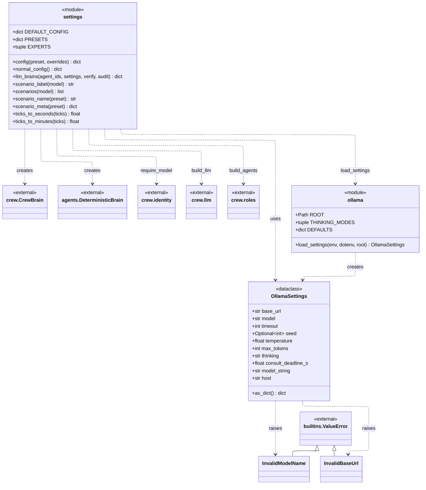

# post_office.config

Every dial of a run and the switch that puts a model behind an expert. `settings` holds `DEFAULT_CONFIG` (arrivals, fleet, storage, plan, brains and log sizes, with battery and charge figures taken from `robots.robot` and `environment.layout`), `normal_config()` for the one NORMAL scenario, `config(preset, **overrides)`, the scenario label and metadata helpers, the tick-to-time conversion and `EXPERTS`, the seven agents a model may sit behind. `ollama` builds the frozen `OllamaSettings` from the environment over an optional `.env` over `DEFAULTS` with `load_settings`, and the dataclass validates itself, raising `InvalidModelName` or `InvalidBaseUrl`. `llm_brains` ties the two together: it loads the settings, checks the model with `crew.identity.require_model`, builds the shared LLM and agents with `crew.llm` and `crew.roles`, and returns one `crew.CrewBrain` per expert with a fresh `DeterministicBrain` fallback, importing CrewAI only when called. `main.py`, `api.runner`, `api.server`, `ui`, `simulation.ecosystem`, `observability.run_record` and the tools read it, and the `crew` modules that reach the model (`brain`, `consultation`, `llm`, `audit`, `identity`) read `OllamaSettings`. The rule to know: the provider is always Ollama, so a model name containing "/" or a base URL without a port or ending in `/v1` is refused rather than silently routed elsewhere.

## Class diagram

## Classes

| Class | Module | Role |
|---|---|---|
| `OllamaSettings` | `ollama.py` | Frozen, self-validating Ollama settings: base URL, model, timeout, seed, temperature, max tokens, thinking mode, consultation deadline. |
| `InvalidModelName` | `ollama.py` | Raised when the model name would select a CrewAI provider other than Ollama. |
| `InvalidBaseUrl` | `ollama.py` | Raised when the base URL is not the bare Ollama server address with its port. |
| `ollama` (module) | `ollama.py` | `ROOT`, `THINKING_MODES`, `DEFAULTS`, `load_settings`: settings from environment over `.env` over defaults. |
| `settings` (module) | `settings.py` | `DEFAULT_CONFIG`, `PRESETS`, `EXPERTS`, `config`, `normal_config`, `llm_brains`, scenario helpers and tick conversion. |
