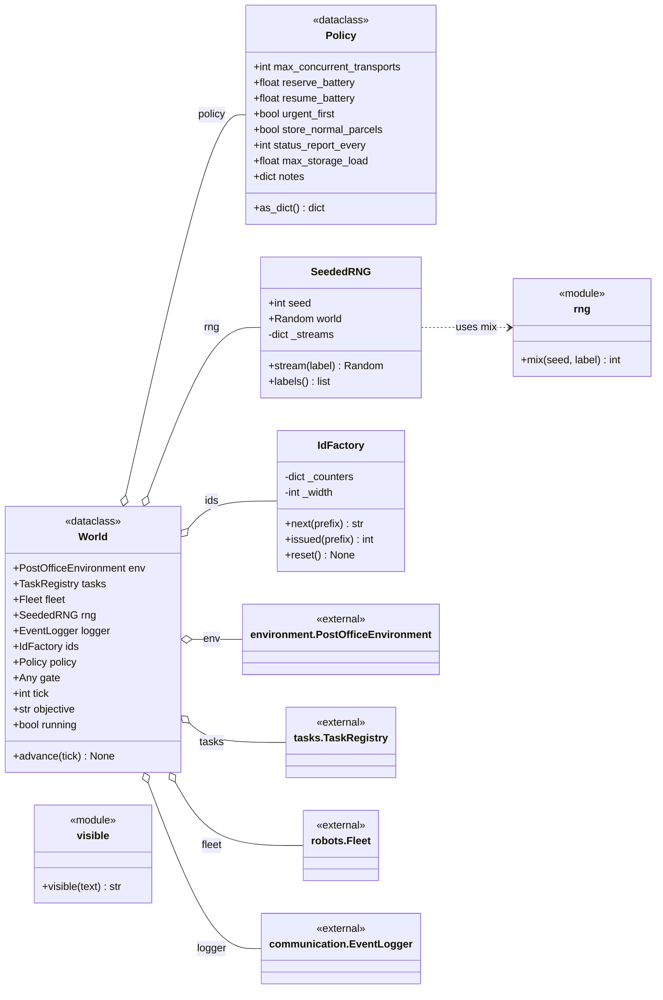

# post_office.core

The small things every layer needs: reproducible randomness, readable identifiers, the supervisor's standing orders and the bundle of shared handles agents are attached with. `SeededRNG` gives each named participant its own `random.Random` stream, derived from the run seed and the participant's label through `mix()`, so adding a robot does not shift anybody else's draws; `IdFactory` hands out per-prefix counters such as `P-0007` and `T-0012` instead of UUIDs. `World` is a plain dataclass that gathers the facility, task registry, fleet, generators, logger, `Policy` and the policy gate, and `World.advance()` is its only behaviour (it moves the shared clock). The simulation ecosystem builds one `World` and hands it to every agent at attach time; `agents`, `communication`, `crew` and `discussion` import from here, and the `visible()` helper strips hidden `<think>` reasoning from model replies for `crew` and `discussion`. The package depends on `environment`, `robots`, `tasks` and `communication` only for the types `World` holds. The rule to know: `World` holds no agents and has no behaviour of its own, so an agent can never reach another agent through it, and `Policy` is written only by the supervisor and read by everybody else.

## Class diagram

## Classes

| Class | Module | Role |
|---|---|---|
| `World` | `world.py` | Dataclass of shared, non-agent runtime handles passed to every agent at attach time; `advance()` sets the tick on itself and the environment. |
| `Policy` | `world.py` | Dataclass of the supervisor's standing orders (transport limit, battery thresholds, storage load cap, report cadence). |
| `SeededRNG` | `rng.py` | Run seed plus one lazily created `random.Random` stream per named participant. |
| `IdFactory` | `ids.py` | Monotonic per-prefix counters producing readable, run-stable ids such as `P-0007`. |
| `rng` (module) | `rng.py` | `mix(seed, label)`: derives an independent sub-seed by hashing the run seed with a label. |
| `visible` (module) | `visible.py` | `visible(text)`: a model reply with every form of `<think>` reasoning removed. |
