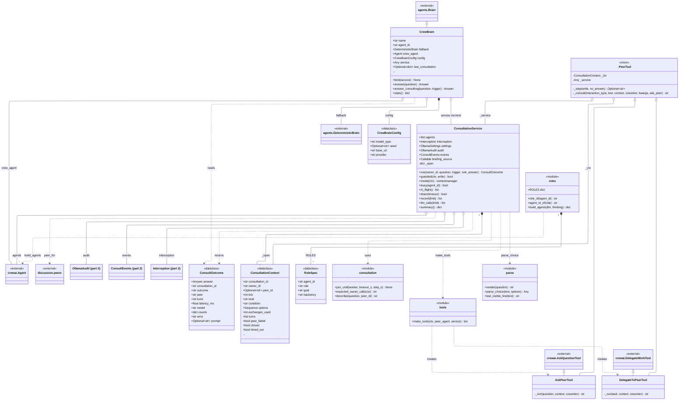
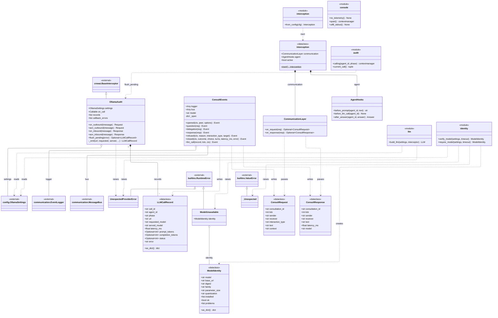

# post_office.crew

The CrewAI side of the prototype: the seven experts as CrewAI agents on one shared Ollama-backed LLM, and the synchronous owner, peer, owner consultation that runs a model decision. `CrewBrain` sits behind the `agents.Brain` interface and always asks its `DeterministicBrain` rule first; once the ecosystem has bound a `ConsultationService`, it hands the decision over as `service.run(owner_id, question, trigger, rule_answer)` and reads back a `ConsultOutcome`. The service picks the peer from `discussion.peers.peer_for`, opens a `ConsultationContext` (`CSL-0001`, ...), runs the owner's CrewAI task in a worker thread under a deadline, gives the owner the `AskPeerTool` and `DelegateToPeerTool` bound to that one peer, and parses the closing `DECISION:` line with `parse_choice`. Every model call goes through `OllamaAudit`, the transport interceptor that refuses any host but the configured Ollama and records an `LLMCallRecord`; `ConsultEvents` writes the `consult_*` and `llm_call` events and the `CONSULT_*` messages through the ecosystem's `EventLogger` and `MessageBus`, and `Interception` holds the identity `CommunicationLayer` and `AgentHooks` seams. The package is built by `config.settings.llm_brains` and wired by `simulation.PostOfficeEcosystem`; `api.runner` and `api.server`, `main.py` and the command-line tools use `identity.require_model` and `console.quiet`, and it depends on `agents.brain`, `config.ollama`, `discussion`, `communication` and `core.visible`. The rule to know: the brain never applies anything and the peer is a consultant, not a second controller; only the owner's parsed answer, checked again against the question's options, goes back to `BaseAgent.decide`, whose policy gate checks it before the agent's own Python acts, and nothing here writes to the world.

## Class diagram

### Brain and consultation

### Model access and audit

## Classes

| Class | Module | Role |
|---|---|---|
| `CrewBrainConfig` | `brain.py` | Frozen record of a brain's model: type, seed, base URL, provider. |
| `CrewBrain` | `brain.py` | `Brain` that starts from the rule's answer and hands the decision to the bound consultation service; counts calls, fallbacks, retries. |
| `ConsultOutcome` | `consultation.py` | What one consultation returns to the brain: answer, id, outcome, peer, turns, latency, counts, error, prompt. |
| `ConsultationService` | `consultation.py` | Runs one owner, peer, owner consultation per model decision in a worker thread under a deadline; keeps history, LLM calls and summary counts. |
| `ConsultationContext` | `tools.py` | Mutable state of one open consultation: ids, peer, turns, exchanges used, peer failure, closed and timed-out flags. |
| `_PeerTool` | `tools.py` | Mixin with the guarded request, peer call and response steps shared by the two peer tools. |
| `AskPeerTool` | `tools.py` | CrewAI `Ask question to coworker` bound to the one allowed peer. |
| `DelegateToPeerTool` | `tools.py` | CrewAI `Delegate work to coworker` bound to the one allowed peer. |
| `RoleSpec` | `roles.py` | Frozen role, goal and backstory of one expert as a CrewAI agent. |
| `UnexpectedProviderError` | `llm.py` | Raised when a model call would go, or went, anywhere but the configured Ollama. |
| `LLMCallRecord` | `audit.py` | One model call as the wire saw it: agent, phase, URL, requested and served model, latency, tokens, status, error. |
| `OllamaAudit` | `audit.py` | CrewAI transport interceptor: refuses foreign hosts, records every request and reply, reports each record to `on_call`. |
| `ModelUnavailable` | `identity.py` | Raised by `require_model` when the configured model is not usable; carries the `ModelIdentity`. |
| `ModelIdentity` | `identity.py` | What the Ollama server reports about the configured model: digest, family, size, quantization, installed list, problems. |
| `_Unexpected` | `identity.py` | Internal error for a JSON reply that is not shaped as Ollama's. |
| `ConsultEvents` | `events.py` | Writes `consult_*` and `llm_call` events through the `EventLogger` and `CONSULT_*` messages through the `MessageBus`. |
| `ConsultRequest` | `interception.py` | One owner-to-peer message: a question or a delegated sub-question. |
| `ConsultResponse` | `interception.py` | The peer's advice on its way back to the owner. |
| `CommunicationLayer` | `interception.py` | Seam on each request and response between owner and peer; identity in this phase, `None` means withheld. |
| `AgentHooks` | `interception.py` | Seam around the owner's model: before the prompt, before the call, after the answer; identity in this phase. |
| `Interception` | `interception.py` | The pair of seams a consultation service uses; `inert()` is the NORMAL arrangement. |
| `consultation` (module) | `consultation.py` | `join_until`, `expected_owner_calls`, `describe`: the deadline join, the retry baseline and the owner's task text. |
| `tools` (module) | `tools.py` | `make_tools`: the ask and delegate tools for one consultation, bound to one peer. |
| `parse` (module) | `parse.py` | `render`, `parse_choice`, `last_visible_line`: how a question is put to an expert and how the reply is read. |
| `roles` (module) | `roles.py` | `ROLES`, `role_of`, `agent_id_of`, `build_agents`: the seven experts as CrewAI agents on one LLM. |
| `llm` (module) | `llm.py` | `build_llm`: the one Ollama LLM, checked for class, provider, model, endpoint and retries. |
| `audit` (module) | `audit.py` | `calling`, `current_call`: attribute model calls to an agent and phase through a context variable. |
| `identity` (module) | `identity.py` | `verify_model`, `require_model`: ask the Ollama server whether the configured model is installed. |
| `interception` (module) | `interception.py` | `from_config`: the inert interception for an empty `interceptors` list, anything else refused. |
| `console` (module) | `console.py` | `no_telemetry`, `quiet`, `utf8_stdout`: silence CrewAI's console panels and telemetry, UTF-8 output. |
