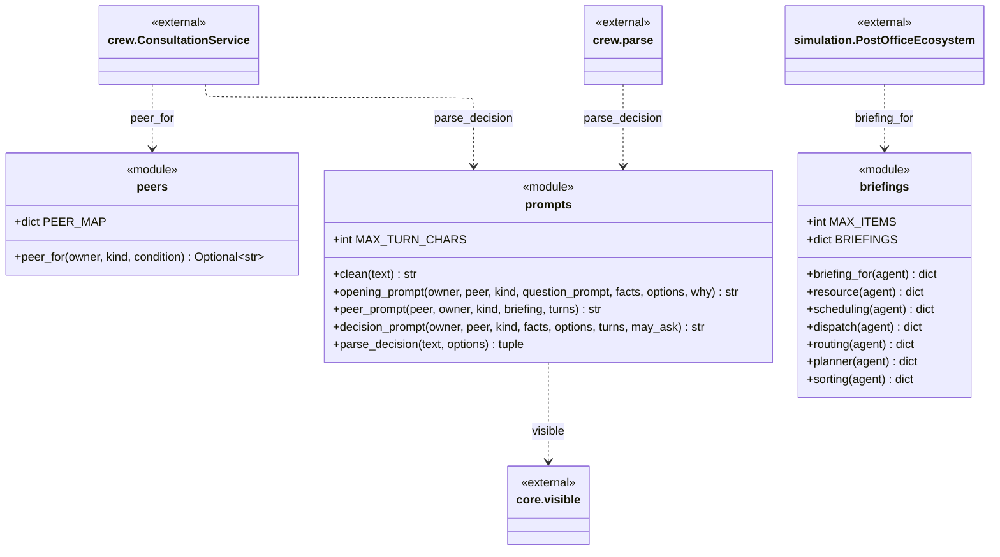

# post_office.discussion

Three small function modules that say who an expert may consult, what a peer reports, and how the decision line in a reply is read. `peers` holds `PEER_MAP`, one table keyed by (owner, decision kind, fired condition), and `peer_for` returns the one expert the owner may consult, or None to decide alone. `briefings` gathers a peer's own view of the floor (robots, charge points, transports, vans, shelves) through one function per expert in `BRIEFINGS`, behind `briefing_for`, which never raises. `prompts` holds the consultation texts and `parse_decision`, which finds the last `DECISION:` line in a reply with hidden reasoning removed and matches it against the allowed options. In this prototype `crew.consultation` uses `peer_for` and `parse_decision`, `crew.parse` uses `parse_decision`, and `simulation.PostOfficeEcosystem` passes `briefing_for` to the consultation service as its briefing source; `opening_prompt`, `peer_prompt`, `decision_prompt` and `clean` have no caller outside the package. It depends only on `core.visible`. The rule to know: `PEER_MAP` is the only source of truth for who may consult whom, and nothing here writes to the world.

## Class diagram

## Classes

The package defines no classes; it is drawn as `<<module>>` boxes.

| Class | Module | Role |
|---|---|---|
| `peers` (module) | `peers.py` | `PEER_MAP` and `peer_for`: the one peer an owner may consult for a decision kind and condition. |
| `prompts` (module) | `prompts.py` | `clean`, `opening_prompt`, `peer_prompt`, `decision_prompt`, `parse_decision`: consultation texts and the DECISION-line reader. |
| `briefings` (module) | `briefings.py` | `BRIEFINGS`, `briefing_for` and one gatherer per expert (`resource`, `scheduling`, `dispatch`, `routing`, `planner`, `sorting`): the peer's facts for a reply. |
