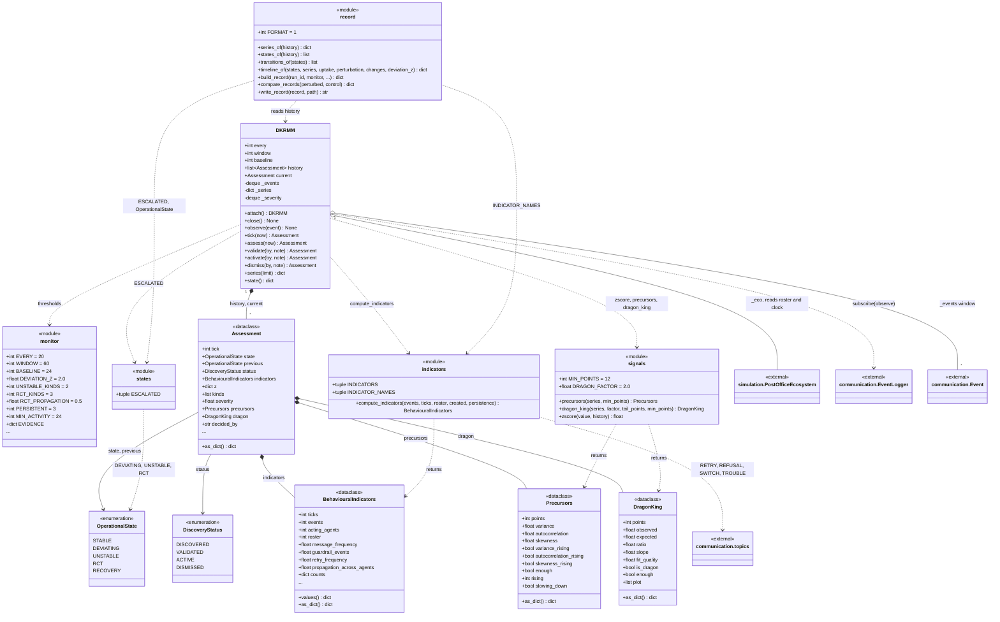

# post_office.dkrmm

This package is DK-RMM, the Dragon-King Runtime Monitoring Model: an independent observer that reads the event stream and names the collective operational state of the ecosystem. `DKRMM.attach` subscribes `observe` to the ecosystem's `EventLogger`, the monitor keeps a moving window of events, and every `EVERY` ticks `assess` computes the twelve `BehaviouralIndicators` (`compute_indicators`), scores each against its own baseline with `zscore`, folds them into a severity series and reads `Precursors` (critical slowing down) and `DragonKing` (the rank-ordering tail test) from that series. The rules in `_classify` turn independent evidence kinds, their persistence and their spread across acting agents into an `Assessment` carrying an `OperationalState` (STABLE, DEVIATING, UNSTABLE, RCT, RECOVERY) and a `DiscoveryStatus` that only a person moves on, through `validate`, `activate` or `dismiss`. The `record` module transposes the monitor's history into per-indicator series, state transitions and a timeline of firsts, and compares a perturbed run with its matched control. It is used by api (`SimulationRunner`, `digest`), observability (`run_record`, `rct_explain`), `ui.views` and `main.py`, and depends only on `communication.topics` and on the ecosystem's logger, roster and clock. The invariant: it observes only; it is not on the bus, never sends a message, never writes to the world, and no agent or simulation module imports it, so removing it changes nothing about a run.

## Class diagram

## Classes

| Class | Module | Role |
|---|---|---|
| `DKRMM` | `monitor.py` | The monitor: subscribes to the event log, assesses a window every `EVERY` ticks, keeps the assessment history and exposes the human gate (`validate`, `activate`, `dismiss`) and the `state` / `series` reads. |
| `monitor` | `monitor.py` | `<<module>>`: the thresholds (`EVERY`, `WINDOW`, `BASELINE`, `DEVIATION_Z`, `UNSTABLE_KINDS`, `RCT_KINDS`, `RCT_PROPAGATION`, `PERSISTENT`, `MIN_ACTIVITY`, `HISTORY`) and `EVIDENCE`, the grouping of indicators into evidence kinds. |
| `Assessment` | `monitor.py` | One reading: state, previous state, discovery status, indicators, z-scores, evidence kinds, severity, precursors, dragon-king test, and who decided it. |
| `OperationalState` | `states.py` | The collective condition the monitor can name: STABLE, DEVIATING, UNSTABLE, RCT, RECOVERY. |
| `DiscoveryStatus` | `states.py` | How far a finding has come through the human gate: DISCOVERED, VALIDATED, ACTIVE, DISMISSED. |
| `states` | `states.py` | `<<module>>`: `ESCALATED`, the three states above STABLE in order of severity. |
| `BehaviouralIndicators` | `indicators.py` | One window's twelve indicator values (rates per tick and shares of the population) plus the raw counts behind them. |
| `indicators` | `indicators.py` | `<<module>>`: `INDICATORS` (name and description of the twelve), `INDICATOR_NAMES`, and `compute_indicators` over one window of events. |
| `Precursors` | `signals.py` | Critical-slowing-down reading of the severity series: variance, lag-1 autocorrelation, skewness and whether each is rising; `slowing_down` is the early warning. |
| `DragonKing` | `signals.py` | Rank-ordering test of the series' largest value against a tail fitted without it: expected, observed, ratio, fit quality, `is_dragon`. |
| `signals` | `signals.py` | `<<module>>`: `precursors`, `dragon_king` and `zscore`. |
| `record` | `record.py` | `<<module>>`: builds the per-run DK-RMM artifact (`series_of`, `states_of`, `transitions_of`, `timeline_of`, `build_record`), compares a perturbed run with its control (`compare_records`) and writes it (`write_record`). |
