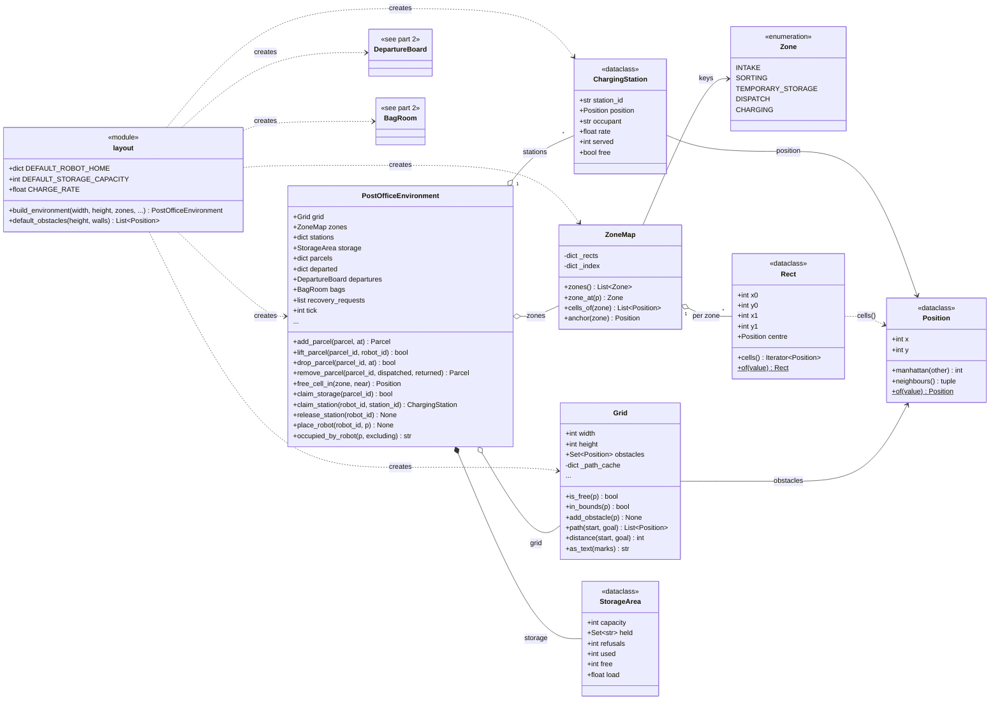
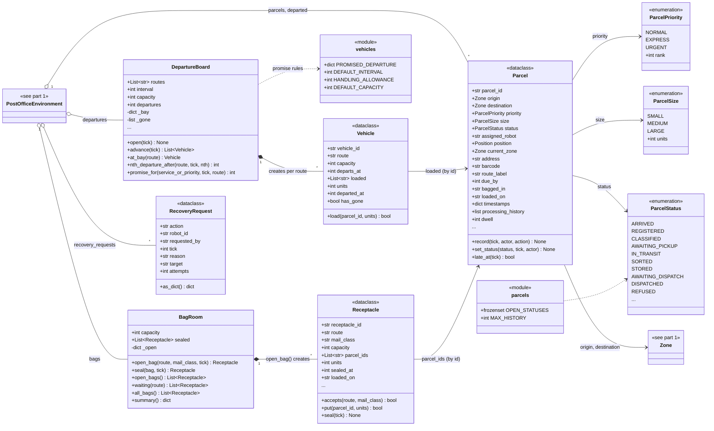

# post_office.environment

The physical facility and nothing else: the floor plan, the five functional zones, the parcels, the charge points and storage shelves, the outbound van timetable, the bag room and the queue of recovery requests. `PostOfficeEnvironment` is the building; it holds a `Grid` (cells, walls and deterministic A* paths over `Position` cells), a `ZoneMap` (which `Zone` each `Rect` of cells is), the `ChargingStation`s and the `StorageArea`, the `Parcel`s still inside and those that have left, a `DepartureBoard` of `Vehicle`s per route and a `BagRoom` of `Receptacle`s. It answers questions (free cells, distances, free charge points) and accepts changes (add, lift, drop and remove a parcel, claim and release a station or a shelf), announcing each change through an optional event sink. `layout.build_environment()` assembles the default 24 by 14 building, attaches the departure board (with the route list from `agents.subagents.sorting_subagents.ROUTES`) and the bag room, and checks that every zone and charge point is reachable from intake. Nearly every package depends on it (`agents`, `robots`, `tasks`, `core`, `policy`, `state`, `config`, `simulation`), and it depends on no other package except that one route list. The rule to know: the environment holds no agents, sends no messages and makes no decisions; capacity is finite and a request that cannot be granted is refused and announced, never queued, and agents act on it only through the simulation.

## Class diagram

### Facility and layout

### Parcels, receptacles, vehicles, recovery

## Classes

| Class | Module | Role |
|---|---|---|
| `PostOfficeEnvironment` | `facility.py` | The building: grid, zones, charge points, storage, parcels inside and departed, timetable, bag room and recovery queue; answers questions and accepts physical changes, emitting an event for each. |
| `ChargingStation` | `facility.py` | Dataclass for one charge point, occupied by at most one robot, with its charge rate and use count. |
| `StorageArea` | `facility.py` | Dataclass for temporary storage with a finite shelf count, the parcels held and the refusals counted. |
| `Grid` | `grid.py` | Rectangle of cells with walls; cached, deterministic 4-connected A* paths and distances. |
| `Position` | `grid.py` | Frozen, ordered dataclass for one cell; Manhattan distance and neighbours in a fixed order. |
| `Zone` | `zones.py` | Enumeration of the five functional areas. |
| `Rect` | `zones.py` | Frozen dataclass for an inclusive rectangle of cells, with its centre. |
| `ZoneMap` | `zones.py` | Which zone each cell belongs to, where each zone is, and each zone's anchor cell. |
| `Parcel` | `parcels.py` | Dataclass for one parcel: its classification, place, promise, bag and van, timestamps and capped processing history. |
| `ParcelPriority` | `parcels.py` | Enumeration NORMAL, EXPRESS, URGENT, with a numeric `rank` for queue ordering. |
| `ParcelSize` | `parcels.py` | Enumeration SMALL, MEDIUM, LARGE, with the load `units` each consumes. |
| `ParcelStatus` | `parcels.py` | Enumeration of a parcel's life stages, ending in DISPATCHED, REFUSED or RETURNED (11 members). |
| `Receptacle` | `receptacles.py` | Dataclass for one bag of parcels sharing a route and mail class; refuses parcels once full or sealed. |
| `BagRoom` | `receptacles.py` | The one open bag per (route, mail class) and the sealed bags waiting for a van. |
| `Vehicle` | `vehicles.py` | Dataclass for one outbound van: route, departure tick, capacity in size units and the parcels loaded. |
| `DepartureBoard` | `vehicles.py` | The staggered per-route timetable, the van at each bay, departures on `advance()`, and the departure a parcel class is promised. |
| `RecoveryRequest` | `recovery.py` | Dataclass for an agent asking the facility to tow a flat robot; queued on the environment, acted on by `simulation.RecoveryService`. |
| `layout` (module) | `layout.py` | `build_environment()` and `default_obstacles()`, plus the default zones, walls, charge points, robot homes, storage capacity and charge rate. |
| `parcels` (module) | `parcels.py` | Constants `OPEN_STATUSES` (statuses that still need work) and `MAX_HISTORY`. |
| `vehicles` (module) | `vehicles.py` | Timetable constants: `PROMISED_DEPARTURE` per service class, `DEFAULT_INTERVAL`, `HANDLING_ALLOWANCE`, `DEFAULT_CAPACITY`. |
