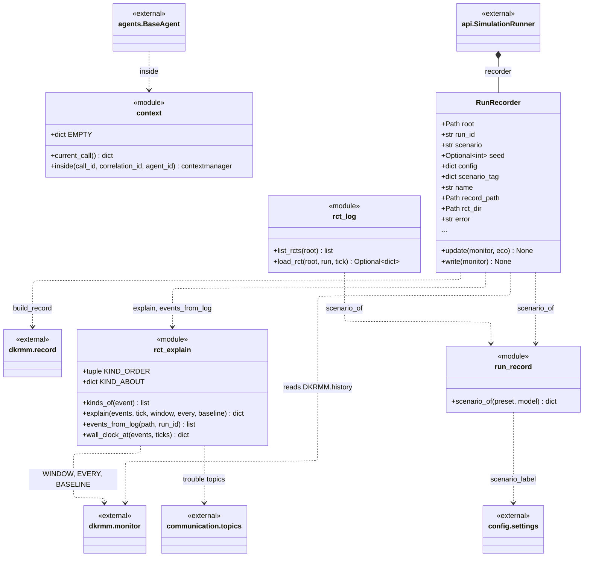

# post_office.observability

Tracing scope and the record of what DK-RMM made of a run, kept beside the simulation and never fed back into it. `context` holds the decision in scope in a `ContextVar`: `BaseAgent` wraps each decision in `inside(decision_id, correlation_id, agent_id)` and `current_call()` reads it back. `rct_explain.explain` reads the event window behind one DK-RMM reading and lays out the trouble events by evidence kind, topic and agent, the expert consultations linked to them (strongly by task or parcel, weakly by robot) and the baseline windows, using `events_from_log` to read the JSON-lines log incrementally. `run_record.RunRecorder`, owned by `api.SimulationRunner`, rewrites the run's DK-RMM record atomically at each new reading through `dkrmm.record.build_record` and saves each RCT with its explanation, and `rct_log` lists and loads those RCT files for `api.server`. It depends on `dkrmm.monitor` for the window constants, `communication.topics` for the trouble topics and `config.settings` for the scenario label. The rule to know: everything here is read-only with respect to DK-RMM and the simulation; its windows, thresholds and states are read, never changed, and a failed write sets `RunRecorder.error` instead of stopping the run.

## Class diagram

## Classes

| Class | Module | Role |
|---|---|---|
| `RunRecorder` | `run_record.py` | Keeps one run's DK-RMM record and its RCT files up to date on disk, once per tick and after a gate decision. |
| `context` (module) | `context.py` | `current_call`, `inside`: the decision or sub-agent invocation in scope for tracing. |
| `rct_explain` (module) | `rct_explain.py` | `kinds_of`, `explain`, `events_from_log`, `wall_clock_at`: what drove a DK-RMM reading, read back from the event log. |
| `rct_log` (module) | `rct_log.py` | `list_rcts`, `load_rct`: every saved RCT, read back from disk. |
| `run_record` (module) | `run_record.py` | `scenario_of`: the scenario name and label a preset runs under. |
