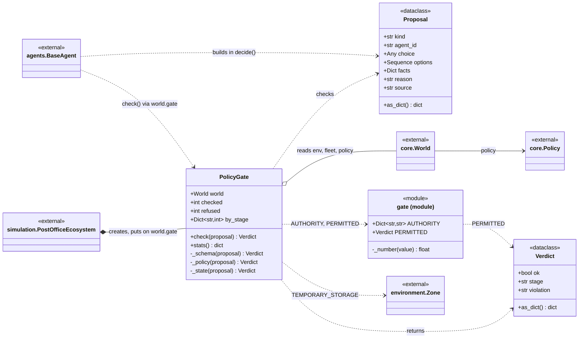

# post_office.policy

The layer between what an agent decided and what the facility does. `BaseAgent.decide()` turns every answer, whether it came from a Python rule or a model, into a frozen `Proposal` and hands it to the one `PolicyGate`, which `simulation.PostOfficeEcosystem` creates and places on `core.World.gate`. `PolicyGate.check()` asks three questions in order and stops at the first refusal: schema (is the choice one of the offered options), policy (does the `AUTHORITY` table give this decision kind to this agent, and does the choice stay under the supervisor's ceilings in `core.Policy`), and state (is the chosen charge point, shelf or robot still available on the floor). The result is a frozen `Verdict` naming the stage and the violation, or the shared `PERMITTED`, and refusals are counted per stage in `by_stage` for the run summary. The package depends only on `core.World` (read through its `env`, `fleet` and `policy`) and `environment.Zone`. The rule to know: the gate reads the world and never writes anything, and it never picks between lawful options; when it refuses, the agent's own deterministic rule answers instead.

## Class diagram

## Classes

| Class | Module | Role |
|---|---|---|
| `PolicyGate` | `gate.py` | Validates proposals in three stages (schema, policy, state) against `world.policy` and the live floor; counts checks and refusals by stage; writes nothing. |
| `Proposal` | `gate.py` | Frozen dataclass: what an agent wants to do (decision kind, agent id, choice, offered options, facts, reason, source) before anyone agreed to it. |
| `Verdict` | `gate.py` | Frozen dataclass: permitted, or refused with the stage (`schema`, `policy`, `state`) and the violation text. |
| `gate (module)` | `gate.py` | `AUTHORITY` maps each decision kind (`release_work`, `accept_parcel`, `choose_robot`, ...) to the one agent id allowed to decide it; `PERMITTED` is the shared ok verdict; `_number()` coerces facts to float. |
