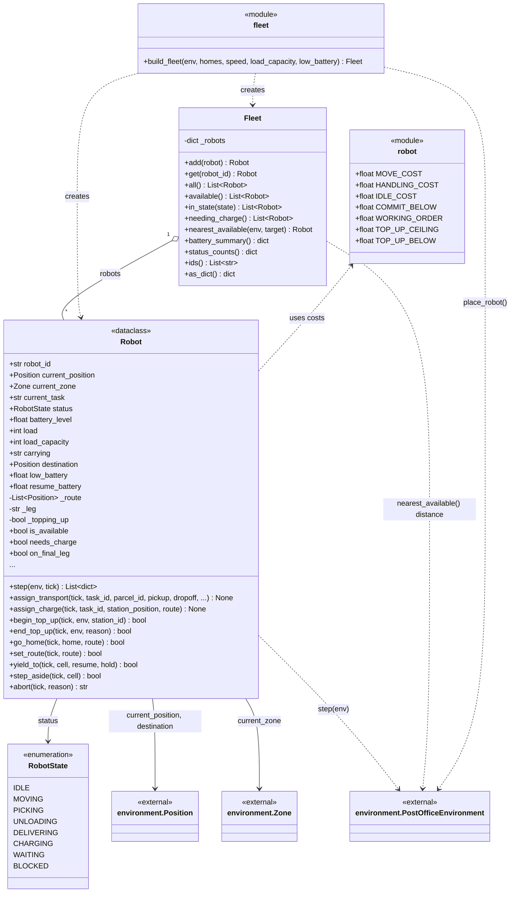

# post_office.robots

The robots as bodies with their own state: where each one stands, what it carries, how much charge it has and which leg of an errand it is walking. A `Robot` is a dataclass that advances itself one tick at a time in `step(env, tick)`, moving up to `speed` cells along the route it was given, stopping and going BLOCKED when the next cell holds another robot, picking and unloading in a whole tick each, and draining battery by the module costs `MOVE_COST`, `HANDLING_COST` and `IDLE_COST`. Its commands (`assign_transport`, `assign_charge`, `go_home`, `set_route`, `yield_to`, `step_aside`, `abort`, `begin_top_up`, `end_top_up`) are issued by the agent layer, and its only output is the list of report dictionaries `step()` returns, which `agents.RobotAgent` turns into messages and events. `Fleet` holds the robots and answers deterministic queries such as `available()`, `needing_charge()` and `nearest_available()`, with ties broken on robot id; `build_fleet()` creates the robots at their home cells and places them on the `environment.PostOfficeEnvironment`. The package depends only on `environment`; it is used by `agents`, `core.World`, `config` and `simulation` (which also tows flat robots through `RecoveryService`). The rule to know: a robot never decides where to go and never writes a task or a parcel's status; routes, work and charge permission come from the agents, and the robot only reports what happened.

## Class diagram

## Classes

| Class | Module | Role |
|---|---|---|
| `Robot` | `robot.py` | Dataclass for one robot's body and errand state; `step()` advances it one tick and returns plain report dictionaries. |
| `RobotState` | `robot.py` | Enumeration of what a robot is doing this tick (idle, moving, picking, unloading, delivering, charging, waiting, blocked). |
| `Fleet` | `fleet.py` | All robots by id, with deterministically ordered queries for availability, charge need, nearest free robot and status summaries. |
| `fleet` (module) | `fleet.py` | `build_fleet()`: creates the robots at their home cells (default `DEFAULT_ROBOT_HOME`) and places them on the floor. |
| `robot` (module) | `robot.py` | Battery costs per cell, per handling and per idle tick, and the charge thresholds (commit, working order, top-up band). |
