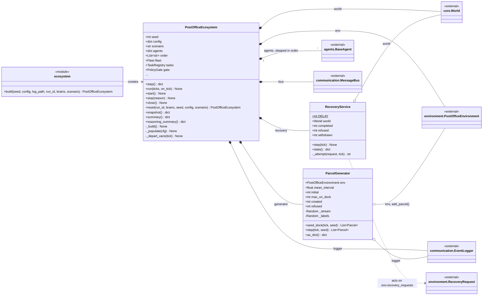

# post_office.simulation

The assembled ecosystem and the clock that drives it. `PostOfficeEcosystem` builds everything in a fixed order: the `EventLogger`, `SeededRNG` and `IdFactory`, the facility from `environment.build_environment()`, the fleet from `robots.build_fleet()`, the `TaskRegistry`, the shared `core.World` with its `Policy` and `PolicyGate`, the `RecoveryService`, the `MessageBus`, the `ParcelGenerator`, and then every agent (supervisor, planner, experts, sub-agents, robot agents), attached in the order that is also the tick order. Each `step()` advances the clock, delivers the previous tick's messages, lets the generator put new parcels on the intake dock, steps every agent in declared order, lets `RecoveryService` act on the recovery requests agents left on the environment, departs any van whose time has come, and returns a snapshot. `ParcelGenerator` draws arrivals and label damage from their own named random streams so that changing an agent never changes when parcels arrive. The package is used by `api.runner` and `state.system_state`, and depends on nearly every other package. The rule to know: same seed and same config give the same event stream, so agent order is declared here explicitly and physical interventions (towing a flat robot, departing a van) are done by the engine, never by an agent.

## Class diagram

## Classes

| Class | Module | Role |
|---|---|---|
| `PostOfficeEcosystem` | `ecosystem.py` | Builds the facility, fleet, registry, world, bus, generator, recovery service and every agent, and runs the fixed-order tick loop that produces one snapshot per tick. |
| `ParcelGenerator` | `generator.py` | Puts new parcels on the intake dock on its own random stream (geometric arrivals, occasional damaged or off-network labels) and refuses arrivals when the dock is full. |
| `RecoveryService` | `recovery.py` | Engine-side handler for agents' recovery requests: after a delay, tows a flat robot to a free charge point, or defers or withdraws the request. |
| `ecosystem` (module) | `ecosystem.py` | `build()`: convenience constructor for `PostOfficeEcosystem`. |
