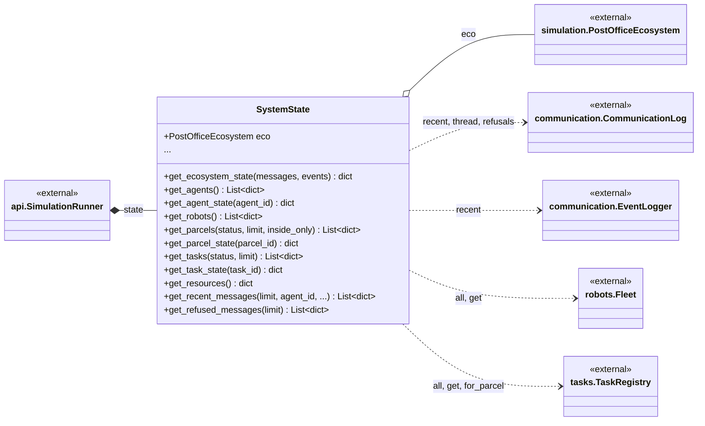

# post_office.state

The read side of the running system: one JSON-serialisable view of the whole ecosystem, so that the HTTP API and the UI share a single answer to "what is the state of the system". It consists of one class, `SystemState`, which `api.SimulationRunner` creates around the `simulation.PostOfficeEcosystem` it runs (and recreates when the run is rebuilt). Its methods return only dicts and lists: `get_ecosystem_state()` assembles run info, policy, hierarchy, agents, robots, parcels, tasks, resources, environment, communications, events and counters, and the narrower getters serve agents, robots, parcels, tasks, resources, recent messages, recent events and the bus's refused messages. It reaches the data through the ecosystem's members, chiefly `communication.CommunicationLog` (via `bus.log`), `communication.EventLogger`, `robots.Fleet`, `tasks.TaskRegistry` and the environment. The rule to know: it reads and never writes, which is what makes it safe to expose over HTTP.

## Class diagram

## Classes

| Class | Module | Role |
|---|---|---|
| `SystemState` | `system_state.py` | Read-only facade over a `PostOfficeEcosystem`: whole-system snapshot plus per-agent, per-robot, per-parcel and per-task views, resources, recent messages and events, and refused messages (`get_robot_state`, `get_recent_events` are cut from the box). |
