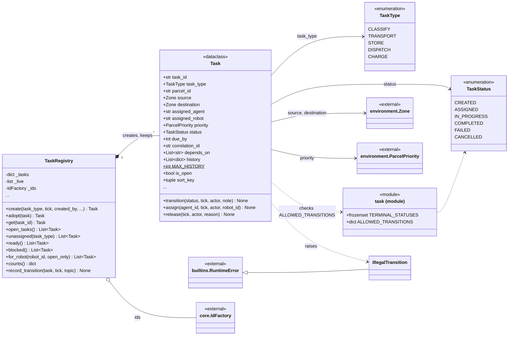

# post_office.tasks

Work as data: every unit of work in the facility is a `Task` with a type, an owner, a status and a written history, so a dependency between agents can be read off the data instead of inferred from a call stack. `Task` moves through the six states of `TaskStatus` only along the edges listed in `ALLOWED_TRANSITIONS`; `transition()` raises `IllegalTransition` on any other move, and the helpers `assign()`, `start()`, `complete()`, `fail()`, `cancel()` and `release()` are named wrappers around it. `TaskRegistry` creates tasks with ids from the shared `IdFactory`, keeps every task ever made, and answers the queue queries (`unassigned()`, `ready()`, `blocked()`, `for_robot()`) in the single ordering defined by `Task.sort_key`: deadline first, then priority, then age. The planner, the expert agents and their sub-agents create and query tasks through the registry held on `core.World`, and the ecosystem builds the registry with an event sink so each creation or recorded transition becomes a TASK event. The package depends only on `environment` (for `Zone` and `ParcelPriority`) and `core` (for `IdFactory`). The rule to know: the registry is a record, not an authority; it never decides who gets a task, and tasks are never deleted.

## Class diagram

## Classes

| Class | Module | Role |
|---|---|---|
| `TaskRegistry` | `registry.py` | Every task by id, a live index of open ones, and the deterministic queue queries the agents use; emits task events through an optional sink. |
| `Task` | `task.py` | Dataclass for one unit of work: owner, state, dependencies, route, capped history, and the shared `sort_key` ordering. |
| `TaskType` | `task.py` | Enumeration of work kinds: classify, transport, store, dispatch, charge. |
| `TaskStatus` | `task.py` | Enumeration of the six task states. |
| `IllegalTransition` | `task.py` | `RuntimeError` raised when a task is moved along an edge not in `ALLOWED_TRANSITIONS`. |
| `task` (module) | `task.py` | Constants `TERMINAL_STATUSES` (completed, failed, cancelled) and `ALLOWED_TRANSITIONS` (the legal state graph). |
