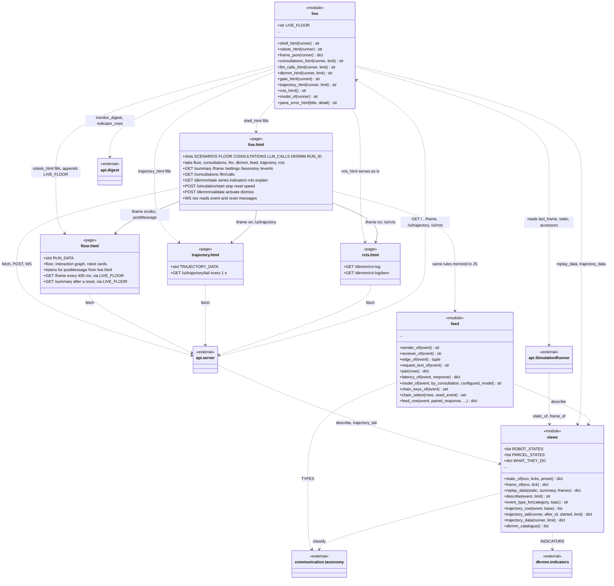

# post_office.ui

This package is the browser front end: three Python modules with no classes, and four HTML pages they serve. `live` builds the pages from what `SimulationRunner` published: `shell_html` fills `live.html` (the shell at `GET /`, with its run line, controls, expert roster and seven panes), `robots_html` fills `floor.html` with the building and the first frame and appends the `LIVE_FLOOR` script that keeps it polling `/frame`, `trajectory_html` fills `trajectory.html` from `views.trajectory_data`, and `rcts_html` returns `rcts.html` unchanged. `views` holds the data shapes: `static_of` and `frame_of`, which the runner calls once per ecosystem and after every tick under its lock, plus `describe` and the trajectory fold shared by the first page load and its live tail. `feed` holds the rules of the Runtime communication pane as pure functions over event dicts, mirrored line for line by the JavaScript in `live.html` so they can be tested without a browser. The pages talk back to `api.server` only through fetch, POST and the `/ws` socket, and `live.html` carries the other three pages as iframes (the floor by `srcdoc`, the trajectory and the RCT log by `src`). The package is imported only by api (runner and server) and reads `communication.taxonomy`, `dkrmm.indicators` and `api.digest`. The rule to know: the page builders in `live` never read the live ecosystem, only `runner.last_frame`, `runner.static` and the runner's lock-free accessors, so a page is served at once even while a tick is blocked in a consultation.

## Class diagram

## Classes

The package defines no classes. Its Python modules are drawn as `<<module>>` boxes and its HTML files as `<<page>>` boxes; a page box lists the data slot the server fills and the routes the page calls, and is a page, not a class.

| Class | Module | Role |
|---|---|---|
| `live` | `live.py` | `<<module>>`: builds and serves the pages (`shell_html`, `robots_html`, `trajectory_html`, `rcts_html`), the `/frame` payload (`frame_json`), the server-side fragments of the Consultations, Ollama calls and DK-RMM panes (`consultations_html`, `llm_calls_html`, `dkrmm_html`, `gate_html`, `consultation_row`, `llm_call_row`), `model_of`, `scenario_options`, and the failure fragments (`failed_pane_html`, `pane_error_html`). |
| `views` | `views.py` | `<<module>>`: the data behind each view: `static_of`, `frame_of`, `replay_data`, `describe`, the trajectory fold (`event_type_for`, `trajectory_row`, `trajectory_tail`, `trajectory_data`) and `dkrmm_catalogue`, plus the interned state lists and `WHAT_THEY_DO`. |
| `feed` | `feed.py` | `<<module>>`: the Runtime communication feed's rules: sender, receiver and edge of a row, request, response, reply and decision texts, request/reply pairing (`pair_key_of`, `reply_to_of`, `pair`), latency, model attribution (`models_by_consultation`, `model_of`), chains (`chain_keys_of`, `chain_select`, `chain_select_by_id`) and `feed_row`. |
| `live.html` | `live.html` | `<<page>>`: the shell at `GET /`; polls the read routes, posts the controls and DK-RMM verdicts, listens on `/ws`, and holds the floor, trajectory and RCT log pages in iframes. |
| `floor.html` | `floor.html` | `<<page>>`: the floor, interaction graph and robot cards, carried in the shell as `srcdoc`; follows the run through the `LIVE_FLOOR` script that `live.robots_html` appends. |
| `trajectory.html` | `trajectory.html` | `<<page>>`: the Trajectory tab at `GET /ui/trajectory`; tails new rows from `/ui/trajectory/tail`. |
| `rcts.html` | `rcts.html` | `<<page>>`: the RCT log tab at `GET /ui/rcts`; reads `/dkrmm/rct-log` and `/dkrmm/rct-log/item` itself. |
