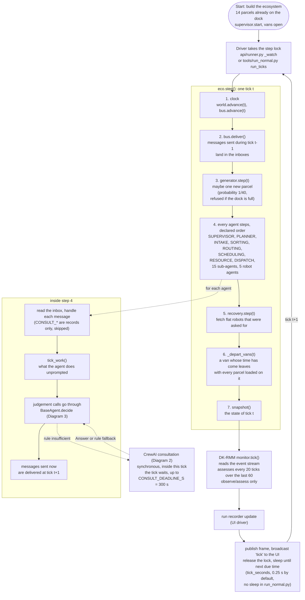
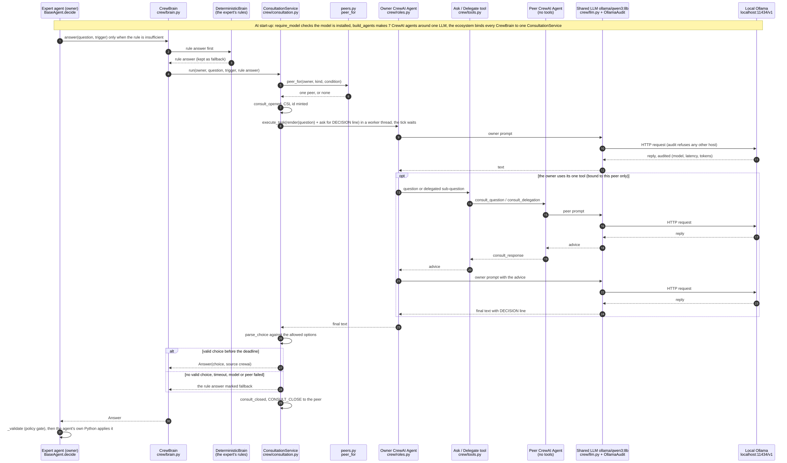
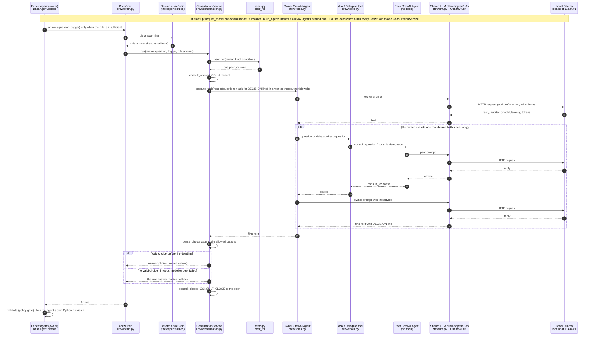
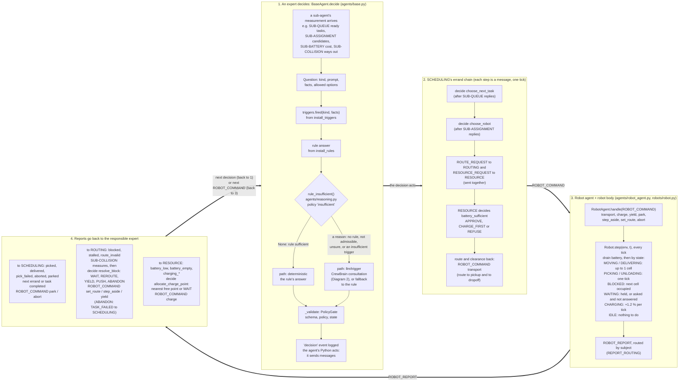

# How the simulation runs: ticks, CrewAI, decisions and robots

Three diagrams, read from the code at the commit this file was added in.
Rendered copies are in `docs/img/sim-*.svg`.

## How ticks are used

A tick is the simulation's only unit of time. The simulated world never reads the
wall clock: every duration (a robot's walk, a van's departure, a deadline, a
DK-RMM window) is counted in ticks.

- **Who advances it.** `PostOfficeEcosystem.step()` (`simulation/ecosystem.py`)
  runs exactly one tick. Two drivers call it:
  - the live UI's `SimulationRunner._watch` (`api/runner.py`) sleeps between
    ticks so the run can be watched. The default `tick_seconds` is 0.25 s and
    can be changed from the UI;
  - `tools/run_normal.py` calls `run_ticks`, which steps back to back with no
    pause (300 ticks by default).
- **Message latency.** The `MessageBus` delivers everything sent during tick
  `t` at the start of tick `t+1`. Every message therefore costs exactly one tick,
  whoever sends it. This is why a request and its answer take at least two ticks.
- **Consultations are inside a tick.** A CrewAI consultation is synchronous: the
  tick waits for it (up to `CONSULT_DEADLINE_S`, 300 s by default). The tick
  number does not move while the model thinks. Only wall-clock time passes.
- **Robots.** One tick moves a robot up to `robot_speed` cells (1 by default).
  It costs 0.12 % battery per cell and 0.01 % per tick standing still. A
  charge point adds 1.2 % per tick.

Periodic work counted in ticks:

| Every | What | Where |
|---|---|---|
| 1 tick | messages delivered, every agent steps, every robot moves | `ecosystem.step`, `bus.deliver` |
| 1 tick | a new parcel arrives with probability 1/40 (`arrival_interval` 40) | `simulation/generator.py` |
| 5 ticks | a waiting robot re-reports `stalled` | `robots/robot.py` |
| 10 ticks | SCHEDULING sends idle robots home (`PARK_EVERY`) | `agents/scheduling_agent.py` |
| 15 ticks | SCHEDULING asks SUB-DEADLINE for overdue work (`DEADLINE_EVERY`) | `agents/scheduling_agent.py` |
| 20 ticks | PLANNER reports status to SUPERVISOR (`status_report_every`) | `agents/planner_agent.py` |
| 20 ticks | DK-RMM assesses, looking back 60 ticks (`EVERY`, `WINDOW`) | `dkrmm/monitor.py` |
| 20 ticks | a flat robot re-reports `battery_empty` | `robots/robot.py` |
| 30 ticks | an unanswered dispatch question is dropped (`DISPATCH_TIMEOUT`) | `agents/scheduling_agent.py` |
| 12 ticks | a recovery crew needs this long to reach a flat robot (`DELAY`) | `simulation/recovery.py` |
| 250 ticks | each route's van leaves (`DEFAULT_INTERVAL`) | `environment/vehicles.py` |

## Diagram 1. The simulation, step by step

## Diagram 2. The role of CrewAI in the post office

CrewAI is used only at the Brain seam of the seven experts (PLANNER, INTAKE,
SORTING, ROUTING, SCHEDULING, RESOURCE, DISPATCH). It does not drive the tick, it
does not move robots and it never writes to the world. It replaces the
implementation of model-backed owner→peer→owner consultation. The peer map
(`discussion/peers.py`) still decides who may be consulted. The policy gate still
checks the answer.

## Diagram 3. How agents decide and how robots act

The left half is what every expert does when it reaches a judgement call. The
right half is a robot's life from one command to the next report. The two halves
meet only through messages on the bus. Agents never touch a robot's body and
robots never write to a task or a parcel.

### Reading Diagram 3

1. A decision always starts from a sub-agent's measurement, which arrives as a
   message one tick after it was asked for.
2. The expert builds a `Question` and runs its triggers and its rule.
3. `rule_insufficient` decides the path:
   - when it returns nothing, the rule's answer is used (`deterministic`);
   - otherwise the CrewBrain consults (`llm/<trigger>`), and the rule's answer
     remains the fallback.
4. The policy gate validates the answer. Only then does the agent's own Python
   send the commands that follow from it.
5. A robot acts only on a `ROBOT_COMMAND`. It moves one cell per tick, and
   reports back what happened. Each report goes to the expert responsible for
   that subject, and that expert's next decision closes the loop.
